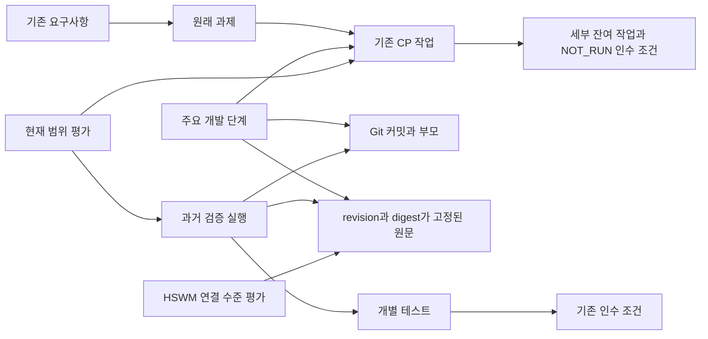

# USL 개발 변천사와 남은 작업

기존 그래프는 CP03 작업 상태 복원·재연결 제안의 인수 근거까지 갖고 있다. 이번 뷰는 흩어진 계획·실행 기록을 Git 이력과 연결한다. **철학적 HSWM 최적화 정도와 특정 HSWM 소프트웨어의 실행 준비는 별도 평가다.** live HSWM 실행·학습 미입증을 철학적 HSWM 점수 0으로 해석하지 않는다.

기준 Git `0ba9e4191e8ca9a53d5ba9265ccab0834e7a1324`, 기록일 2026-10-07. 이 기준에서 도달 가능한 **80개 커밋과 부모 관계 전체**, AI가 선정한 **27개 주요 단계**, 기존 **23개 CP 작업**, **9개 세부 잔여 작업**, **6개 HSWM 연결 평가**를 담았다.

모든 대화·실행 이벤트의 전수 이력은 아니다. Git 메시지는 저장소 기록이고 단계 분류는 SECONDARY_AI다. 사용자 원문은 별도 UserStatement이며, 연결이나 분류가 canon·권한·실행 성공을 만들지 않는다. 이 그래프 자체를 추가한 이후의 커밋은 다음 명시적 갱신 전까지 포함되지 않는다.

## 철학적 HSWM과 소프트웨어 구현

철학적 HSWM을 주어진 범위·목적·제약에서 CHU 구성의 최적화 정도로 해석한다. 특정 HSWM 소프트웨어는 그 관점에서 평가할 후보이며 정의나 자동 만점 기준이 아니다.

사용자는 주어진 범위에서 CHU가 최대로 최적화된 정도를 HSWM 수치로 볼 수 있다고 설명했다. 이어 현재 HSWM 소프트웨어는 미약하며 표준 그래프 엔지니어링의 HSWM 정도가 더 높을 수도 있다고 평가했다. 두 발화는 [결정 기록](DECISIONS.md)과 catalog의 `philosophy.userStatements`에 원문으로 보존했다. **사용자가 제시한 철학적 방향·평가와, 실제 비교 측정 결과는 구분한다.**

현재 HSWM 소프트웨어를 만점의 정의나 유일한 구현으로 두지 않는다. 표준 그래프 기술을 조합한 구성도 같은 목적·제약에서 더 좋은 결과를 낼 수 있다. 이는 비교 가능한 가설이며 이번 작업이 특정 구현의 우위를 입증한 것은 아니다. 규격 문서나 기술 계열 자체를 실행 가능한 후보와 동일시하지 않고 각각 구체적 구성·revision을 선택해야 한다.

평가 초안의 목적: USL 개발 근거와 작업환경 자원을 정확히 연결·탐색·이동하고 결과를 이용해 더 나은 구성을 선택한다. 범위: USL의 선택된 자원·바인딩·개발 근거 그래프; CHU 전체나 일반 지능의 절대 척도가 아니다.

| 제안한 평가 축 | 측정할 내용 | 근거를 제공할 기존 작업 |
|---|---|---|
| 목적 적합성 | 동일한 실제 작업에서 요구사항을 만족한 비율과 실패 유형을 분리한다. | package:CP07, package:CP23 |
| 의미·출처 보존 | ID·역할·맥락·원문 pin·변환 손실을 검사한다. 필수 의미 보존 위반은 집계 전 자격 조건으로 다룬다. | package:CP09, package:CP10, package:CP20 |
| 탐색·판단 품질 | 정답과 근거가 지정된 질의에서 실제 target 도달·근거 지지·잘못된 연결을 측정한다. 노드·링크 수 자체를 점수로 쓰지 않는다. | package:CP08, package:CP15 |
| 이동·변화에 대한 강건성 | 선택 profile에서 이동·worktree 분기·원본 부재·손상 이후 의미와 작업 상태가 보존되는지를 측정한다. | package:CP03, package:CP04, package:CP05, package:CP06, package:CP07 |
| 결과에 근거한 개선 | 작업 결과로 구성을 바꿨을 때 baseline·holdout·replay 대비 개선되는지를 평가한다. 수동 또는 자동이라는 이름만으로 우열을 정하지 않는다. | package:CP21, package:CP22 |
| 제약 안에서의 자원 효율 | 동일 정확도·지원 범위·예산 아래 시간·메모리·bytes·실제 비용을 각각 측정한다. token 추정과 실제 청구는 분리한다. | package:CP07, package:CP17 |

위 여섯 축과 측정 방법은 SECONDARY_AI 설계 제안이다. 철학 전체의 완성된 수학적 정의나 사용자가 지정한 가중치가 아니다. 먼저 축별 결과를 보존하고, 숫자 하나로 집계하려면 정규화·가중치·집계 규칙과 선택 주체를 명시한다. 이 평가 가중치를 HSWM의 canonical W와 자동으로 동일시하지 않는다.

수치 비교 전에 고정할 항목:

- 목적·scope·제약·평가 profile version
- 비교할 실행 가능한 구성과 각각의 revision·artifact digest
- 같은 workload·입력 digest·환경·예산
- 측정법·오류 처리·측정 시각·raw 결과와 evidence pin
- 정규화·집계 방식·가중치 및 선택 주체
- 반복 측정의 변동성과 평가 한계

필수 의미·출처·owner 범위 제약 위반은 다른 축의 높은 값으로 상쇄하지 않는다. 같은 조건의 유한 시험으로 해당 작업 범위에서의 우위는 평가할 수 있지만, 관측된 최고값을 CHU 전체의 전역 최적점이라고 부르지 않는다.

현재 두 후보의 점수는 **null / NOT_MEASURED**, 우위는 **UNDETERMINED**, 최적성은 **NOT_PROVEN**이다. workload·구성 revision·측정법·정규화·가중치가 아직 정해지지 않았기 때문이다. HSWM 프로그램에 연결되지 않았거나 `NOT_READY`라는 이유만으로 0점을 부여하지 않는다. 노드 수·표준 이름·HSWM이라는 명칭에도 자동 가산점을 주지 않는다.

[철학적 평가 뷰](../research/development-lineage/philosophy.graph.json)에서 두 후보와 비교 가설을 기존 USL로 조회한다:

```sh
npm run usl -- adapt --format resource-graph --graph research/development-lineage/philosophy.graph.json --profile research/development-lineage/profile.json --namespace usl.development.lineage --operation context --focus evaluation:hswm-philosophy:usl-v1 --target comparison:hswm-philosophy:standards-vs-software --compact
```

새 평가 엔진이나 학습기를 만든 것은 아니다. USL은 기준·대상·맥락·원문·측정 근거의 연결을 보존하고, 실제 측정과 최적화는 선택한 소비자 프로그램이 수행하는 기존 경계를 유지한다. 기존 CP 개발 순서도 이 관점으로 평가하되 새 점수 체계가 완성될 때까지 개발을 중단하지 않는다.

## 연결 구조



그림은 읽기 순서다. 실제 관계 방향·역할·타입·필수 cardinality는 [profile](../research/development-lineage/profile.json)에 명시했다. 각 관계는 두 역할을 정확히 하나씩 갖는다. `parent`는 자식→부모, 의존 관계는 후속→선행이다. Git 부모 관계와 개별 의존 관계에만 비순환 검사를 적용하며, 그래프 전체에 DAG를 강제하지 않는다.

## 지금 남은 구체 작업

기존 [CP01–CP23 계획](COMPLETION_PLAN.md)을 대체하거나 범위를 줄이지 않는다. 아래는 현재 우선순위를 실행 단위로 구체화한 부분집합이다. CP08–20 등의 메모리 anchor·표준 교환·다기기 revision·CLI 호환성도 원래 ID와 의존성·인수 조건 그대로 연결되어 있다.

| 세부 작업 | 원래 작업 | 선행 | 완료 조건 / 반드시 거부할 경우 |
|---|---|---|---|
| `coordinated-export` · 미커밋 작업 상태와 base Git bundle 통합 내보내기 | package:CP03 | 없음 | 별도 clean checkout 준비 없이 동일 owner/repo/HEAD/ref의 bundle+sidecar를 한 결과로 생성하고 기존 CP03 importer로 원본 제거 후 복원한다. / 수집 중 HEAD/index/파일이 바뀌거나 budget을 넘으면 성공 artifact를 게시하지 않는다. 원자 snapshot이라고 주장하지 않는다. |
| `state-cli` · 통합 export·state import·검증을 CLI와 package surface로 제공 | package:CP03 | coordinated-export | build된 package에서 문서의 export→복원→검증 명령을 실행하고 staged/working/untracked를 구분한다. / 잘못된 옵션·pin·owner·기존 목적지·권한 없는 입력을 거부하고 기존 파일을 보존한다. |
| `binding-registration` · 복원 제안의 명시적 로컬 바인딩 등록 흐름 | package:CP02 | state-cli | owner가 선택한 로컬 registry만 갱신하고 stable ID·역할·선택하지 않은 표현을 보존하며 적용 전후 조회로 확인한다. / 오래된 restore 검증·충돌 workspace·잘못된 revision은 적용을 거부한다. 자동 원격 등록·접근 권한 승격은 없다. |
| `git-profiles` · 고급 Git 상태와 제외 데이터의 profile별 지원표 | package:CP04 | 없음 | symlink/submodule/LFS/alternates/partial/sparse 및 진행 중 작업·stash/reflog/ignored/empty-directory를 지원·별도 의존·의도적 제외로 나누고 각 지원 profile에 실제 왕복 근거를 붙인다. / 미포함 데이터가 있는데 full workspace/self-contained로 성공 표시하지 않는다. |
| `snapshot-crash` · 일관성·중단·재시작 복구 계약 | package:CP05 | coordinated-export | source 일관성 방법을 명시하고 게시 전후 강제 종료에서 부분 결과 식별·자기 소유 staging 정리·재시작 동작을 검사한다. / 프로세스 실패 처리만으로 원자 snapshot이나 crash durability를 PASS로 처리하지 않는다. |
| `platform-matrix` · Linux·macOS·Windows 실제 실행 증거 | package:CP06 | 없음 | 대소문자·Unicode·실행 비트·경로·Git object format 차이를 지원 OS별 실제 runner에서 측정한다. / 미실행 OS는 NOT_RUN으로 남기며 Linux 성공을 복제하지 않는다. |
| `device-roundtrip` · 실기기 왕복 이동·원본 부재·규모 예산 | package:CP07 | binding-registration, git-profiles, snapshot-crash, platform-matrix | 서로 다른 두 장치에서 선택 profile의 export→복원→바인딩 조회와 원본 부재 시나리오를 실행하고 시간·메모리·크기를 기록한다. / 같은 호스트 임시 디렉터리 이동을 실기기 인수로 간주하지 않는다. |
| `operational-outcomes` · 실제 운영 outcome 기반 W 후보 검토 | package:CP21 | 없음 | owner가 제공한 versioned 실제 outcome에서 baseline/holdout/replay를 비교하고 근거와 맥락·제안을 연결한다. / 합성 fixture 결과를 metahumotonic_dashboard나 live HSWM 개선으로 승격하지 않는다. |
| `owner-application` · HSWM 현재 접근·검토·적용·rollback 근거 | package:CP22 | operational-outcomes | 기존 owner workflow에서 선택 자원 등록·수신자·범위·만료·철회·허가된 도달성·검토 결정·적용 및 rollback을 별도 기록한다. / 이 그래프나 바인딩만으로 접근·실행·학습 권한을 생성하지 않는다. 복원 outcome을 쓰면 CP14 대조가 선행한다. |

우선 **coordinated-export → state-cli → binding-registration** 순서다. advanced Git profile·일관성/장애 복구·OS별 검증은 각 CP 의존 조건을 지키면서 병렬로 준비한다. 실제 HSWM 접근·실행·적용은 owner workflow의 별도 범위다.

모든 새 작업은 PLANNED / NOT_RUN이다. CP01–03은 기존 receipt의 로컬 지원 범위를 현재 평가로 연결했다. 나머지 CP의 `NO_NEW_ACCEPTANCE_IMPORTED`는 이번 뷰에 추가 실행 증거를 가져오지 않았다는 뜻이며, 실패·미구현을 새로 전수 확인했다는 뜻이 아니다.

## 개발 변천사

아래는 주요 변화만 추린 해설이다. 중간 수정·근거 갱신을 포함한 전체 커밋과 정확한 부모는 [inventory](../research/development-lineage/inventory.json)에 있다. GitHub 게시 여부는 확인하지 않았으며 모든 source hash는 로컬 Git 객체의 파일 바이트로 검사한다.

| 주요 단계 | Git revision | 원문 경로 (해당 revision) |
|---|---|---|
| Git 정체성과 초기 USL 기록 | `1b2ab8bf94b9` | `README.md` |
| 문법·어댑터 통합과 Lean 연결 | `6a9834704d59` | `docs/DECISIONS.md` |
| Lean 그래프·읽기 범위 계약 증명 | `250b493308f4` | `docs/LEAN4_INTEGRATION.md` |
| 공학 계약과 적대적 검증 그래프 | `85c41d7d6228` | `research/engineering/graph.json` |
| SDK·CLI·MCP capability 발견 | `3c2c810d52bc` | `docs/CAPABILITY_CATALOG.md` |
| portable resource bindings와 그래프 CLI | `01239ca94aba` | `docs/RESOURCE_BINDINGS.md` |
| 바인딩 관측과 작업 기록 대조 | `aaca7c4d9089` | `docs/BINDING_OPERATIONS.md` |
| 선택 HSWM 자료 연결 | `ee0af92f6a9f` | `connections/hswm/source-receipt.json` |
| 단순 바인딩과 상위 CLI 프로그램으로 범위 명확화 | `ae5210b1ec14` | `docs/DECISIONS.md` |
| CLI 도움말 C01 검증 기록 | `0b90a37d6196` | `research/architecture/core-cli-c01.receipt.json` |
| 공유 KG 최신 근거 안내 draft | `20aa6ac1f137` | `research/architecture/kg-bridge.publication.json` |
| 선택형 규칙 강제 수준과 soft weight | `bb3f58e24908` | `docs/RULE_POLICY.md` |
| 맥락·outcome·W 변경 제안 연결 | `05d4c68de0f4` | `docs/RULE_WEIGHT_EVIDENCE.md` |
| 오프라인 학습기 검토와 replay | `fa6b6d382fbb` | `research/rule-weight-evidence/learner-execution.json` |
| PT01 이식 identity·revision 명세 | `f7a93226f1ed` | `docs/PORTABLE_TRANSFER.md` |
| 표준 적용 범위와 상위호환 주장 감사 | `32a20fcf1336` | `research/standards-coverage/coverage.json` |
| 분기 worktree 격리·이식 한계 감사 | `2576eef7df08` | `research/worktree-audit/receipt.json` |
| 선택형 checkout guard | `4d9a175b994f` | `docs/CHECKOUT_GUARD.md` |
| 선택 파일 복원과 로컬 재바인딩 | `8845156644b9` | `docs/PORTABLE_TRANSFER_IMPORT.md` |
| 미완료 작업 CP01–CP23 계획 | `d0959ec7b6c3` | `research/completion-plan/plan.json` |
| CP01 clean Git export | `330b663af420` | `docs/PORTABLE_TRANSFER_GIT.md` |
| CP02 여러 clean worktree 복원 | `f6a684c396da` | `docs/PORTABLE_TRANSFER_GIT_IMPORT.md` |
| CP03 index·working 상태 수집 | `e0caa66b8ed5` | `docs/PORTABLE_TRANSFER_GIT_STATE.md` |
| HSWM_LIKENESS 세션 탐색 설정 | `aeaa0cb1dc6d` | `connections/hswm-likeness/session-2026-10-06.json` |
| CP03 작업 상태 복원·재연결 제안 | `10fd5d47efee` | `docs/PORTABLE_TRANSFER_GIT_STATE.md` |
| CP03 복원 인수검사 근거 | `fd0cd87d9445` | `research/clean-git-progress/receipt.json` |
| 복원 구현 이후 연구 근거 pin 갱신 | `0ba9e4191e8c` | `research/portability-research/research.json` |

## 검증 근거를 읽는 방법

최신 clean Git receipt는 `10fd5d47efeeff01bc50871fd3c1bbab052dd702`에서 실행한 **51개 PASS**를 기록한다. 이를 RecordedRun·TestObservation으로 가져와 각각 CP 인수 조건 및 당시 소스 pin과 연결했다. **이번에 51개 런타임 테스트를 다시 실행했다는 뜻은 아니다.** 과거 receipt·원래 PLANNED/NOT_RUN 계획은 수정하지 않는다.

파일 전용 PT03의 `GIT_PENDING`과 CP03 Git 복원 성공은 서로 다른 profile의 관측이다. CP03의 LOCAL_STATE_PROFILE_CASES_PASS도 통합 dirty exporter·CLI·고급 Git 상태·다른 OS·실기기·crash recovery 완료를 뜻하지 않는다.

## HSWM화 감사

| 확인한 연결 | 증거 수준 | 한계 |
|---|---|---|
| `source-links` | `SELECTED_FILES_PINNED_HISTORICALLY` | 2026-09-28 선택 파일 관측이며 전체 USL 개발사나 현재 HSWM 동작 증거가 아니다. |
| `navigation` | `NAVIGATION_ONLY_NOT_EXECUTED` | SECONDARY_AI_NAVIGATION / NOT_EXECUTED / NOT_ESTABLISHED; host actions는 비어 있다. |
| `adapter` | `ARGUMENT_PREPARATION_ONLY` | caller 소유 policy·allowed_reads·resource pins가 필요하며 준비 함수는 권한/credit/learning을 만들지 않는다. |
| `likeness-session` | `EXTERNAL_DESCRIPTOR_ONLY` | 외부 host-local graph를 가리키는 설정만 확인했다. allowedLocators=[]; 이번 작업은 외부 graph를 읽거나 실행하지 않는다. |
| `weight-learning` | `OFFLINE_SYNTHETIC_REVIEW_ONLY` | SYNTHETIC_OFFLINE_LEARNER_NO_LIVE_HSWM; 실제 운영 효과나 canonical W 갱신 증거가 아니다. |
| `kg-bridge` | `PUBLISHED_PRELIMINARY_HISTORICALLY` | 2026-10-01 PUBLISHED_DRAFT 관측; ABOUT는 PROPOSED. 새 이력 그래프의 원격 게시나 canon 승격을 뜻하지 않는다. |

원문 근거: [HSWM 연결](HSWM_CONNECTION.md), [adapter 경계](HSWM_INTEGRATION.md), [W 검토](RULE_WEIGHT_REVIEW.md), [세션 연결](../connections/hswm-likeness/README.md). H/S/W/M 약자의 의미를 이 작업에서 새로 정의하지 않았다. soft coefficient·후보 제안·합성 outcome을 canonical W·실제 개선·적용 결과와 동일시하지 않는다.

현재 이 개발 이력의 `hswmExecution=NOT_READY`, `hswmAuthority=NOT_GRANTED`, `operationalLearning=NOT_ESTABLISHED`는 **특정 소프트웨어 통합·실행 경로**의 상태다. 철학적 최적화 정도는 별도 `NOT_MEASURED`이며 이 값들을 0점으로 환산하지 않는다. 원격 KG에는 새 그래프를 쓰지 않았고 HSWM 외부 경로를 읽거나 실행하지 않았다. 기존 KG bridge의 PUBLISHED_DRAFT / PROPOSED는 그 당시의 예비 안내 기록으로 보존한다.

## USL 바인딩과 재현

모든 graph resource는 [bindings](../research/development-lineage/bindings.json)와 명시적 [selections](../research/development-lineage/selections.json)를 가진다. Git commit·원문 snapshot은 immutable Git locator를 사용하고, 계획/평가 등의 설명 표현은 `usl` workspace alias와 repository-relative catalog 경로를 사용한다. 설명 표현을 고른 것은 원문 증거를 읽은 것이 아니다. 원문은 그래프의 Source 노드로 따라가야 한다.

[host](../research/development-lineage/host.json)의 root는 저장소 상대 경로 `../..`이고 actions는 비어 있다. 개인 절대 경로·credential을 저장하지 않는다. 별도 폴더 배치에서는 owner가 root mapping을 바꾸되 기존 resource ID·역할은 유지한다. 실제 source 파일 내용 검사는 Git pin 검사로 수행하며, binding 자체는 파일 읽기 권한이나 내용 검증을 대신하지 않는다.

```sh
python3 -B scripts/build-development-lineage.py --check
node --import tsx scripts/validate-development-lineage.ts
python3 -B scripts/validate-development-lineage.py
```

다음 작업 조회는 기본 CLI 한도 안의 유도 부분 그래프를 사용한다. 원래 노드 ID·metadata·역할을 바꾸지 않고 선택된 노드 사이 관계만 담는다.

```sh
npm run usl -- adapt --format resource-graph --graph research/development-lineage/next.graph.json --profile research/development-lineage/profile.json --namespace usl.development.lineage --operation context --focus lineage:usl-development-2026-10-07 --target task:usl-remaining:coordinated-export --compact
```

전체 graph는 컴파일 snapshot이 기본 CLI 입력 한도를 넘으므로, 원문·컴파일 snapshot 각각 최대 16 MiB로 제한한 기존 MCP 설정을 제공한다. 허용 locator는 비어 있고 외부 HSWM 연결이나 쓰기 동작을 등록하지 않는다.

```sh
npm run usl -- mcp --config research/development-lineage/mcp.json
```

MCP `context` 입력 예: `{"connection":"usl-development-lineage","query":{"focus":"lineage:usl-development-2026-10-07","target":"task:usl-remaining:coordinated-export","maxHops":1,"maxResources":64},"compact":true}`. 설정은 [mcp.json](../research/development-lineage/mcp.json)에 있다.

Python RDF 검증은 기존 `scripts/requirements-standards.txt` 환경을 사용한다. TypeScript 검사는 기존 USL adapter/profile과 JSON-LD 변환, 두 임시 root 사이 바인딩 이동 시 ID·역할·원문 locator 보존을 검사한다. Python 검사는 실제 RDF/SHACL, 질의의 정확한 결과 집합, Git 부모·소스 hash·작업 의존성, 과장된 완료/권한 주장을 포함한 음성 사례를 검사한다. 런타임 기능 구현 인수와는 별도다.

[catalog](../research/development-lineage/catalog.json) → [생성기](../scripts/build-development-lineage.py) → [USL graph](../research/development-lineage/graph.json) · [JSON-LD/RDF](../research/development-lineage/trace.jsonld) · [SHACL](../schemas/development-lineage/lineage.shacl.ttl). JSON-LD/RDF와 PROV-O 매핑·SHACL 구조 검증을 실제 사용하지만 프로젝트 어휘 자체가 보편 표준이거나 USL이 모든 그래프 표준의 상위호환이라는 주장은 하지 않는다.

갱신할 때는 catalog의 기준 commit과 새 단계·남은 작업을 실제 근거로 수정한 뒤 생성·검증한다. 미래 PASS를 쓰거나 옛 receipt를 덮어쓰지 않는다. 모든 커밋을 매번 포함하려고 생성 결과 자신의 commit을 재귀적으로 pin할 필요는 없다.
