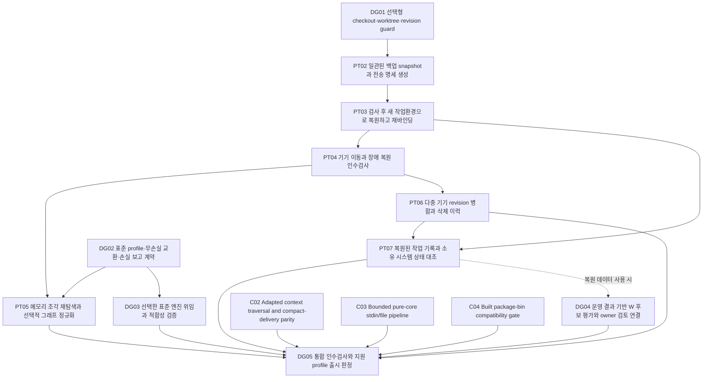

# USL 통합 개발 계획

이 문서는 원래 계획 스냅샷이다. 이후 구현 상태와 실제 실행 결과는 [개발 진행](DEVELOPMENT_PROGRESS.md)에서 확인한다.

이 계획은 **기기·메모리·작업환경 이동과 Git worktree 분기에도 의미 있는 연결을 보존하는 USL**을 개발하기 위한 통합 작업 그래프다. 2026-10-03 기준 **요구사항 13개 · 후속 과제 14개 · 완료 조건 47개 · milestone 5개**로 구성한다.

첫 구현은 **DG01: 선택형 checkout·worktree·revision guard**다. 잘못된 worktree 또는 HEAD를 선택했는데 파일 bytes만 같아서 일치로 보이는 경계를 먼저 막고, PT02 실제 snapshot/export → PT03 staging restore → PT04 환경별 검증으로 이어 간다.

이 문서는 SECONDARY_AI의 구현 제안이다. 현재 모든 후속 과제는 **PLANNED / NOT_STARTED**, 미래 완료 조건은 **NOT_RUN**이다. 그래프 생성·검증 성공은 해당 기능의 구현 완료가 아니다. 근거 snapshot은 Git `2576eef7df08e0866d709d5f23da06e79950cc21`과 파일별 SHA-256으로 고정한다. 과거 실행 근거 4건을 포함한 근거 55개를 참조하며 이번 계획 생성에서 재실행하지 않았다.

## 개발 원칙과 범위

- PT02–PT07/C02–C04의 canonical task ID와 원래 acceptance는 유지한다. 변경된 선행 조건은 이 통합 계획 snapshot의 제안이며 원래 문서를 덮어쓰지 않는다.
- dependsOn은 이 snapshot의 미래 과제만 참조한다. 이미 구현된 P01–P03/PT01/C01/W foundation은 buildsOn으로 구분한다.
- DG01을 먼저 시작하고 PT02 exporter로 이어 간다. DG02와 C02–C04 및 새 owner 데이터의 DG04 검토는 병렬 진행 가능하다. DG04의 복원 데이터 profile만 PT07에 조건부 의존한다.
- 선택한 모든 기능을 연결한 DG05 외에 M2 portable MVP와 M4 표준 profile을 각각 독립 출시 판정할 수 있다.
- 계획 그래프 검증 성공은 개발 구현·인수검사·운영 효과·전체 표준 상위호환 성공을 뜻하지 않는다.

고정 resource ID·revision·representation·현재 위치를 분리한다. 기본 core는 resource·meaning·이름 있는 role에 집중하고, 복원·표준 교환·W 평가 알고리즘은 선택형 consumer 또는 owner 프로그램에 둔다. 링크·출처·plan·receipt는 접근 권한을 부여하지 않는다. private registration과 credential은 로컬에 남긴다.

‘표준 그래프 엔지니어링으로 계획을 구축했다’는 뜻은 typed relation·role/cardinality·provenance·검증 가능한 제약·질의·실패 반례를 갖췄다는 것이다. USL이 RDF/OWL/SHACL/SPARQL/GQL 전체를 구현했거나 표준 기관의 인증을 받았다는 뜻은 아니다. 기존 [지원 범위 감사](STANDARDS_COVERAGE.md)의 NOT_A_STANDARDS_SUPERSET 판정을 유지한다.

## 이미 있는 기반

| ID | 재사용할 구현 | 남은 경계 |
|---|---|---|
| binding-core | P01–P03의 resource·meaning·named role·stable ID·로컬 표현 분리와 선택형 profile이 구현되어 있다. | 자동 위치 발견·완전한 backup·표준 엔진·분산 실행 보장은 포함하지 않는다. |
| PT01 | CONTRACT_ONLY: 후속 receipt에서 순수 manifest 계약의 로컬 검사 12개가 통과했다. 기존 최초 계획의 PLANNED 표시는 역사적 스냅샷으로 보존한다. | 실제 payload export·restore는 NOT_IMPLEMENTED, 다른 기기 인수검사는 NOT_RUN이다. |
| C01 | 기존 C01 완료와 receipt를 재사용한다. | C02–C04 adapter context·stdin·built-bin 검증은 별도 후속 과제다. |
| rule-weight-review | hard/soft 규칙 계약과 W evidence/review bridge가 있다. HSWM_LIKENESS의 합성 640개 episode로 validate/run/replay와 REVIEW_READY를 기록했으며 disposition은 REVIEW_ONLY_NOT_APPLIED다. | 실제 운영 데이터의 성능 향상·live HSWM 상태 대조·owner 적용은 입증하지 않았다. learned estimate를 penalty coefficient로 복사하지 않는다. |

PT01의 최초 PLANNED 기록과 후속 CONTRACT_IMPLEMENTED receipt는 서로 다른 시점의 기록이다. 원래 문서를 덮어쓰지 않고 후속 영수증으로 제한된 현재 기반을 표현한다. PT01은 실제 전송·복원 완료가 아니다. W도 offline learner 실행과 review bridge는 존재하지만 운영 효과와 live 적용은 별도다.

## 요구사항 추적

사용자 원문은 USER_PRIMARY, 다음 요구사항과 작업 배치는 SECONDARY_AI로 분리한다. 원문은 기계 판독 입력의 userStatements에 그대로 보존한다.

| 요구사항 | 해석 | 담당 과제 |
|---|---|---|
| R01 | 컴퓨터와 경로가 바뀌어도 자원 ID와 선택한 버전 및 역할을 보존한다. | DG01, PT03, DG05 |
| R02 | 선택한 복원 범위의 파일과 의존성 누락·손상·혼합 snapshot을 판별한다. | PT02, DG05 |
| R03 | 기존 작업환경을 덮어쓰지 않고 검증된 묶음만 새 로컬 바인딩으로 활성화한다. | PT03, DG05 |
| R04 | 파일과 메모리 조각의 위치 변경, 그래프 직렬화 차이를 자원 정체성과 구분한다. | PT05, DG02, DG05 |
| R05 | 서로 다른 기기의 수정·삭제·옛 백업을 구분하며 충돌과 이력을 보존한다. | PT03, PT06, DG05 |
| R06 | 이동한 링크와 과거 실행 기록을 접근 권한 또는 현재 외부 효과로 승격하지 않는다. | PT02, PT03, PT07, DG04, DG05 |
| R07 | 다른 OS와 복원 실패 상황에서 불변식과 실패 상태를 실제로 검증한다. | PT04, DG05 |
| R08 | 같은 파일 bytes라도 의도한 worktree·checkout·revision이 다르면 명시한 guard가 검출하고 미확인 상태를 일치로 승격하지 않는다. | DG01, DG05 |
| R09 | 선택한 그래프 표준 profile의 입력·용어·property·왕복·손실 계약을 명시하고 실제 상호운용 범위를 검증한다. | DG02, DG03, DG05 |
| R10 | 질의·추론·검증은 명시적으로 선택한 owner engine과 versioned profile로 위임하며 링크를 실행 권한으로 해석하지 않는다. | DG03, DG05 |
| R11 | 규칙의 hard/soft 강제성, penalty coefficient, HSWM의 학습된 W, evidence confidence, 권한을 구분하고 결과 근거로 후보를 검토한다. | DG04, DG05 |
| R12 | 기본 바인딩 core와 기존 CLI를 작게 유지하며 선택형 기능에서도 stable ID·role·metadata·provenance와 bounded delivery를 보존한다. | DG01, DG02, C02, C03, C04, DG05 |
| R13 | 실행된 근거와 미래 완료 조건을 구분하고 요구사항에서 release 판단까지 추적 가능하게 검증한다. | DG03, DG04, DG05 |

## 의존 순서와 병렬 작업

무조건 선행 과제가 없어 먼저 착수 가능한 작업은 **DG01, DG02, DG04, C02, C03, C04**다. 우선 선택한 과제는 DG01이다. 이는 일정상 선행 조건이며 외부 실행 승인이나 배포 권한이 아니다. DG02 표준 교환 계약과 C02–C04 CLI 및 새 owner 데이터의 DG04 검토는 이동성 작업과 병렬로 진행할 수 있다.



그림의 화살표는 선행 → 후속이다. 저장된 dependsOn 관계는 후속 task → prerequisite 방향이다. 이미 있는 기반은 buildsOn으로 연결한다. DG04는 복원된 outcome/receipt를 사용하는 profile에만 PT07 선행을 요구하며 requiresReconciliation으로 별도 표현한다. 기본 의존 DAG와 조건부 의존을 합한 DAG 모두 순환이 없어야 한다. 기존 offline review와 새 owner 데이터 검토는 이 조건에 막히지 않는다.

| 과제 | 우선순위 · 단계 | 선행 과제 | 완료 조건 수 |
|---|---|---|---|
| DG01 선택형 checkout·worktree·revision guard | P0 · FOUNDATION | 없음 | 3 |
| PT02 일관된 백업 snapshot과 전송 명세 생성 | P0 · PORTABLE_MVP | DG01 | 4 |
| PT03 검사 후 새 작업환경으로 복원하고 재바인딩 | P0 · PORTABLE_MVP | PT02 | 5 |
| PT04 기기 이동과 장애 복원 인수검사 | P0 · PORTABLE_MVP | PT03 | 3 |
| PT05 메모리 조각 재탐색과 선택적 그래프 정규화 | P1 · ADVANCED_PORTABILITY | PT04, DG02 | 3 |
| PT06 다중 기기 revision 병합과 삭제 이력 | P1 · ADVANCED_PORTABILITY | PT04 | 3 |
| PT07 복원된 작업 기록과 소유 시스템 상태 대조 | P1 · ADVANCED_PORTABILITY | PT03, PT06 | 3 |
| DG02 표준 profile·무손실 교환·손실 보고 계약 | P1 · STANDARD_INTEROP | 없음 | 3 |
| DG03 선택한 표준 엔진 위임과 적합성 검증 | P1 · STANDARD_INTEROP | DG02 | 3 |
| DG04 운영 결과 기반 W 후보 평가와 owner 검토 연결 | P1 · WEIGHT_OPERATIONS | 없음; 복원 데이터: PT07 | 3 |
| C02 Adapted context traversal and compact-delivery parity | P2 · CLI_COMPATIBILITY | 없음 | 4 |
| C03 Bounded pure-core stdin/file pipeline | P2 · CLI_COMPATIBILITY | 없음 | 3 |
| C04 Built package-bin compatibility gate | P2 · CLI_COMPATIBILITY | 없음 | 4 |
| DG05 통합 인수검사와 지원 profile 출시 판정 | P1 · RELEASE_GATE | PT05, PT06, PT07, DG03, DG04, C02, C03, C04 | 3 |

## 단계별 완료 판정

### DG-M1 · 의도한 checkout 보호

과제: DG01. 상태: PLANNED.

DG01 반례와 기존 inspect 호환성 검사 통과. 별도 명시적 guard만 완료로 표시.

### DG-M2 · 실제 휴대 가능한 backup/restore MVP

과제: PT02, PT03, PT04. 상태: PLANNED.

M1 선행. 선택한 restore profile의 closure·staging·재바인딩·지원 환경 인수검사 실행 근거가 있어야 portable MVP로 인정.

### DG-M3 · 조각·분기·복원된 작업 상태

과제: PT05, PT06, PT07. 상태: PLANNED.

M2와 DG02 관련 profile 선행. anchor/causality/tombstone/current owner reconciliation 결과와 미확인 상태 보존.

### DG-M4 · 명시한 표준 profile 상호운용

과제: DG02, DG03. 상태: PLANNED.

선택 profile의 무손실 또는 손실 보고와 engine adapter/suite 근거. 미지원 표준은 여전히 미지원.

### DG-M5 · CLI 호환 및 운영 W 검토와 통합 gate

과제: C02, C03, C04, DG04, DG05. 상태: PLANNED.

의존 DAG의 선택 기능 gate와 운영 근거 확인. owner 승인이 없는 W 적용은 하지 않으며 REVIEW_ONLY도 올바른 종료 상태.

portable MVP(M2), 선택한 표준 상호운용(M4), 전체 선택 기능을 연결한 검증(DG05)을 구분한다. 한 기능의 미완료를 감추지 않으면서 기본 바인딩과 준비된 선택 기능을 각각 제공할 수 있다.

## 과제별 구현 범위와 인수 조건

아래 경로는 계획한 산출물이다. 파일이 이미 존재하면 그 범위의 수정이며, 미존재 경로는 아직 생성한 구현이 아니다. 모든 인수 조건의 실행 상태는 NOT_RUN이다.

### DG01 · 선택형 checkout·worktree·revision guard

owner가 별도로 고정한 resource/representation/checkout identity·expected revision·dirty policy를 실제 관측과 비교한다. 기존 inspect의 보고 의미는 유지하고 엄격 검사를 선택형 consumer로 추가한다.

남은 문제: 같은 bytes의 잘못된 alias/HEAD를 현재 content MATCH만으로 거부하지 못한다. 영구 worktree 정체성은 owner가 관리하며 path·branch·commit·commonGitDir만으로 대체할 수 없다.

담당 경계: USL_OPTIONAL_CONSUMER. 기존 기반: PT01, binding-core. 선행: 없음.

계획 산출물: `src/addons/checkout-guard.ts`, `test/checkout-guard.test.ts`, `docs/CHECKOUT_GUARD.md`.

- **DG01-C1 · NOT_RUN:** 같은 bytes지만 다른 HEAD·worktree·root를 고른 경우 기대값의 독립 출처와 대조하여 MISMATCH/HOLD를 낸다. 올바른 move 후 명시적 remap은 동일 논리 ID/role을 보존한다. **실패 반례:** 관측한 현재 HEAD를 expected HEAD로 자동 채우거나 alias·branch·commonGitDir 일치만으로 통과하면 실패.
- **DG01-C2 · NOT_RUN:** clean/dirty 허용 정책과 worktree별 index·untracked 범위를 고정하고 detached/unborn/sparse/subdirectory/broken gitfile 상태를 구분한다. 정책 없는 기존 inspect는 기존 상태를 보고한다. **실패 반례:** Git 사실 불명·부분 검사·subdirectory 오인식을 VERIFIED로 승격하거나 guard 미선택 기본 바인딩을 깨면 실패.
- **DG01-C3 · NOT_RUN:** 행동을 보호할 때 owner preflight가 작업 직전 고정 조건을 재검증한다. 검사 후 변경 가능성과 원자성 한계를 명시하고 stale plan은 실행 전에 중단한다. **실패 반례:** 검사 뒤 HEAD·index·runner가 바뀌었는데 이전 판정만으로 실행하거나 관측 검사를 원자적 snapshot으로 주장하면 실패.

근거 기록: `finding:WT07`, `finding:WT12`, `finding:WT02`, `usl-worktree-audit-receipt/v1`, `task:P01,task:P02,task:P03`.

고정 원문: [research/worktree-audit/catalog.json](../research/worktree-audit/catalog.json), [research/worktree-audit/receipt.json](../research/worktree-audit/receipt.json), [docs/RESOURCE_BINDINGS.md](../docs/RESOURCE_BINDINGS.md).

### PT02 · 일관된 백업 snapshot과 전송 명세 생성

선택한 복원 profile별 일관된 snapshot/export와 hash/size가 있는 닫힌 manifest를 만든다. Git main/linked admin data·index·선택한 dirty/untracked·submodule·LFS·alternates는 PACKAGED/EXTERNAL_REQUIRED/OPTIONAL로 분류한다. selfContained는 실제 필요한 의존성이 닫힌 범위에서만 가능하다.

남은 문제: 현재 디렉터리 전체 원문·필수 의존성·혼합 시점 파일에 대한 복원 manifest가 없다.

담당 경계: USL_OPTIONAL_CONSUMER. 기존 기반: PT01, binding-core. 선행: DG01.

계획 산출물: `scripts/usl-transfer-export.ts`, `test/portable-transfer-export.test.ts`.

- **PT02-C1 · NOT_RUN:** 소유자가 지정한 범위에서 snapshot/session ID를 발급하고 실제 복사한 바이트의 hash·size를 기록한다. 일관된 owner export/잠금/snapshot이 불가능하면 export를 중단한다. **실패 반례:** 스캔과 복사 사이 파일 변경, live DB 단순 복사, 중간 실패에서 완성 bundle을 공개하면 실패.
- **PT02-C2 · NOT_RUN:** 필수 artifact와 dependency를 PACKAGED, EXTERNAL_REQUIRED, OPTIONAL로 분류한다. selfContained=true는 모든 필수 의존성이 포함되고 검증된 경우에만 허용한다. Git objects/dirty/untracked/submodule/LFS를 각각 명시한다. **실패 반례:** 필수 원문·고정 Git object 누락, manifest에 없는 payload, size/hash 불일치를 정상으로 기록하면 실패.
- **PT02-C3 · NOT_RUN:** manifest body digest를 분리된 envelope에 넣어 자기 해시 순환을 피하고 스키마·정책·필요한 alias dictionary를 동봉한다. 기기 절대 root·credential·private action 등록은 기본 제외한다. **실패 반례:** 검증되지 않은 manifest로 host pin을 자동 등록하거나 비밀값·기기 root를 내보내면 실패.
- **PT02-C4 · NOT_RUN:** 복원 profile이 요구한 Git 공통 object/ref/admin 데이터와 각 worktree HEAD/index/config, 선택한 dirty/untracked 파일, submodule/LFS/alternates closure를 검증한다. payload에 실을 수 없으면 EXTERNAL_REQUIRED로 표기하고 독립 복원 가능 상태를 부여하지 않는다. **실패 반례:** linked worktree 디렉터리만 복사하거나 중간 mutation을 scan/hash만으로 원자적이라 주장하거나 host credential/config를 무분별하게 포함하면 실패.

근거 기록: `task:PT01`, `finding:WT04`, `finding:WT05`, `finding:WT11`, `decision:PR02`, `decision:PR03`, `decision:PR04`, `decision:PR06`.

고정 원문: [research/portability-plan/plan.json](../research/portability-plan/plan.json), [research/portability-research/research.json](../research/portability-research/research.json), [research/portable-transfer/contract.receipt.json](../research/portable-transfer/contract.receipt.json), [research/worktree-audit/catalog.json](../research/worktree-audit/catalog.json).

### PT03 · 검사 후 새 작업환경으로 복원하고 재바인딩

owner가 새 기기에 선택한 root 아래 새 staging으로 검사·복원하고 로컬 표현만 재바인딩한다. Git worktree repair/reconstruction은 명시한 복원 profile의 검증 단계다. 도착 위치의 owner namespace/native ID 충돌을 검출하며 256자 계약에 안 맞는 ID를 자르지 않는다.

남은 문제: root 변경은 지원하지만 bundle staging·완결성 검사·중복 import·복원 경합과 effect 재개 경계는 없다.

담당 경계: USL_OPTIONAL_CONSUMER. 기존 기반: PT01, binding-core. 선행: PT02.

계획 산출물: `scripts/usl-transfer-import.ts`, `test/portable-transfer-restore.test.ts`.

- **PT03-C1 · NOT_RUN:** 임포터 소유의 새 staging 디렉터리에서 전 항목을 검증하고 대상 owner namespace를 확인한 뒤 사용자가 지정한 workspace root로 재바인딩한다. 캐시 없이 원본 ID·역할을 복구한다. **실패 반례:** 이름/mtime/내용 유사성만으로 후보를 채택하거나 기존 resource ID·role을 바꾸면 실패.
- **PT03-C2 · NOT_RUN:** 같은 파일시스템의 새 목적지만 원자적 publish하고 검증 실패·용량 초과·중단은 미완성 상태로 남긴다. 기존 환경은 보존하고 재import는 동일 bundle digest의 기존 결과를 확인한다. **실패 반례:** 경로 탈출·심볼릭 링크·대소문자/Unicode 충돌·동시 목적지 생성·타 파일시스템 rename을 성공처럼 처리하면 실패.
- **PT03-C3 · NOT_RUN:** MVP는 기존 상태와의 자동 merge를 하지 않는다. owner의 알려진 head/철회 정보와 충돌하면 DIVERGED/WITHDRAWN, 기준이 없으면 FRESHNESS_UNKNOWN으로 보존하고 최신 상태 활성화를 보류한다. 명시적 과거 snapshot 읽기는 허용한다. 명시적으로 선택한 복원 revision에서 새 로컬 작업 분기를 만들 수 있으며 전역 최신성은 미확정으로 유지한다. **실패 반례:** 옛 backup의 삭제 전 자원을 현재 head로 부활시키거나 누락을 삭제로 추론하면 실패.
- **PT03-C4 · NOT_RUN:** 과거 operation/receipt를 역사 자료로 분류하고 외부 효과는 UNRECONCILED로 둔다. 복원 자체의 실행 호출은 0회이며 새 host 등록과 현재 상태 확인 전 자동 재시도/예약 해제를 금지한다. **실패 반례:** 복원한 로컬 reservation을 분산 exactly-once 근거로 사용하거나 unknown 효과를 재실행하면 실패.
- **PT03-C5 · NOT_RUN:** 새 root에서 owner가 선택한 Git 재구성/repair를 수행한 후 원본 commonGitDir 없이 checkout 및 파일 pins를 재검증한다. 별도 namespace 등록은 동일 ID 충돌과 정의 불일치를 거부한다. **실패 반례:** 원본 저장소를 계속 참조하는 gitfile로 복원 성공을 선언하거나 긴 native ID를 잘라 충돌시키면 실패.

근거 기록: `task:PT01`, `finding:WT04`, `finding:WT05`, `decision:PR01`, `decision:PR03`, `decision:PR05`, `decision:PR06`, `decision:PR09`.

고정 원문: [research/portability-plan/plan.json](../research/portability-plan/plan.json), [research/portability-research/research.json](../research/portability-research/research.json), [research/portable-transfer/contract.receipt.json](../research/portable-transfer/contract.receipt.json), [research/worktree-audit/catalog.json](../research/worktree-audit/catalog.json).

### PT04 · 기기 이동과 장애 복원 인수검사

지원하려는 OS와 기기 이동·원본 부재·복사/게시 중단·손상·의존성 누락의 실제 인수검사 및 예산을 기록한다.

남은 문제: 기존 테스트는 같은 호스트에서 root 이동을 다루며 다른 OS의 복원·누락·충돌 전반을 실행한 증거는 아니다.

담당 경계: USL_OPTIONAL_CONSUMER. 기존 기반: PT01, binding-core. 선행: PT03.

계획 산출물: `test/portable-transfer-portability.test.ts`, `.github/workflows/portable-transfer.yml`, `docs/PORTABLE_TRANSFER.md`.

- **PT04-C1 · NOT_RUN:** Linux/macOS/Windows에서 서로 다른 root·사용자 홈·cache 없음·원본 장치 없음 조건으로 self-contained bundle을 복원한다. 기대하는 정확한 resource/revision/role 집합과 bytes를 비교한다. **실패 반례:** 원래 절대 경로 또는 캐시가 있어야만 통과하거나 개수만 같아도 성공으로 판정하면 실패.
- **PT04-C2 · NOT_RUN:** 부분 복사·1 byte 손상·알고리즘 변경·의존성 누락·중복 import·중간 종료·대소문자/Unicode 충돌·삭제 전 backup·기준 미확인·복제된 실행 기록 반례를 자동 검사한다. **실패 반례:** 누락/손상/분기/권한 없음이 VERIFIED 또는 현재 ACTIVE로 승격되면 실패.
- **PT04-C3 · NOT_RUN:** OS별 실제 실행 결과와 미실행 플랫폼을 따로 기록하고 기존 core binding/CLI 호환 검사를 유지한다. 전송 bytes·해시 시간·peak memory를 예산별 측정한다. **실패 반례:** 한 OS의 PASS를 전 플랫폼 보장, benchmark를 운영 효과나 Lean 증명으로 기록하면 실패.

근거 기록: `usl-worktree-audit-receipt/v1`, `finding:WT01`, `finding:WT02`, `finding:WT03`, `finding:WT06`, `finding:WT08`, `finding:WT09`, `decision:PR04`, `decision:PR05`, `decision:PR06`, `decision:PR12`.

고정 원문: [research/portability-plan/plan.json](../research/portability-plan/plan.json), [research/portability-research/research.json](../research/portability-research/research.json), [research/portable-transfer/contract.receipt.json](../research/portable-transfer/contract.receipt.json), [research/worktree-audit/catalog.json](../research/worktree-audit/catalog.json).

### PT05 · 메모리 조각 재탐색과 선택적 그래프 정규화

stable fragment ID/source revision/quote context 재탐색과 선택한 RDF dataset의 RDFC digest를 추가한다. hash 목적과 적용 profile을 분리한다.

남은 문제: 파일 이동과 문단 이동은 다르며 원문 바이트 digest만으로 RDF 직렬화 차이와 문맥 이동을 구별하지 못한다.

담당 경계: USL_OPTIONAL_CONSUMER. 기존 기반: PT01, binding-core. 선행: PT04, DG02.

계획 산출물: `src/addons/portable-anchors.ts`, `src/addons/rdf-snapshot-digest.ts`, `test/portable-anchors.test.ts`.

- **PT05-C1 · NOT_RUN:** 문서와 조각의 stable ID, 고정 source revision, exact/prefix/suffix selector를 보존한다. 등록 범위 내 재탐색 결과가 다수면 AMBIGUOUS, 0개면 MISSING으로 반환한다. **실패 반례:** 줄 번호만으로 새 문단을 확정하거나 같은 인용문 여러 개 중 첫 항목을 자동 바인딩하면 실패.
- **PT05-C2 · NOT_RUN:** 원문 byte digest와 RDFC-1.0 dataset digest를 별도 필드로 둔다. 기존 contractDigest는 변경하지 않고 알고리즘 version·허용 quad/시간/메모리 한도를 명시한다. **실패 반례:** blank-node 라벨/직렬화 순서 차이를 내용 변경으로 오인하거나 semantic equivalence로 과대 주장하면 실패.
- **PT05-C3 · NOT_RUN:** JSON-LD 외부 context는 고정·동봉된 자료만 사용하고 정규화 예산 초과는 미확정으로 반환한다. 관계의 역할과 ID가 바뀐 그래프는 달라야 한다. **실패 반례:** 원격 context의 조용한 변경 또는 바뀐 role을 같은 그래프로 인정하면 실패.

근거 기록: `decision:PR10`, `assessment:rdfc`, `assessment:annotation`.

고정 원문: [research/portability-plan/plan.json](../research/portability-plan/plan.json), [research/portability-research/research.json](../research/portability-research/research.json), [research/portable-transfer/contract.receipt.json](../research/portable-transfer/contract.receipt.json), [research/worktree-audit/catalog.json](../research/worktree-audit/catalog.json).

### PT06 · 다중 기기 revision 병합과 삭제 이력

owner/actor/operation 식별자와 revision DAG, fork·conflict·tombstone을 보존하고 명시적 병합 정책을 적용한다. 필요가 입증된 자료형만 선택형 CRDT로 확장한다.

남은 문제: 현재 USL에는 기기 간 causal history와 충돌 처리 및 tombstone 교환 규약이 없다.

담당 경계: USL_OPTIONAL_CONSUMER. 기존 기반: PT01, binding-core. 선행: PT04.

계획 산출물: `src/addons/portable-revisions.ts`, `test/portable-revisions.test.ts`.

- **PT06-C1 · NOT_RUN:** revision parent DAG와 actor/operation identity로 후속·동시 변경을 구별한다. 복제된 장치 이미지의 actor counter 재사용을 막고 동일 operation import는 멱등 처리한다. **실패 반례:** 기기 시계/mtime으로 승자를 고르거나 두 기기가 같은 actor-counter로 다른 변경을 쓰면 실패.
- **PT06-C2 · NOT_RUN:** 동시 변경의 양쪽 원문과 provenance를 보존하고 owner가 선택한 merge 정책을 기록한다. CRDT는 필요가 입증된 선택형 소비자 구현으로만 평가한다. **실패 반례:** 자동 수렴을 owner 권위·정책·의미적 정당성으로 간주하면 실패.
- **PT06-C3 · NOT_RUN:** 명시적 tombstone을 revision으로 유지한다. peer 확인/retention 정책 없이 삭제하지 않고 오래된 backup 및 offline peer 재등장에서 비의도적 부활을 차단한다. **실패 반례:** tombstone을 지워 old live revision을 새 현재 상태로 채택하거나 parent 누락을 숨기면 실패.

근거 기록: `decision:PR07`, `decision:PR08`, `finding:WT01`.

고정 원문: [research/portability-plan/plan.json](../research/portability-plan/plan.json), [research/portability-research/research.json](../research/portability-research/research.json), [research/portable-transfer/contract.receipt.json](../research/portable-transfer/contract.receipt.json), [research/worktree-audit/catalog.json](../research/worktree-audit/catalog.json).

### PT07 · 복원된 작업 기록과 소유 시스템 상태 대조

복원된 역사적 intent/receipt와 현재 owner operation 상태를 허가된 범위에서 대조한다. 분리된 operation store는 중복 실행 방지의 공유 근거가 아니다.

남은 문제: 로컬 예약 저장소 복제는 기기 간 중복 외부 효과를 차단하지 못한다.

담당 경계: USL_OPTIONAL_CONSUMER. 기존 기반: PT01, binding-core. 선행: PT03, PT06.

계획 산출물: `src/addons/portable-operation-review.ts`, `test/portable-operation-review.test.ts`.

- **PT07-C1 · NOT_RUN:** historical receipt와 현재 owner 상태를 분리하고 owner의 idempotency key/status API가 있을 때만 명시적으로 대조한다. 외부 조회에는 기존 scoped host authorization을 적용한다. **실패 반례:** 복원된 host/credential/예약 또는 artifact graph만으로 원격 접근·실행 권한을 얻으면 실패.
- **PT07-C2 · NOT_RUN:** 현재 상태 digest와 operation ID를 고정하고 owner가 제공하는 조건부 갱신/중복 방지 범위를 문서화한다. 지원하지 않는 owner는 UNKNOWN/HOLD와 실행 0회를 유지한다. **실패 반례:** offline 두 컴퓨터가 각자 unknown을 성공/미실행으로 추정해 같은 외부 효과를 실행하면 실패.
- **PT07-C3 · NOT_RUN:** 대조 결과는 별도 관측으로 기록하고 기존 receipt/intent를 수정하지 않는다. 테스트는 fake owner의 명시적 보장 범위와 실제 연결 관측을 구분한다. **실패 반례:** 로컬 모의 테스트로 실제 분산 exactly-once 또는 HSWM 연결 완료를 선언하면 실패.

근거 기록: `decision:PR09`, `decision:PR11`, `finding:WT10`, `finding:WT08`, `finding:WT09`.

고정 원문: [research/portability-plan/plan.json](../research/portability-plan/plan.json), [research/portability-research/research.json](../research/portability-research/research.json), [research/portable-transfer/contract.receipt.json](../research/portable-transfer/contract.receipt.json), [research/worktree-audit/catalog.json](../research/worktree-audit/catalog.json).

### DG02 · 표준 profile·무손실 교환·손실 보고 계약

선택한 RDF dataset/LPG profile의 지원 문법·의미·version·거부/손실 계약을 먼저 고정하고 선택형 교환 adapter를 구현한다. PROV/SKOS/DCAT/CSVW/annotation/LDP는 선언한 mapping/protocol 범위마다 지원 상태를 따로 기록한다.

남은 문제: 현재 일반 RDF 입력과 LPG 임의 property의 무손실 교환을 제공하지 않는다. 모든 어휘·프로토콜·draft를 한 번에 지원한다는 의미가 아니다.

담당 경계: USL_OPTIONAL_CONSUMER. 기존 기반: binding-core. 선행: 없음.

계획 산출물: `docs/STANDARD_INTEROP_PROFILE.md`, `src/addons/standard-interchange.ts`, `test/standard-interchange.test.ts`.

- **DG02-C1 · NOT_RUN:** 표준 edition·profile·정규화 algorithm·지원 syntax·context resolver 정책과 loss report 형식을 버전으로 고정한다. Recommendation/Note/Draft와 ISO 공개 초록/규범 전문 접근 범위를 구분한다. **실패 반례:** 미지원 keyword·프로토콜·확정되지 않은 draft를 무시하고 full support로 표기하면 실패.
- **DG02-C2 · NOT_RUN:** 선택 profile의 IRI·typed/language literal·blank-node scope·default/named graph·빈 graph 표현 한계와 LPG node/edge property·label을 왕복하거나 정확히 명시한 손실/거부 결과를 낸다. **실패 반례:** 원문 domain triple 대신 USL 선언 wrapper만 출력하고 무손실 roundtrip이라고 하거나 임의 property를 조용히 버리면 실패.
- **DG02-C3 · NOT_RUN:** stable ID·named/n-ary roles·metadata·provenance를 보존하며 raw byte digest·contract digest·RDF dataset digest·entailment 비교를 구분한다. 외부 context는 pinned/bundled 허용 목록과 예산으로 제한한다. **실패 반례:** blank-node label이나 semantic similarity를 자원 ID로 쓰거나 stale dictionary/cache로 다른 그래프를 복원하면 실패.

근거 기록: `assessment:rdf-model`, `assessment:rdf-syntax`, `assessment:jsonld-export`, `assessment:jsonld-processing`, `assessment:rdfc`, `assessment:lpg`, `assessment:prov`, `assessment:skos`, `assessment:catalog`, `assessment:tabular`, `assessment:annotation`, `assessment:ldp`, `assessment:nary`, `assessment:drafts`.

고정 원문: [research/standards-coverage/coverage.json](../research/standards-coverage/coverage.json), [research/engineering/catalog.json](../research/engineering/catalog.json), [research/architecture/hswm-like.plan.json](../research/architecture/hswm-like.plan.json).

### DG03 · 선택한 표준 엔진 위임과 적합성 검증

owner가 선택한 SHACL/SPARQL/추론/GQL 등의 adapter를 profile별로 연결하고 capability/version/result semantics·오류 계약·독립 suite를 명시한다. 실제 지원한 profile만 적합성을 주장한다.

남은 문제: 현재 외부 SHACL fixture 검증은 runtime SHACL engine 위임이 아니다. 모든 표준 엔진을 USL core에 구현하지 않는다. GQL의 유료 규범 접근 미평가를 유지한다.

담당 경계: USL_OPTIONAL_CONSUMER. 기존 기반: binding-core. 선행: DG02.

계획 산출물: `docs/STANDARD_ENGINE_ADAPTER.md`, `src/addons/standard-engine.ts`, `test/standard-engine.test.ts`.

- **DG03-C1 · NOT_RUN:** engine ID/version·entailment regime·dataset/result terms·error/timeout·update capability를 owner 계약으로 고정하고 지원 여부를 조회 가능하게 한다. 읽기/변경은 기존 scoped owner 권한으로 분리한다. **실패 반례:** link/route를 engine 실행 허가로 읽거나 query capability를 update 권한으로 확대하거나 다른 version 결과를 재사용하면 실패.
- **DG03-C2 · NOT_RUN:** 선택 profile의 공식 또는 독립 fixture/suite revision과 실행 환경을 고정하고 실행·실패·제외·미실행 항목을 모두 기록한다. suite가 없거나 규범 전문을 확인하지 못한 항목은 NOT_ESTABLISHED로 남긴다. **실패 반례:** USL wrapper SHACL 통과를 RDF/OWL/GQL 전체 conformance로 승격하거나 알려진 오답 fixture를 통과시키면 실패.
- **DG03-C3 · NOT_RUN:** 같은 입력과 profile의 direct engine 결과와 USL adapter 결과를 term identity·bindings·graph/result semantics·진단으로 비교한다. CPU/time/bytes 한계 초과는 명시적 결과로 종료한다. **실패 반례:** ASK/SELECT/CONSTRUCT 결과·SHACL severity·entailment·오류를 임의로 동일시하거나 실패를 빈 성공으로 바꾸면 실패.

근거 기록: `assessment:rdfs`, `assessment:owl`, `assessment:shacl`, `assessment:sparql-query`, `assessment:sparql-update`, `assessment:sparql-results`, `assessment:gql`.

고정 원문: [research/standards-coverage/coverage.json](../research/standards-coverage/coverage.json), [research/architecture/hswm-like.plan.json](../research/architecture/hswm-like.plan.json).

### DG04 · 운영 결과 기반 W 후보 평가와 owner 검토 연결

현재 offline review bridge를 재사용하여 versioned 운영 outcome을 owner 상태와 대조하고 맥락별 W 후보를 train/holdout·baseline·replay로 평가한다. 새 owner 데이터의 검토는 독립 진행하며 복원된 outcome/receipt를 쓰는 profile만 PT07 대조가 선행해야 한다. 산출물은 owner 검토 제안까지이며 실제 적용은 별도 owner 정책과 명시적 권한에 따른다.

남은 문제: 합성 데이터 실행만으로 metahumotonic_dashboard나 실제 HSWM 개선을 증명하지 못한다. 운영 outcome 공급·효과 측정·현재 owner 상태 대조가 남았다. 복원된 outcome을 사용할 때 PT07 선행이 필요하다.

담당 경계: USL_OPTIONAL_CONSUMER. 기존 기반: rule-weight-review. 선행: 없음. 복원 데이터 사용 시 선행: PT07.

계획 산출물: `docs/RULE_WEIGHT_OPERATIONAL_REVIEW.md`, `src/addons/rule-weight-operational-review.ts`, `test/rule-weight-operational-review.test.ts`.

- **DG04-C1 · NOT_RUN:** rule ID/revision·context·action·outcome·latency/cost 단위·evidence provenance·owner 상태를 고정한다. 결측/합성/실측과 관측 신뢰도를 구분하며 수집 범위와 원자료 접근은 owner가 정한다. 복원된 outcome/receipt가 하나라도 입력되면 PT07의 현재 owner 대조를 선행하고, 미대조 결과는 HOLD로 남긴다. **실패 반례:** 이동한 receipt·copied registration·미인증 outcome을 현재 허가나 실제 개선 증거로 승격하면 실패.
- **DG04-C2 · NOT_RUN:** 데이터 누출을 차단한 baseline/train/holdout·맥락별 표본 수·후보 효과·불확실성·재현 가능한 replay를 보고한다. 근거가 부족하면 KEEP_BASELINE/HOLD로 남긴다. **실패 반례:** 합성 holdout 승리를 운영 보장으로 바꾸거나 learned estimate를 soft coefficient에 자동 복사하거나 hard constraint를 W로 상쇄하면 실패.
- **DG04-C3 · NOT_RUN:** review/apply 경계를 유지하고 실제 owner 상태/revision 변경이나 미승인은 HOLD/REVIEW_ONLY로 남긴다. 후속 적용이 승인되는 경우에도 owner capability·조건부 update·rollback·감사 근거를 별도 확보한다. **실패 반례:** candidate policy나 링크만으로 live HSWM/CHU/KG를 변경하거나 owner state 대조 없이 exactly-once를 주장하면 실패.

근거 기록: `usl-offline-learner-execution/v1`, `usl-rule-weight-review-receipt/v1`, `decision:PR11`, `finding:WT10`.

고정 원문: [docs/RULE_POLICY.md](../docs/RULE_POLICY.md), [docs/RULE_WEIGHT_EVIDENCE.md](../docs/RULE_WEIGHT_EVIDENCE.md), [docs/RULE_WEIGHT_REVIEW.md](../docs/RULE_WEIGHT_REVIEW.md), [research/rule-weight-evidence/learner-execution.json](../research/rule-weight-evidence/learner-execution.json), [examples/fixtures/rule-weight-review/review.json](../examples/fixtures/rule-weight-review/review.json).

### C02 · Adapted context traversal and compact-delivery parity

기존 CLI 계획의 범위를 그대로 이행한다. Keep multiple representations explicit. Do not equate a resource link with access permission. Do not add automatic tokenizer dependencies.

남은 문제: src/cli-adapter.ts accepts focus, target and compact for context, but not max-hops/max-links/max-visits/via/max-bytes/known-context/stats despite those being supported by src/cli.ts context.

담당 경계: USL_CLI. 기존 기반: C01, binding-core. 선행: 없음.

계획 산출물: `src/cli-adapter.ts`, `src/adapters.ts`, `docs/CLI.md`, `test/adapter-boundaries.test.ts`, `test/cli.test.ts`.

- **C02-C1 · NOT_RUN:** Support max-hops, max-resources, max-links, max-visits, repeated via, max-bytes, known-context and stats for adapt --operation context. **실패 반례:** 상한 우회·다른 validation·canonical ID/role 손실·선택하지 않은 profile 적용은 실패.
- **C02-C2 · NOT_RUN:** Use the same validation and compact fallback/error contract as source context. **실패 반례:** 상한 우회·다른 validation·canonical ID/role 손실·선택하지 않은 profile 적용은 실패.
- **C02-C3 · NOT_RUN:** Preserve native IDs and explicitly selected resource-graph profiles. **실패 반례:** 상한 우회·다른 validation·canonical ID/role 손실·선택하지 않은 profile 적용은 실패.
- **C02-C4 · NOT_RUN:** Preserve the existing max-resources policy cap when adding the missing query and delivery options. **실패 반례:** 상한 우회·다른 validation·canonical ID/role 손실·선택하지 않은 profile 적용은 실패.

근거 기록: `task:C02`, `task:C01`.

고정 원문: [research/architecture/core-cli.plan.json](../research/architecture/core-cli.plan.json), [research/architecture/core-cli-c01.receipt.json](../research/architecture/core-cli-c01.receipt.json), [research/architecture/hswm-like.plan.json](../research/architecture/hswm-like.plan.json).

### C03 · Bounded pure-core stdin/file pipeline

기존 CLI 계획의 범위를 그대로 이행한다. Preserve JSON stdout and --out collision protection. Do not change registered child-process stdin behavior.

남은 문제: src/cli.ts reads every source from a file path; there is no bounded UTF-8 --source - contract for pure core pipeline commands.

담당 경계: USL_CLI. 기존 기반: C01, binding-core. 선행: 없음.

계획 산출물: `src/cli.ts`, `src/cli-io.ts`, `docs/CLI.md`, `test/cli.test.ts`, `test/cli-project-inputs.test.ts`.

- **C03-C1 · NOT_RUN:** Support --source - only for check, compile and context. **실패 반례:** unbounded stdin·관측/변경/host 실행으로 stdin 확대·--out 충돌 보호 제거는 실패.
- **C03-C2 · NOT_RUN:** Bound bytes before parsing and give stdin a stable source label in errors/provenance. **실패 반례:** unbounded stdin·관측/변경/host 실행으로 stdin 확대·--out 충돌 보호 제거는 실패.
- **C03-C3 · NOT_RUN:** Keep observe, file-changing operations and registered-host execution file/config based. **실패 반례:** unbounded stdin·관측/변경/host 실행으로 stdin 확대·--out 충돌 보호 제거는 실패.

근거 기록: `task:C03`, `task:C01`.

고정 원문: [research/architecture/core-cli.plan.json](../research/architecture/core-cli.plan.json), [research/architecture/core-cli-c01.receipt.json](../research/architecture/core-cli-c01.receipt.json), [research/architecture/hswm-like.plan.json](../research/architecture/hswm-like.plan.json).

### C04 · Built package-bin compatibility gate

기존 CLI 계획의 범위를 그대로 이행한다. Do not add tokenizer dependencies or API cost estimates. Do not change host registration or external execution authority.

남은 문제: package.json maps the usl bin to dist/src/cli.js, but current CLI tests invoke TypeScript through tsx rather than a built package bin.

담당 경계: USL_CLI. 기존 기반: C01, binding-core. 선행: 없음.

계획 산출물: `package.json`, `test/cli-package-bin.test.ts`, `docs/GETTING_STARTED.md`.

- **C04-C1 · NOT_RUN:** After npm run build, invoke the package bin symlink for --help and one pure check fixture. **실패 반례:** tsx 직접 실행만 검사하거나 dist bin import/shebang/exit 오류를 놓치거나 기존 pre-build test를 깨면 실패.
- **C04-C2 · NOT_RUN:** Verify dist import, shebang and exit status. **실패 반례:** tsx 직접 실행만 검사하거나 dist bin import/shebang/exit 오류를 놓치거나 기존 pre-build test를 깨면 실패.
- **C04-C3 · NOT_RUN:** Retain moved-workspace and cli-list to cli-inspect tests as compatibility gates rather than new host development. **실패 반례:** tsx 직접 실행만 검사하거나 dist bin import/shebang/exit 오류를 놓치거나 기존 pre-build test를 깨면 실패.
- **C04-C4 · NOT_RUN:** Provide the built-bin check as an explicit post-build command, preserving the current pre-build npm test workflow. **실패 반례:** tsx 직접 실행만 검사하거나 dist bin import/shebang/exit 오류를 놓치거나 기존 pre-build test를 깨면 실패.

근거 기록: `task:C04`, `task:C01`.

고정 원문: [research/architecture/core-cli.plan.json](../research/architecture/core-cli.plan.json), [research/architecture/core-cli-c01.receipt.json](../research/architecture/core-cli-c01.receipt.json), [research/architecture/hswm-like.plan.json](../research/architecture/hswm-like.plan.json).

### DG05 · 통합 인수검사와 지원 profile 출시 판정

선택한 기능 묶음에서 이동/분기/표준 교환/규칙 검토/CLI를 연결한 시나리오와 지원 범위별 release gate를 만든다. 중간 portable MVP 출시는 M2로 별도 판정하며 전체 gate를 기다릴 필요는 없다.

남은 문제: 현재 40개 기술·12개 control과 22개 표준 평가의 대응은 감사 목록이지 모두 구현한 인증이 아니다. proofStatus는 NOT_PROVEN이며 각 미지원 범위를 명시해야 한다.

담당 경계: USL_OPTIONAL_CONSUMER. 기존 기반: binding-core, PT01, C01, rule-weight-review. 선행: PT05, PT06, PT07, DG03, DG04, C02, C03, C04.

계획 산출물: `research/development-acceptance/report.json`, `docs/DEVELOPMENT_ACCEPTANCE.md`, `test/development-acceptance.test.ts`.

- **DG05-C1 · NOT_RUN:** 요구사항→과제→criterion→실행 receipt→지원 profile을 추적한다. 기존 40 technologies/12 controls/22 assessments 각각에 지원·위임·미지원·제외 사유를 연결하고 변경된 원문 revision을 다시 조사한다. **실패 반례:** 노드/edge 수 일치만으로 ID·role·metadata·상태·payload 정확성을 대체하거나 NOT_RUN을 PASS로 승격하면 실패.
- **DG05-C2 · NOT_RUN:** 새 경로/사용자/cache 부재/원본 기기 부재/worktree 분기와 backup import/표준 roundtrip/W review 시나리오를 지원 OS 및 실제 환경에서 검사한다. 미실행 OS·실기기·서비스 경계는 별도로 표시한다. **실패 반례:** local Linux fixture만으로 모든 OS·분산 환경·운영 dashboard·기능적 완전 상위호환을 주장하면 실패.
- **DG05-C3 · NOT_RUN:** bytes·시간·peak memory·정확성·관측/권한/실행 효과 상태를 분리하여 예산 내 종료와 호환성 회귀를 검증한다. W 등 미선택 기능은 별도 profile gate로 격리한다. **실패 반례:** payload byte 감소를 token/billing/heap/품질 개선이나 Lean 증명으로 대체하거나 optional 엔진을 기본 바인딩 필수 조건으로 만들면 실패.

근거 기록: `usl-worktree-audit-receipt/v1`, `task:PT01`, `assessment:practice`, `usl-offline-learner-execution/v1`.

고정 원문: [research/portability-research/research.json](../research/portability-research/research.json), [research/worktree-audit/receipt.json](../research/worktree-audit/receipt.json), [research/standards-coverage/coverage.json](../research/standards-coverage/coverage.json), [research/engineering/catalog.json](../research/engineering/catalog.json), [research/architecture/hswm-like.plan.json](../research/architecture/hswm-like.plan.json).

## 근거와 실패 사례의 연결

Worktree 감사의 PASS에는 현재 한계를 재현한 검사가 포함된다. 표준 coverage는 bounded probe/정적 검토이며 전체 적합성 suite가 아니다. 이동성 연구는 설계 근거, W learner 실행은 합성 offline 근거다. 각 원문 기록을 그 범위대로 참조한다.

| 근거 기록 | 유형 | 연결된 과제 |
|---|---|---|
| task:PT01 | HISTORICAL_LOCAL_EXECUTION | PT02, PT03, DG05 |
| task:P01,task:P02,task:P03 | HISTORICAL_IMPLEMENTATION_RECORD | DG01 |
| task:C01 | HISTORICAL_LOCAL_EXECUTION | C02, C03, C04 |
| task:C02 | RECORDED_BACKLOG | C02 |
| task:C03 | RECORDED_BACKLOG | C03 |
| task:C04 | RECORDED_BACKLOG | C04 |
| usl-worktree-audit-receipt/v1 | HISTORICAL_LOCAL_EXECUTION | DG01, PT04, DG05 |
| finding:WT01 | RECORDED_WORKTREE_FINDING | PT04, PT06 |
| finding:WT02 | RECORDED_WORKTREE_FINDING | DG01, PT04 |
| finding:WT03 | RECORDED_WORKTREE_FINDING | PT04 |
| finding:WT04 | RECORDED_WORKTREE_FINDING | PT02, PT03 |
| finding:WT05 | RECORDED_WORKTREE_FINDING | PT02, PT03 |
| finding:WT06 | RECORDED_WORKTREE_FINDING | PT04 |
| finding:WT07 | RECORDED_WORKTREE_FINDING | DG01 |
| finding:WT08 | RECORDED_WORKTREE_FINDING | PT04, PT07 |
| finding:WT09 | RECORDED_WORKTREE_FINDING | PT04, PT07 |
| finding:WT10 | RECORDED_WORKTREE_FINDING | PT07, DG04 |
| finding:WT11 | RECORDED_WORKTREE_FINDING | PT02 |
| finding:WT12 | RECORDED_WORKTREE_FINDING | DG01 |
| assessment:rdf-model | RECORDED_STANDARDS_ASSESSMENT | DG02 |
| assessment:rdf-syntax | RECORDED_STANDARDS_ASSESSMENT | DG02 |
| assessment:jsonld-export | RECORDED_STANDARDS_ASSESSMENT | DG02 |
| assessment:jsonld-processing | RECORDED_STANDARDS_ASSESSMENT | DG02 |
| assessment:rdfc | RECORDED_STANDARDS_ASSESSMENT | PT05, DG02 |
| assessment:rdfs | RECORDED_STANDARDS_ASSESSMENT | DG03 |
| assessment:owl | RECORDED_STANDARDS_ASSESSMENT | DG03 |
| assessment:shacl | RECORDED_STANDARDS_ASSESSMENT | DG03 |
| assessment:sparql-query | RECORDED_STANDARDS_ASSESSMENT | DG03 |
| assessment:sparql-update | RECORDED_STANDARDS_ASSESSMENT | DG03 |
| assessment:sparql-results | RECORDED_STANDARDS_ASSESSMENT | DG03 |
| assessment:lpg | RECORDED_STANDARDS_ASSESSMENT | DG02 |
| assessment:gql | RECORDED_STANDARDS_ASSESSMENT | DG03 |
| assessment:prov | RECORDED_STANDARDS_ASSESSMENT | DG02 |
| assessment:skos | RECORDED_STANDARDS_ASSESSMENT | DG02 |
| assessment:catalog | RECORDED_STANDARDS_ASSESSMENT | DG02 |
| assessment:tabular | RECORDED_STANDARDS_ASSESSMENT | DG02 |
| assessment:annotation | RECORDED_STANDARDS_ASSESSMENT | PT05, DG02 |
| assessment:ldp | RECORDED_STANDARDS_ASSESSMENT | DG02 |
| assessment:practice | RECORDED_STANDARDS_ASSESSMENT | DG05 |
| assessment:nary | RECORDED_STANDARDS_ASSESSMENT | DG02 |
| assessment:drafts | RECORDED_STANDARDS_ASSESSMENT | DG02 |
| decision:PR01 | RECORDED_RESEARCH_DECISION | PT03 |
| decision:PR02 | RECORDED_RESEARCH_DECISION | PT02 |
| decision:PR03 | RECORDED_RESEARCH_DECISION | PT02, PT03 |
| decision:PR04 | RECORDED_RESEARCH_DECISION | PT02, PT04 |
| decision:PR05 | RECORDED_RESEARCH_DECISION | PT03, PT04 |
| decision:PR06 | RECORDED_RESEARCH_DECISION | PT02, PT03, PT04 |
| decision:PR07 | RECORDED_RESEARCH_DECISION | PT06 |
| decision:PR08 | RECORDED_RESEARCH_DECISION | PT06 |
| decision:PR09 | RECORDED_RESEARCH_DECISION | PT03, PT07 |
| decision:PR10 | RECORDED_RESEARCH_DECISION | PT05 |
| decision:PR11 | RECORDED_RESEARCH_DECISION | PT07, DG04 |
| decision:PR12 | RECORDED_RESEARCH_DECISION | PT04 |
| usl-offline-learner-execution/v1 | HISTORICAL_SYNTHETIC_EXECUTION | DG04, DG05 |
| usl-rule-weight-review-receipt/v1 | HISTORICAL_SYNTHETIC_REVIEW | DG04 |

기존 40개 technology와 12개 control의 전체 항목은 [engineering catalog](../research/engineering/catalog.json) 및 [표준 감사 입력](../research/standards-coverage/coverage.json)에 보존한다. 이번 계획은 22개 표준 평가 모두를 작업에 연결하고 DG05에서 원래 catalog까지 지원·위임·미지원 판정을 대조하도록 한다. 모든 기술을 구현하겠다는 일괄 약속으로 바꾸지 않는다. 표준의 최신 상태를 이번에 다시 검색한 문서는 아니며 구현 시 선택 edition과 source revision을 재확인한다.

## 그래프 계약과 재현

[계획 입력](../research/development-plan/plan.json) → [USL graph](../research/development-plan/graph.json) / [JSON-LD 선언](../research/development-plan/graph.jsonld) / [typed RDF trace](../research/development-plan/trace.jsonld) / [role profile](../research/development-plan/profile.json) / 이 문서를 같은 builder에서 생성한다. RDF trace는 계획의 관계를 명시한 별도 projection이며, 임의 RDF 입력의 무손실 수입 기능이 아니다.

| USL 의미 / RDF predicate | domain → range | 의미 |
|---|---|---|
| depends_on / dependsOn | Task → Task | Future task requires prerequisite in this planning snapshot; these edges alone form a DAG |
| requires_reconciliation / requiresReconciliation | Task → Task | Conditional prerequisite only when this task consumes restored outcomes or receipts; combined dependency graph must also be acyclic |
| addresses / addresses | Task → Requirement | Proposed task addresses the derived requirement; not proof of satisfaction |
| builds_on / buildsOn | Task → Baseline | Task reuses an existing implementation within its recorded limits |
| motivated_by / motivatedBy | Task → Evidence | Historical observation, assessment or backlog motivates future work |
| uses_source / usesSource | Task → Source | Task derives from this pinned source snapshot |
| validated_by / validatedBy | Task → Criterion | Future acceptance requirement with NOT_RUN execution |
| for_task / forTask | Criterion → Task | Criterion belongs to exactly one task in this snapshot |
| recorded_in / recordedIn | Evidence → Source | Evidence points to a pinned historical source; this build does not replay it |
| requirement_derived_from / derivedFrom | Requirement → Source | AI requirement interpretation is grounded in the source |
| baseline_derived_from / derivedFrom | Baseline → Source | Bounded implementation state is grounded in the source |
| interprets / interprets | Requirement → UserStatement | AI interpretation of primary user words; never user canon by inference |
| includes / includes | Milestone → Task | Milestone groups tasks; its gate does not grant authority |

각 link는 profile에 지정한 역할을 정확히 하나씩 가진다. Task는 requirement·baseline·evidence·source·criterion을 하나 이상 참조한다. Criterion은 task 하나에 귀속되고 Task의 validatedBy와 역방향으로 일치한다. Requirement는 사용자 원문과 고정 source를 각각 하나 이상 참조한다. 모든 요구사항과 미래 과제는 작업/milestone에 연결된다.

- 어떤 사용자 요구를 어떤 구현 과제와 실패 반례가 다루는가?
- PT01 기존 계약과 실제 backup/restore의 남은 작업은 어떻게 다른가?
- WT07과 WT10 등 재현된 경계는 어느 과제에서 막는가?
- 현재 ready 과제와 첫 구현 과제, 선행 DAG는 무엇인가?
- 22개 표준 평가와 기존 기술 catalog가 어떤 과제의 범위를 제한하는가?
- 합성 offline W 검토와 운영 owner 결과는 어떻게 분리되는가?
- 모든 미래 criterion이 NOT_RUN이고 과거 receipt가 재실행으로 승격되지 않았는가?

[SHACL](../schemas/development-plan/plan.shacl.ttl)과 [독립 validator](../scripts/validate-development-plan.py)는 실제 RDF parsing, typed 관계의 정확한 endpoint 집합, 상태·provenance·source pins·DAG·원래 인수 조건 보존을 확인한다. source pin은 계획 당시 고정 Git revision의 실제 bytes와 비교한다. 이후 같은 경로에 새 실행 영수증이 기록되어도 원래 계획의 근거와 미래 상태를 소급 변경하지 않는다. 현재 구현 진행과 새 실행 결과는 별도 진행 기록에서 검증한다. 근거 제거·잘못된 타입/역할·순환·고아 criterion·미래 PASS/완료 승격 등의 변조는 거부해야 한다. 이 검증은 계획의 구조적 적합성이며 미래 runtime 인수검사나 형식 증명은 아니다.

```sh
node --import tsx scripts/build-development-plan.ts
node --import tsx scripts/build-development-plan.ts --check
python3 scripts/validate-development-plan.py
```

Python validator는 저장소 scripts/requirements-standards.txt의 rdflib/pyshacl을 사용한다. CI에서 생성물 일치·TypeScript 검사·독립 검증을 반복한다.

| 고정 source | SHA-256 |
|---|---|
| [research/portability-plan/plan.json](../research/portability-plan/plan.json) | `sha256:8b75194d5dadfbaa0701a1bb3ea66e31dfdfc6ce14aef14e4e6401435f3074d5` |
| [research/portable-transfer/contract.receipt.json](../research/portable-transfer/contract.receipt.json) | `sha256:b7a92a99d060ce940ac6ba50f5627c7a015d85909a9ab598d8e0a7879f02c0c3` |
| [docs/PORTABLE_TRANSFER.md](../docs/PORTABLE_TRANSFER.md) | `sha256:77d7b0f0ad3d9cf21ffe9c6a353f56f71039e69570185153b5d789054ddbecdc` |
| [research/portability-research/research.json](../research/portability-research/research.json) | `sha256:2653ab750d79fd9f63d95f808b18cc03d6aeb32adf254916b972b4a71166ac92` |
| [research/worktree-audit/catalog.json](../research/worktree-audit/catalog.json) | `sha256:ad8f4eb72248bc30b5d5fd36489b0fb2fb153bc8d056a6f5cb534738e1cb7c7d` |
| [research/worktree-audit/receipt.json](../research/worktree-audit/receipt.json) | `sha256:07d265649e868e85d3d7021e7a88ce426f0d9eaa55556f378c920a76f08264f3` |
| [research/standards-coverage/coverage.json](../research/standards-coverage/coverage.json) | `sha256:ad5b9f6d84fb805418e14228574670ce66bb09e037a2167d0a36c8f9554cf1ae` |
| [research/engineering/catalog.json](../research/engineering/catalog.json) | `sha256:537b2b8d8cfd843fbbf7d2ea2b245873c73c5854f2faaef7e5aef71193e6cc2e` |
| [research/architecture/hswm-like.plan.json](../research/architecture/hswm-like.plan.json) | `sha256:ed6e2eed6282f3fa0b167b8444b2588edea9a28d374005583689a97b537d3c26` |
| [research/architecture/core-cli.plan.json](../research/architecture/core-cli.plan.json) | `sha256:f2e63859905bf13e94201ae3f1fcbcdd68aca2a82702cb6b431244d257cf0f4d` |
| [research/architecture/core-cli-c01.receipt.json](../research/architecture/core-cli-c01.receipt.json) | `sha256:06ea0e588aac95521d97aad8b2673350e525e9c696239c7cc1c83aba147c9e14` |
| [docs/RESOURCE_BINDINGS.md](../docs/RESOURCE_BINDINGS.md) | `sha256:474a509a98f8d8b2b5dc75afd4525ec8220d4f3048d6afaf4b41dfe364fbbaa1` |
| [docs/RULE_POLICY.md](../docs/RULE_POLICY.md) | `sha256:6302edb9518d49e94944670acc1efaa06117c64314b17727db2e67efb9870f26` |
| [docs/RULE_WEIGHT_EVIDENCE.md](../docs/RULE_WEIGHT_EVIDENCE.md) | `sha256:c9cf0606eaa752e0b7078efd2b0735c89e163ba74d2a22b0a3344725ac7fae91` |
| [docs/RULE_WEIGHT_REVIEW.md](../docs/RULE_WEIGHT_REVIEW.md) | `sha256:4fd9716a318eb02e77a960394d81735f9b7553d0118b1e00569e2657e1b9c789` |
| [research/rule-weight-evidence/learner-execution.json](../research/rule-weight-evidence/learner-execution.json) | `sha256:42c4b25334c7958ecb77d0e556833671356f60eed8b147dd0a304adf0daff1d6` |
| [examples/fixtures/rule-weight-review/review.json](../examples/fixtures/rule-weight-review/review.json) | `sha256:e5fd0e6e298cfaab896a9ae2bdf183836f56cfce84e74e13488d4e227a6db66b` |
