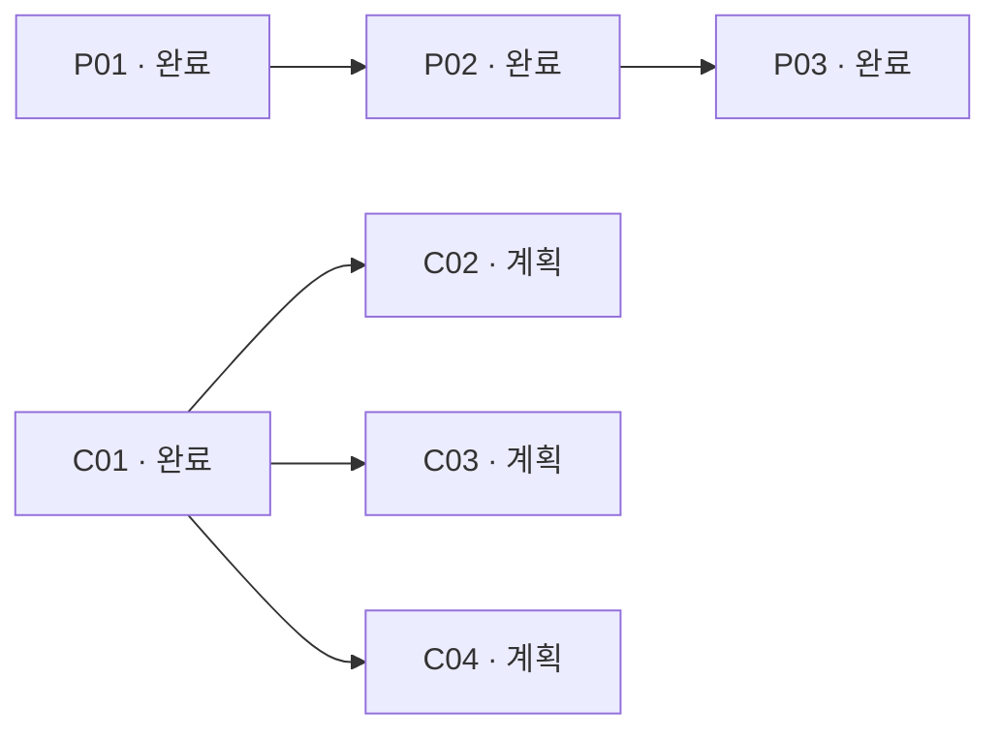

# USL 표준 그래프 엔지니어링 현황

이 문서는 기존 작업 그래프에서 자동 생성한 **SECONDARY_AI 현황 뷰**다. 사용자 원문은 그래프의 USER_PRIMARY 자원에 보존한다.

## 1. 역할과 경계

| 층 | 책임 |
|---|---|
| USL 문법 | Resource·Meaning·이름 있는 Participant·Link·출처를 보존하는 단순 바인딩 |
| core CLI / SDK | 선언·구조 검사·연결 탐색·명시적 표현 선택·compact 문맥 전달 |
| 선택 profile | 사용자가 선택한 역할 타입·필수 metadata 검사 |
| 소비자 프로그램 / 애드온 | 가중치 해석·갱신, 계층 알고리즘, M 색인, HSWM 규칙과 실행 |

자원의 ID와 로컬 경로·GitHub·고정 revision 표현을 구분한다. 경로 이동은 workspace mapping으로 처리하며, 여러 표현은 명시적으로 선택한다.

## 공유 KG와 최신 현황

로컬 탐색 브리지는 공유 KG의 sym:Concept:usl와 저장소 subject:usl을 연결한다. 이는 **SECONDARY_AI 로컬 탐색 주장**이며 두 대상을 동일한 엔터티로 선언하지 않고, 원본 KG 개념의 속성을 변경하지 않는다.

현재 결정 user:binding-only, user:addon-rules, user:cli-programs, user:compression-cost 및 작업 task:P01, task:P02, task:P03, task:C01, task:C02, task:C03, task:C04는 subject:usl에서 관계로 탐색한다. 따라서 sym:Concept:usl → subject:usl → task:C02 및 sym:Concept:usl → subject:usl → user:binding-only 질의를 수행할 수 있다.

공유 KG에는 노트 sym:Note:chatgpt-usl-current-state-2026-10-01가 **PUBLISHED_DRAFT**로 저장되고 ABOUT 관계가 **PROPOSED**로 기록되었다. 작성 주체/권위 분류는 SECONDARY_AI, 범위는 PENDING_OR_PRELIMINARY, 검토 필요 상태다. 정전 승인·ACTIVE 관계·원본 사용자 기록의 최신화는 주장하지 않는다. 로컬 검증 입력은 research/architecture/kg-bridge.json 및 research/architecture/kg-bridge.publication.json이다.

## 2. 작업 상태와 선행 관계

아래 화살표는 **선행 작업 → 후속 작업**이다. 저장된 task_depends_on 관계는 task → prerequisite 방향이며, 그림은 읽기 편하게 그 반대로 표시한다.



| 작업 | 내용 | 상태 | 선행 작업 | 검증 / 증명 |
|---|---|---|---|---|
| P01 | 단순 바인딩의 기초 계약 점검 | COMPLETED | 없음 | 로컬 PASS 기록 / NOT_PROVEN |
| P02 | 선택형 애드온 규칙을 연결하는 방법 정리 | COMPLETED | P01 | 로컬 PASS 기록 / NOT_PROVEN |
| P03 | CLI 최소 사용 흐름과 호환 예제 검증 | COMPLETED | P02 | 로컬 PASS 기록 / NOT_PROVEN |
| C01 | Main entry help and command-family contracts | COMPLETED | 없음 | 로컬 PASS 기록 / NOT_PROVEN |
| C02 | Adapted context traversal and compact-delivery parity | PLANNED | C01 | 구현 전 / NOT_PROVEN |
| C03 | Bounded pure-core stdin/file pipeline | PLANNED | C01 | 구현 전 / NOT_PROVEN |
| C04 | Built package-bin compatibility gate | PLANNED | C01 | 구현 전 / NOT_PROVEN |

**현재 선행 조건이 충족된 미완료 작업: C02, C03, C04.** 이는 작업 순서 판정이며 외부 실행 권한을 부여하지 않는다.

C02·C03·C04 사이의 추가 선행 관계는 선언되어 있지 않다. 실제 작업 시 겹치는 파일의 변경을 조정한다.

## 3. 관계의 타입과 역할

| 관계 | 이름 있는 역할과 대상 타입 | 뜻 |
|---|---|---|
| planned_work | task: Task / criterion: AcceptanceCriterion / requirement: UserStatement | 작업·수용 기준·사용자 요구의 추적 |
| completed_by | task: Task / criterion: AcceptanceCriterion / evidence: VerificationReceipt | 작업·수용 기준·실제 검증 기록의 연결 |
| planned_evidence | task: Task / artifact: Artifact | 계획 판단에 참고한 현재 소스; 미래 구현 완료 근거와 구분 |
| task_depends_on | task: Task / prerequisite: Task | 작업의 선행 조건; 이 관계의 작업 그래프만 순환 금지 |
| measured_by | requirement: UserStatement / technique: CompressionTechnique / benchmark: BenchmarkArtifact | 압축 요구·기법·오프라인 측정 결과의 연결 |
| describes_subject | subject: ArchitectureSubject / external: ExternalSubject | 저장소 subject와 외부 KG subject 사이의 로컬 탐색 연결; 동일성·공유 KG 활성 관계는 주장하지 않음 |
| current_decision | subject: ArchitectureSubject / statement: UserStatement | 저장소 subject에서 보존된 USER_PRIMARY 결정으로의 로컬 탐색 연결 |
| tracks_work | subject: ArchitectureSubject / task: Task | 저장소 subject에서 계획·완료 작업으로의 로컬 탐색 연결 |
| published_note | record: Source / external: ExternalSubject | 공유 KG에 저장된 SECONDARY_AI 초안 노트와 대상의 읽기 전용 기록; PROPOSED 상태를 보존 |

각 연결 안에서 표의 역할은 정확히 하나씩 필요하고 추가 역할은 허용하지 않는다. 한 작업에는 요구사항이나 선행 작업별로 여러 연결이 붙을 수 있다. 수용 기준과 완료 근거는 별도 자원으로 보존한다.

## 4. 근거와 검증 범위

- P01~P03은 [검증 기록](../research/architecture/binding-delivery.receipt.json)의 2026-10-04 로컬 명령 PASS와 파일 digest로 연결되어 있다. 이 요약의 재생성은 그 테스트 명령을 재실행하지 않는다.
- C01은 [검증 기록](../research/architecture/core-cli-c01.receipt.json)의 2026-10-04 로컬 명령 PASS, 파일 digest와 source commit `7576cf9bccea1a068f2a84f69bace3f3eb419b72`으로 연결되어 있다. 이 기록은 Lean 증명이 아니다.
- JSON-LD/RDF 교환 표현과 PROV-O 출처 관계, SHACL 역할·타입·카디널리티 검사를 사용한다. USL 어휘와 task 상태 규약은 프로젝트 소유다.
- 별도 검증기가 현재 파일 digest, 완료 근거 연결, 작업 상태와 선행 관계의 순환 여부를 확인한다. 명령 기록은 서명된 실행 증명이나 원격 상태 관측이 아니다.
- 완료된 작업은 해당 수용 기준의 로컬 검증 기록을 뜻한다. graph-cli 제안 전체나 남은 계획 작업의 완료를 뜻하지 않는다.
- 기존 [Lean 모델의 증명 범위](LEAN4_INTEGRATION.md)와 이번 작업의 NOT_PROVEN을 구분한다. CLI 외부 효과·토큰 비용에 새 증명을 추가하지 않았다.
- [압축 측정](COMPACT_SYNTAX_RESEARCH.md)은 bytes와 encoding별 tokens를 구분한다. 실제 heap·API 청구액·모델 품질은 미측정이다.

## 5. 탐색과 재현

| 확인할 질문 | 읽을 자료 |
|---|---|
| 코어와 프로그램의 책임은? | [아키텍처](SYNTAX_CLI_GRAPH_ARCHITECTURE.md) |
| 무엇을 완료했나? | [P01~P03](HSWM_LIKE_EXECUTION_PLAN.md) · [애드온 예제](ADDON_BINDING.md) |
| 다음 변경 파일과 완료 조건은? | [C01~C04 계획](CORE_CLI_PLAN.md) |
| 공유 KG sym:Concept:usl에서 최신 로컬 근거는? | [bridge](../research/architecture/kg-bridge.json) · [publication readback](../research/architecture/kg-bridge.publication.json) · [아키텍처](SYNTAX_CLI_GRAPH_ARCHITECTURE.md#공유-kg와-최신-현황-찾기) |
| 기계가 읽는 원본은? | [resource graph](../research/architecture/syntax-cli.graph.json) · [JSON-LD](../research/architecture/syntax-cli.graph.jsonld) · [profile](../research/architecture/syntax-cli.profile.json) · [SHACL](../research/architecture/syntax-cli.shacl.ttl) |

```sh
node --import tsx scripts/build-syntax-cli-architecture.ts --check
python3 scripts/validate-syntax-cli-architecture.py
```

SHACL 검사는 scripts/requirements-standards.txt를 설치한 Python 환경을 사용한다. 원본 catalog/plan 수정 후 generator를 --check 없이 실행하면 그래프와 이 문서를 함께 갱신한다.

그래프 digest: `sha256:c45a5825d822301789713fcbcfcf364c27d43d3429b85dec87aaabb3feaf6071`.
