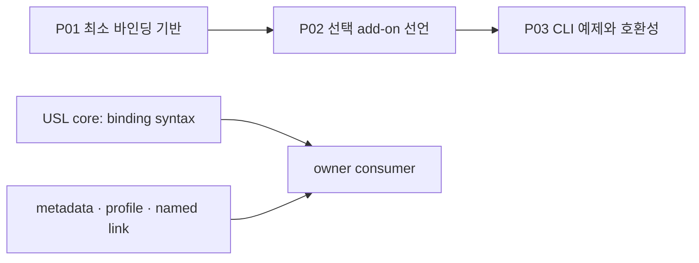

# USL 단순 바인딩과 선택 add-on 계획

2026-09-29 사용자 정정 뒤의 축소 계획이다. 다음 사용자 원문이 이 문서의
범위를 정한다.

> “아니 USL 은 단순 연결이라니까 너무 많은걸 하지말아 그 기초는 가능하도록 만 해주면돼 ㅇㅇ 그 규칙은 에드온처럼 심고”

> “그거를 할수 있게끔하는 단순 바인딩 문법이잖아 USL 은 ㅇㅇ;”

USL 코어는 자원과 의미, 이름 있는 참여 역할을 연결하는 문법·구조 검사·참조
보존 계층이다. HSWM 규칙을 포함해 어떤 도메인 규칙도 선택 add-on으로 붙인다.
이 순서와 구체적 수용 기준은 **SECONDARY_AI 계획**이며, 위 원문은
**USER_PRIMARY** 방향이다.

2026-09-29: P01~P03의 문서·예제·CLI 검증을 완료했다. 기초 계약 문서의 단항
문법표를 수정하고, [선택 규칙 graph/profile](ADDON_BINDING.md)과 CLI 회귀 예제를
추가했다. [검증 기록](../research/architecture/binding-delivery.receipt.json)은
실제로 통과한 명령과 해당 파일의 digest를 보존한다.

2026-09-30: 메인 CLI의 C01 도움말·명령군 계약을 완료했다.
후속 C02~C04는 [core CLI 계획](CORE_CLI_PLAN.md)에 남아 있다.



## P01 — 최소 바인딩 기반 확인과 계약

USL의 최소 단위는 `Resource`, `Meaning`, `Link`, 이름 있는 `Participant`다.
link는 다자 연결을 보존하며, Resource의 stable ID는 경로나 URL 같은
representation과 다르다. worktree 이동, 로컬 경로와 GitHub 표현의 병존은
binding 선택 문제이지 의미 ID를 새로 만드는 사유가 아니다.

완료 기준은 다음과 같다.

- `.usl`과 `resource-graph/v1`가 resource/meaning/link와 중복되지 않는 역할을
  구조적으로 검사한다.
- stable ID와 여러 representation/binding의 구분, 명시적 선택, 기존 locator와
  profile 경계가 문서·fixture에서 유지된다.
- 구조 검사가 사실성·원격 접근·실행 권한을 주지 않는다는 경계가 유지된다.

P01은 [언어](LANGUAGE.md), [resource bindings](RESOURCE_BINDINGS.md),
[`test/navigation.test.ts`](../test/navigation.test.ts)의 기존 계약을 점검한다.

## P02 — 선택 add-on 규칙 선언

도메인 규칙은 existing metadata, optional profile, named meaning/link로
선언한다. 예를 들어 HSWM 관련 제약, 가중치, 상하위 관계, 색인 힌트는 add-on
소유자가 resource·link의 metadata와 profile 역할 계약으로 표현할 수 있다.
USL 코어는 generic structural/profile constraint만 검사하고, 의미를 평가하거나
규칙을 실행하지 않는다.

P02 산출물은 `docs/ADDON_BINDING.md`, `examples/fixtures/addon-binding.json`,
`examples/fixtures/addon-binding.profile.json`이다.
owner consumer가 add-on의 뜻을 해석하고, 필요하다면 별도 저장소·인덱스·실행기
또는 정책을 제공한다. 현재 실제 공백이 확인되기 전에는 새 loader, registry,
자동 설치·실행 engine, DSL, 가중치 엔진, hierarchy traversal, M map,
feedback/learning pipeline을 USL 코어 작업으로 추가하지 않는다.

완료 기준은 add-on 선언이 기존 core input과 호환되고, core가 모르는 metadata를
사실·권한·실행으로 승격하지 않으며, consumer가 없을 때도 단순 binding 사용이
그대로 동작하는 것이다.

## P03 — 단순 CLI 예제와 호환성

CLI는 기존 `check`, `compile`, `context`, `adapt`, `locate`, `bind-graph`를 통해
같은 stable ID와 명시 representation을 다룬다. P03은 `docs/CLI.md`,
`docs/ADDON_BINDING.md`, `examples/fixtures/addon-binding.json`에서 fixture를
읽어 구조를 검사하고, ID를 지정해 context를 조회하며, 선택한 binding 결과를
보여 주는 정도로 제한한다.

```sh
npm run usl -- adapt --format resource-graph \
  --graph examples/fixtures/resource-graph.json --namespace demo --operation check
npm run usl -- adapt --format resource-graph \
  --graph examples/fixtures/resource-graph.json --namespace demo --operation context \
  --focus example:spec --target example:proof --compact
```

완료 기준은 기존 명령·JSON 호환성과 문법/구조 검증 범위를 보존하는 것이다.
Lean의 기존 증명 범위는 추상 연결 구조·역할·탐색 계약이며, add-on 규칙의
의미적 참이나 owner의 관측·실행 효과를 증명했다는 주장은 하지 않는다.

## add-on의 책임 경계

가중치의 평가·갱신, 계층 탐색, M 인덱스, 결과 피드백/학습, HSWM별 규칙은
**ADD-ON RESPONSIBILITY**다. 필요해지면 해당 owner consumer가 규칙·저장 방식·
권한·검증을 정하고 USL의 기존 binding을 입력으로 사용한다. ordinary binding에
HSWM gate나 원격 접근 확인을 필수로 추가하지 않는다.

이전의 넓은 HSWM-like 구현안은 [상위 초안의 대체 기록](SYNTAX_CLI_GRAPH_ARCHITECTURE.md#축소된-범위와-대체된-제안)에 보존한다. 현재 작업 순서는 이 문서의 P01 → P02 → P03이다.

## 작업 그래프

[계획 catalog](../research/architecture/hswm-like.plan.json)를 기존
[resource graph](../research/architecture/syntax-cli.graph.json)와
[JSON-LD](../research/architecture/syntax-cli.graph.jsonld)로 연결했다.
`planned_work(task, criterion, requirement)`는 작업·완료 기준·사용자 요구를,
`task_depends_on(task, prerequisite)`는 선행 조건을 표현한다. 각 역할은 연결마다
하나이며 순환 금지는 작업 선행 관계에만 적용한다. profile·SHACL·계획 상태
검사는 이 계획의 일관성을 확인한다. P01~P03은 `COMPLETED`이며
`completed_by(task, criterion, evidence)`로 검증 기록을 연결한다. 이는 해당
예제와 유한 검증의 완료이며 새 Lean 증명을 뜻하지 않는다. C01은 별도 검증
기록으로 `COMPLETED`이고, C02~C04는 `PLANNED` 상태와 C01 선행 관계를 보존한다.
