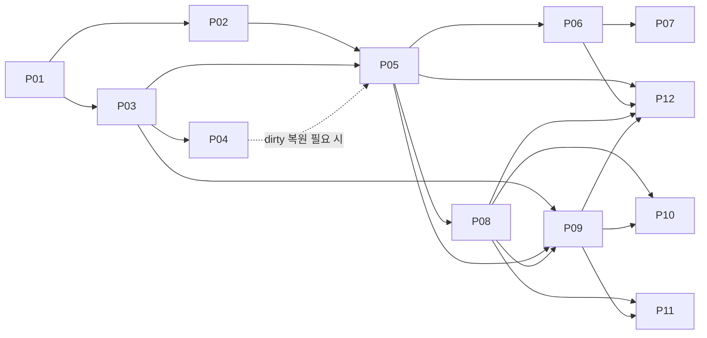

# USL native 개발 그래프

Git·URL·작업환경 이동·필수 읽기·조합 확률·HSWM W·입체운행구름 연구를 **사용자 원문 → 요구사항 → 개발 작업 → 근거 → 수용 기준**으로 연결한 로컬 개발 계획이다. [plan.json](../research/native-development/plan.json)이 편집 원본이며, 현재 요구사항 10개, 작업 12개, 성공·적대적 수용 명세 24개를 가진다. [graph.json](../research/native-development/graph.json)은 USL에서 탐색하는 생성물이다.

새 작업은 모두 `PLANNED`, 수용 명세는 모두 `SPECIFIED_NOT_RUN`이다. 기존 구현은 재사용 근거로 연결했다. 이 계획의 구조 검증 통과가 미래 기능 구현 완료를 뜻하지 않는다. 이번 실제 검증은 [verification.json](../research/native-development/verification.json)에 별도로 기록한다.

## 목표와 요구사항

위치와 리소스의 정체성을 분리하고, owner가 선택한 환경 프로필 하나를 바꿔 로컬 경로·Git checkout·URL representation을 해석한다. 전환 후에는 내용 pin과 실행 문맥을 다시 확인한다. 영구 ID가 있어도 없어진 파일·접근 불가능한 서버를 복구하지는 못하므로, 필요한 내용의 백업·복원·가용성은 별도 검증 대상이다.

| 요구 | 개발에서 보장할 범위 | 담당 작업 |
|---|---|---|
| R01 위치 독립 ID | resource/representation ID·role·provenance 보존 | P01, P03, P05 |
| R02 단일 프로필 전환 | 불변 snapshot, generation, CAS, 이전 handle 무효화 | P01, P02, P05, P12 |
| R03 Git·파일 native 관측 | worktree·common-dir·HEAD/ref·dirty·object-format·file pin | P03, P05 |
| R04 dirty 상태 이동 | 지원하는 clean bundle + raw-state sidecar 복원 | P04 |
| R05 URL·GitHub 연결 | HTTP 응답/캐시와 Git 객체 및 서비스 identity 분리 | P06, P07, P12 |
| R06 필수 읽기 | 정확한 원문 전달·ack·필요한 evaluator 결과 | P08, P10, P12 |
| R07 통제된 실행 | fresh admission 소비, 사전/효과 영수증, 불명 결과 처리 | P01, P09, P10, P12 |
| R08 선택 확률 | 필수 항목 고정, optional 전체 조합의 실제 π 기록 | P08, P11 |
| R09 HSWM W 검토 | 범위·역할·목표·비용과 독립 holdout, review-only | P11 |
| R10 입운구 접합 | owner projection과 bounded read-only pilot | P12 |

`KG에도 웨이트를 표현할 수 있다.` 여기서 추가하는 것은 웨이트 유무만이 아니라, 규칙의 타입·적용 범위·실행 경로·측정 근거·실패 판정을 함께 연결하는 개발 계약이다. RDF/SHACL/PROV를 사용하는 이 계획을 모든 그래프 기술의 상위호환으로 선언하지 않는다.

## 개발 순서와 완료 조건

| 작업 | 선행 조건 | 낼 결과 / 기존 기반과의 차이 |
|---|---|---|
| **P01 계약·fixture** | 없음 | 기존 binding/checkout/CLI receipt를 profile·admission 계약으로 연결하는 스키마와 고정 digest fixture |
| P02 profile registry | P01 | owner 저장소의 단조 generation·CAS·handle 소비·재시작 계약 |
| P03 native observation | P01 | 기존 Git/file probe의 공통 envelope와 capability·freshness 기록 |
| P04 dirty 이동 | P03 | 기존 CP01–03 bundle/sidecar 복원을 프로필 전환에 연결 |
| P05 단일 전환 controller | P02, P03 | root mapping/rebind에 aggregate profile generation·CAS를 연결 |
| P06 HTTP adapter | P05 | bounded HTTP observer에 캐시 문맥·validator·freshness 추가 |
| P07 GitHub adapter | P06 | Git local-object resolver와 분리된 service identity·scope adapter |
| P08 required delivery | P05 | 순수 policy 결과를 실제 loader/invocation 전달 영수증에 연결 |
| P09 action dispatcher | P03, P05, P08 | 기존 CLI preflight/recheck/dedup에 profile·delivery·evaluator pin 연결 |
| P10 agent bridge | P08, P09 | 한 harness의 instruction load·compaction·sub-agent·tool 경로 계측 |
| P11 확률·W review | P08, P09 | 기존 full-coalition ticket producer와 독립 outcome/holdout을 review bridge에 연결 |
| P12 입운구 pilot | P05, P06, P08, P09 | 자료 1개와 등록된 local read-only action 1개의 종단 trace |



P12에서 GitHub API, agent harness, W 검토를 사용할 때만 각각 P07/P10/P11이 추가 선행 조건이다. 조건부 간선에는 조건 문장을 보존하며 일반 의존성과 구분한다. P01이 첫 작업이라는 뜻은 구조상 선행 작업이 없다는 뜻이다. 이후 owner 접근이나 외부 실행을 허가하는 의미는 없다.

P01은 네트워크·실제 HSWM 실행 없이 순수 계약과 host test-double로 시작할 수 있다. 각 작업에는 `ownerBoundary`, `deliverable`, `remaining`, 기존 `groundedIn` 근거, 성공/적대적 테스트가 있다. 완료 처리 시에는 실제 실행 명령·버전·입력 pin·결과 영수증을 새 증거로 추가하고 그래프/shape 버전을 함께 갱신한다. 지금 shape의 `PLANNED`를 임의로 `DONE`으로 바꾸면 검증이 실패한다.

## 강제성, 확률, W의 계약

| 개념 | 담당 | 구별할 점 |
|---|---|---|
| Required constraint | host/evaluator | 후보 모두가 만족해야 한다. 자료 누락·미상·미지원·예산 초과는 HOLD |
| Soft coefficient | rule policy | 권고/위반 비용의 계수이며 읽기 확률 자체가 아님 |
| Selection probability π | sampler | 필터 후 **전체 조합**의 실제 선택 확률. 개별 항목 확률을 곱해 추측하지 않음 |
| Context-dependent W | HSWM owner learner | 기록된 범위·역할·결과·비용에서 얻는 학습/검토 결과 |
| Authority | resource/host owner | 위 숫자들과 독립. W가 필수 규칙·접근 권한을 자동 변경하지 않음 |

사용자의 “주어진 범위에서 CHU의 최적화 정도를 본다”는 관점은 [원문](../research/native-development/request.json)에 보존했다. 실제 수치에는 범위·목표·비용·관측과 비교 기준이 필요하다. 현 tabular/고정 조합/holdout W 구현은 한정된 운영 지표의 근거이며, HSWM 전체의 유일한 공식·최적성 증명이 아니다.

필수 읽기 영수증은 정확한 자료 전달/ack의 증거다. 모델의 이해·준수는 그것만으로 증명되지 않는다. 규칙 평가는 별도 evaluator로, 실행 강제성은 owner가 통제하는 dispatch 경로로 구현한다. 외부 효과까지 포괄하는 범용 원자성은 주장하지 않는다. 기존 `INDETERMINATE`와 계획상 `UNKNOWN`의 매핑을 명시하며 불명 결과는 owner reconcile 전 자동 재시도하지 않는다.

## 그래프 계약과 표준 교환

타입 namespace는 로컬 `urn:usl:native-development:`이다. 새 ontology 표준 등록이나 KG canon 변경은 하지 않았다. 기존 사용자 source ID와 N1–N6 work ID는 유지하고, 세분화한 P 작업을 `refines`로 연결한다. 편집 원본의 JSON Pointer와 파일 byte digest가 각 노드의 locator를 해석한다.

| 간선 | 방향과 domain → range | 계획에서 필요한 수 |
|---|---|---|
| `derivedFrom` | Requirement → UserSource | 요구당 1개 이상 |
| `realizes` | WorkItem → Requirement | 작업당 1개 이상, 모든 요구에 작업 존재 |
| `verifiedBy` | WorkItem → AcceptanceTest | 작업당 긍정·적대적 명세 각각 1개 이상; 각 명세는 작업 1개 소유 |
| `groundedIn` | WorkItem → Artifact | 작업당 1개 이상; 구현 완료 주장이 아님 |
| `dependsOn` | WorkItem → WorkItem | 0개 이상, 순환 금지 |
| `conditionallyDependsOn` | WorkItem → WorkItem | 0개 이상, 조건 필수; 전체 의존성과 함께 순환 검사 |
| `constrainedBy` | WorkItem → Constraint | 작업당 1개 이상 |
| `refines` | WorkItem → PriorWork | 작업당 1개 이상; 기존 연구를 수정하지 않음 |
| `originallyDeclaredIn` | PriorWork → Artifact | 원래 연구당 1개; 당시 graph의 selector·revision·digest 보존 |

각 간선의 두 역할은 정확히 한 번씩 존재하고 추가 역할은 허용하지 않는다. [profile.json](../research/native-development/profile.json)이 USL role/type/authority/status를 검사한다. 전체 coverage·DAG·원문 digest는 builder와 테스트가 검사한다.

- [graph.jsonld](../research/native-development/graph.jsonld): 기존 USL exporter가 만드는 role 선언 및 PROV 교환물. native ID를 별도 필드로 보존한다.
- [trace.jsonld](../research/native-development/trace.jsonld): 같은 ID와 선언을 RDF 직접 속성으로 투영한다. 출처 관계는 PROV derivation도 기록한다. 조건부 의존성은 별도 조건 노드로 한정한다.
- [shapes.ttl](../research/native-development/shapes.ttl): 실제 RDF 데이터에 적용하는 SHACL shape. 현재 계획 상태와 domain/range/required properties를 검사한다.
- [references.json](../research/native-development/references.json): 원문 코드/연구 30개 byte pin과 앞선 조사에서 검토한 공개 문서 11개. build는 pin을 자동 갱신하지 않는다.

Git 연구의 9개 실행 결과는 설치된 Git **2.47.3**의 당시 관측이다. Git **2.56.0**은 별도로 수집한 선택 소스의 버전이며 전체 clone/build 실행 근거가 아니다. HSWM W 소스 중 미커밋 파일은 `LOCAL_UNTRACKED_SNAPSHOT`으로 표시했다. 저장소 HEAD가 그 파일 내용을 보증하지 않는다.

## 재현과 이동

```bash
python3 scripts/build-native-development.py --check
python3 scripts/build-native-development.py --self-test
TSX_DISABLE_CACHE=1 TMPDIR=/dev/shm node --import tsx --test test/native-development-plan.test.ts
python3 scripts/validate-native-development.py
npm run typecheck
python3 scripts/check-docs.py
```

RDF validator에는 [고정 의존성](../scripts/requirements-standards.txt)의 `rdflib`/`pyshacl` 환경이 필요하다. validator는 설치 작업을 하지 않는다. sibling 연구/HSWM 저장소가 명시적으로 준비된 환경에서는 `python3 scripts/build-native-development.py --check --check-evidence`로 30개 원본 pin까지 대조할 수 있다. 추적된 자료는 현재 worktree와 독립된 **고정 Git revision의 blob**으로, 미커밋 자료 9개는 당시 byte pin과 현재 파일로 비교한다. 원래 N1–N6의 selector가 같은 ID를 가리키는지도 확인한다. 이 옵션의 기본 source roots는 USL과 같은 부모 아래의 repository aliases다. 다른 환경에서는 먼저 해당 source roots를 준비해야 하며, 이 추가 검사가 실패해도 기본 계획의 로컬 탐색과 구분해서 해석한다.

USL 탐색 예시:

```bash
TSX_DISABLE_CACHE=1 TMPDIR=/dev/shm node --import tsx src/cli.ts adapt \
  --format resource-graph --graph research/native-development/graph.json \
  --profile research/native-development/profile.json \
  --namespace usl.native.development --operation context \
  --focus urn:usl:dev:req:R06 --target urn:usl:dev:work:P08 --compact
```

[connection.json](../connections/native-development/connection.json)은 `allowedLocators: []`, `programs: {}`인 metadata 탐색용 연결이다. 실제 코드/URL 읽기 권한을 추가하지 않는다. [host.json](../research/native-development/host.json)의 `workspaces.usl`과 [bindings.json](../research/native-development/bindings.json)은 계획/원문/근거 목록의 로컬 representation을 해석하며 `actions: []`다. 전체 USL checkout을 옮기면 상대 root가 유지된다. 경로 구조가 달라지면 로컬 host mapping만 바꾼다.

이번 root 전환 테스트는 이 개발 그래프의 ID·링크·metadata·선택 representation 보존을 검증한다. 실제 개발 환경의 원자적 전환, 모든 Git 상태 이전, 여러 컴퓨터의 종단 실행은 P 작업의 미래 수용 기준이다.
