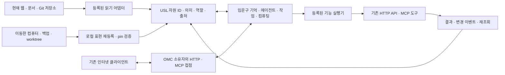

# 입체운행구름 · USL · 현재 인터넷 접합

2026-10-10의 사용자 요구를 개발 구조로 옮긴 **로컬 설계 제안**이다.
입체운행구름(OMC)의 자원·작업·기억을 USL로 연결하고, 기존 웹·API·저장소와
정보 및 기능을 주고받는 것이 목표다. 공개 OMC endpoint 배포나 외부 서비스
연결 완료를 뜻하지 않는다.

## 사용자 원문과 식별

[원문 기록](../connections/omc-internet/request.json)은 이번 인터넷 접합 요구와
앞선 컴퓨터·백업·작업환경 이동 요구를 그대로 담는다. `textDigest`는 추가
줄바꿈 없는 UTF-8 `text` 값의 SHA-256이다. `recordedAt`은 기록 시각이며
알 수 없는 발화 시각은 `utteredAt: null`로 남겼다.
그래프의 원문 자원에는 `request.json` 전체 바이트의 `documentDigest`와
`/sources/0`, `/sources/1` JSON Pointer를 함께 두어 해당 발화를 정확히
선택한다. 이 selector를 실제로 읽는 일은 owner adapter의 책임이다.

OMC는 기존 UID `sym:Character:입체운행구름`을 재사용한다. KG에서 확인한
기존 entity의 authority는 `UNSPECIFIED`이며, 그것을 새 구현의 승인으로
해석하지 않는다. 원문에만 `USER_PRIMARY`를 붙이고 아래 요구사항 분해,
아키텍처, 작업 순서는 `SECONDARY_AI / PROPOSED`로 기록했다. 공유 KG에는
게시하지 않았다.
KG authority 표시는 이 작업 때 조회한 내용이며 원격 응답을 보관·서명한
증거 또는 이후에도 유효한 live KG 판정을 뜻하지 않는다.

## 접합 구조



화살표는 목표 데이터 흐름이다. USL은 소유자의 원문·서비스를 연결하는
공통 문법과 검증 경계다. 원문 저장, 인증, 네트워크 접속, 스케줄링, 실제
실행과 상태 저장은 각 owner/host가 담당한다. P2P 컴퓨팅을 추가하더라도
일반 HTTPS·Git·API 연결을 계속 사용할 수 있도록 전송 방식과 의미 ID를
분리한다.

예를 들어 입운구가 웹 문서를 참고해 작업한다면 `문서 ID → 이번에 읽은
표현/revision → 출처 있는 관측 → 작업 → 실행 결과`를 연결한다. 문서가
갱신되면 새 관측을 추가한다. 컴퓨터가 바뀌면 로컬 표현의 위치를 재등록한다.
같은 URL의 내용이 바뀌거나 같은 파일이 복제됐다는 사실만으로 다른 자원을
같은 ID로 합치지 않는다.

## 현재 사용할 수 있는 것

아래 소스 검토 기준은 `25a1489a944b830d34eb1ec1f9b251d80848931f`다.
코드가 있다는 사실과 OMC에서 실제 운용된다는 사실을 구분한다.

| 접점 | 현재 USL 기능 | OMC에서 더 연결할 부분 |
| --- | --- | --- |
| 내부 연결 | [resource graph](RESOURCE_GRAPH.md), owner UID, 이름 있는 다자 역할, JSON-LD/PROV 출처 | 각 OMC owner의 실제 bounded projection |
| 인터넷 읽기 | [URL resolver](../src/resolve.ts): 실제 HTTP(S) GET, 허용 주소·redirect 검사, timeout/byte cap, hash·조회 시각 | 첫 endpoint 등록, 원문을 활용할 read adapter, 갱신 정책 |
| API·도구 호출 | [capability 계약](ENGINEERING_CONTRACTS.md): OpenAPI 3.1.x 일부/MCP tools 목록 import, 명시적 host executor | 서비스별 HTTP/MCP driver, 인증, 입력·출력 매핑 |
| 외부에서 OMC 이용 | [현재 MCP](MCP.md)는 로컬 stdio 연결 | 소유자가 운영하는 원격 HTTP/MCP 접점과 접근 범위 |
| 변경·결과 환류 | 출처·관측·작업 관계를 그래프로 표현 | polling/webhook 수신, 누락 대조, 중복·순서 제어 |
| 환경 이동 | [bindings](RESOURCE_BINDINGS.md), [메모리 이동 CAS](MEMORY_RELOCATION.md), Git/worktree 검사 | 실제 OMC owner store·목적지 등록과 여러 host의 통합 검증 |

기존 [metahumocoin 참여 연결](../connections/metahumocoin/README.md)의
`metahumocoin-participation-v1`도 재사용한다. 이 연결은 owner가 내보낸
스냅샷을 탐색하며, 기본 `allowedLocators: []`다. 여기서 OMC를 찾았다고
원격 OMC 프로세스에 접속한 것은 아니다.

현재 URL 관측 결과는 주소·hash·조회 시각 중심이다. 원문 body를 OMC의
추론 입력으로 넘기거나 ETag 캐시를 운용하는 전체 수집기는 아직 없다.
HTTP 성공은 그때의 응답 관측이며, 이후 가용성·내용의 진실·소유권이나
HSWM 최적화 성능을 보증하지 않는다.

<a id="development-sequence"></a>

## 개발 순서

| 작업 ID | 구현할 결과 | 완료를 판단할 검증 |
| --- | --- | --- |
| `omc:work:identity` | 기존 OMC UID 아래 기억·작업·도구·계산 자원의 owner projection 연결 | 실제 subject·역할·원문 출처를 질의하고 AI 해석과 구분 |
| `omc:work:web` | 소유자가 정한 공개 HTTPS 자원 1개부터 읽기·내용 활용·재검증 연결 | 성공, 허용 밖 redirect, 변경 응답, 404/410, timeout, 용량 초과, stale 구분 |
| `omc:work:actions` | 외부 기능 1개의 고정 executor와 필요한 OMC 공개/인가 접점 | 계약·scope 검사, 실제 결과 대조, 쓰기 timeout 뒤 중복 실행 방지 |
| `omc:work:feedback` | 결과와 외부 변경을 원래 작업·자원에 환류 | 중복·역순 이벤트, webhook 누락, 재조회, 철회·인증 만료 |
| `omc:work:mobility` | 다른 컴퓨터에서도 같은 ID로 원문·도구를 다시 선택 | 원본 부재, 다른 revision, 동시 갱신, worktree 분기, 로컬 재등록 |

이 순서는 첫 관통 동작을 작게 만드는 제안이다. 그래프의 `dependsOn`은
**개발 선행 관계**이며 실제 프로그램의 실행 의존성을 선언하지 않는다.
`identity` 다음 `web`, 그다음 `actions`와 `feedback`을 진행하고,
`mobility`는 `identity` 이후 독립적으로 연결할 수 있다.

첫 운영 연결에 필요한 구체 값은 OMC owner, endpoint, 읽을 내용, 허용
scope, 갱신 주기와 보관 정책이다. 이번 요구에 특정 endpoint가 없으므로
추측한 OMC URL·인증정보를 만들지 않았다. 이 값들이 정해지면 기존 resolver와
host callback을 연결하는 범위부터 시작할 수 있다.

후속 관측 레코드에는 최소한 `resourceId`, owner, 요청/최종 locator,
`revision` 또는 응답 digest, `observedAt`, `checkedAt`, freshness 상태와
근거, 연결 scope를 남긴다. HTTP validator는 해당 표현의 재검증에 쓰며
전역 자원 ID로 쓰지 않는다. 캐시 재사용은 서버 정책을 따르고, 네트워크가
끊기면 마지막 관측과 현재 접속 상태를 따로 표시한다.

외부 변경은 owner와 event ID로 중복을 구분하고 owner revision/generation으로
순서를 대조한다. 중복 방지 저장은 host가 책임진다. 웹에서 읽은 지시문이
실행 권한을 늘려서는 안 된다. 새 컴퓨터에서는 endpoint·credential·workspace
root를 그 host의 정책으로 다시 결속한다. 결과에서 측정한 비용·지연·정확도는
HSWM W 평가의 입력 후보이며, 연결 수 자체를 최적화 점수로 취급하지 않는다.

## 조회·검사 가능한 연결 그래프

[graph.json](../connections/omc-internet/graph.json)은
`usl-resource-graph/v1`이고 [profile.json](../connections/omc-internet/profile.json)은
역할·타입·권한 구분을 검사한다. [고정 connection 설정](../connections/omc-internet/connection.json)의
ID는 `omc-internet-design-v1`이다. 기존 USL SDK·CLI·MCP에서 읽을 수 있다.

| meaning | 방향과 역할 | 카디널리티·의미 |
| --- | --- | --- |
| `interprets` | UserSource `source` → Requirement `requirement`, System `subject` | 링크마다 각 역할 정확히 1개. AI의 요구사항 해석 |
| `addresses` | WorkItem `work` → Requirement `requirement` | 각 역할 1개. 작업이 다루는 요구, 완료 주장이 아님 |
| `groundedIn` | WorkItem `work` → Evidence `evidence` | 각 역할 1개. 참고한 코드·표준, 배포 증거가 아님 |
| `dependsOn` | WorkItem `work` → WorkItem `prerequisite` | 각 역할 1개. 계획의 비순환 선행 관계 |

하나의 자원에는 여러 링크가 붙을 수 있다. 역방향 탐색에서도 역할은
그대로 유지한다. `profile`은 참여 자원의 타입·authority·계획/미배포 상태를
검사한다. 링크 자체의 `SECONDARY_AI / PROPOSED` metadata와 기대한
요구→작업→근거, 선행 관계는 테스트에서 확인한다. 이 도메인 어휘는
USL의 로컬 어휘이며 표준 자체에 새 관계를 등록한 것은 아니다.

신규 원문·설계 자원의 `file://usl-document-root/...`는 **locator template**이다.
이 호스트명을 실제 컴퓨터로 가정하지 않는다. 원문을 읽을 때는 기존
`bind-graph`/owner `read` 경로에서 로컬 workspace에 결속해야 한다. 코드 근거는
기존 commit의 Git locator와 파일 digest를 사용하고, 표준 자료에는 실제
공개 URL을 사용한다. metadata 탐색에는 원문 locator 읽기가 필요 없다.
기본 connection의 읽기 허용 목록은 비어 있으며, 새 endpoint를 배포하지 않는다.

```sh
npm run usl -- adapt --format resource-graph \
  --graph connections/omc-internet/graph.json \
  --profile connections/omc-internet/profile.json \
  --namespace omc.internet.design.v1 --operation check

npm run usl -- adapt --format resource-graph \
  --graph connections/omc-internet/graph.json \
  --profile connections/omc-internet/profile.json \
  --namespace omc.internet.design.v1 --operation context \
  --focus omc:requirement:web --target omc:evidence:http --compact

npm run usl -- adapt --format resource-graph \
  --graph connections/omc-internet/graph.json \
  --profile connections/omc-internet/profile.json \
  --namespace omc.internet.design.v1 --operation jsonld
```

테스트: `node --import tsx --test test/omc-internet.test.ts`.
CLI 예제는 기본 2홉 범위에서 웹 요구→작업→HTTP 근거에 도달한다. 테스트의
SDK 질의는 `maxHops: 3`을 지정해 OMC→요구→작업→HTTP까지 확인한다.
어느 쪽도 실행·진실 판정을 부여하지 않는다. JSON-LD 출력은 기존 exporter의
RDF/PROV 매핑을 사용한다. 실제로 수행하지 않은 OMC 운영 시험이나 전체
프로토콜 호환성을 이 검사로 통과 처리하지 않는다.

## 확인한 표준 자료

- [HTTP Semantics, RFC 9110](https://www.rfc-editor.org/rfc/rfc9110.html):
  HTTPS 자원·표현·메서드·redirect·validator를 기존 인터넷과의 접점으로 사용한다.
- [HTTP Caching, RFC 9111](https://www.rfc-editor.org/rfc/rfc9111.html):
  freshness와 재검증을 분리한다. 이것이 USL에 이미 캐시가 있다는 뜻은 아니다.
- [OpenAPI 3.2.1](https://spec.openapis.org/oas/v3.2.1.html):
  2026-10-10 확인한 현행 명세. 현재 USL의 **3.1.x 일부 importer**와 버전 차이가
  있다. 3.2.1과 전체 HTTP 실행 지원은 별도 구현·호환성 검사 대상이다.
- [JSON-LD 1.1](https://www.w3.org/TR/json-ld11/):
  기존 웹/JSON 도구와 의미 연결을 교환하는 형식이다. graph export 자체가
  원격 접근이나 의미적 동등성을 보장하지 않는다.
