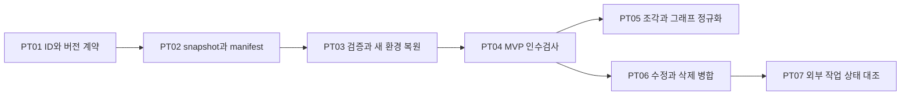

# USL 기기 이동과 백업 복원 작업 계획

다른 컴퓨터와 경로에서 메모리·작업환경을 복원해도 같은 자원과 고정 버전의 연결을 확인하는 작업 계획이다. 먼저 명시한 범위를 검증하고 재바인딩하는 MVP를 만들고, 메모리 조각 재탐색·동시 수정 병합·외부 작업 상태 대조를 후속 단계로 둔다.

이 문서는 **최초 계획의 고정 snapshot**이다. 아래 상태는 계획 수립 시점의 `PLANNED / NOT_STARTED / NOT_RUN`을 보존한다. 이후 구현·검증은 [PT01 계약 진행 기록](PORTABLE_TRANSFER.md)과 별도 검증 영수증에서 확인한다. 이 계획 그래프의 검증 범위는 출처 pin·의존성·구조다. 기존 USL 코어의 자원·의미·역할·바인딩 문법을 유지하고 별도 선택형 계약과 CLI 소비 프로그램으로 확장한다.

사용자 요청: “ㅇㅇ 해당 내용 표준그래프 엔지니어링으로 작업 계획좀 세워줘봐봐 ㅇㅇ”

사용자 원문과 AI의 구현 해석은 [기계 판독 계획](../research/portability-plan/plan.json)에 구분했다. 기존의 코어/애드온 경계는 [앞선 작업 계획](../research/architecture/hswm-like.plan.json)을 따른다.

## 현재 기반과 추가할 범위

현재 [portable bindings](RESOURCE_BINDINGS.md)는 자원 ID와 위치를 분리하고 workspace root 변경을 처리한다. [실행 기록 계약](BINDING_OPERATIONS.md)은 같은 로컬 저장소의 중복 호출을 차단한다. 복원 manifest·다중 기기 revision 병합·분산 외부 효과 보장은 추가 설계가 필요하다. 기준 소스 commit과 파일별 해시는 plan.json에 고정했다.

## 구현 순서

PT01 → PT02 → PT03 → PT04. 이후 PT05와 PT06은 병렬 가능하고 PT07은 PT06 뒤 진행한다.



| 작업 | 범위 | 선행 작업 | 완료 판단 |
|---|---|---|---|
| PT01 고정 ID와 버전 및 복원 계약 정의 | MVP | 없음 | 아래 인수기준 3개와 반례를 실제 실행 |
| PT02 일관된 백업 snapshot과 전송 명세 생성 | MVP | PT01 | 아래 인수기준 3개와 반례를 실제 실행 |
| PT03 검사 후 새 작업환경으로 복원하고 재바인딩 | MVP | PT01, PT02 | 아래 인수기준 4개와 반례를 실제 실행 |
| PT04 기기 이동과 장애 복원 인수검사 | MVP | PT01, PT02, PT03 | 아래 인수기준 3개와 반례를 실제 실행 |
| PT05 메모리 조각 재탐색과 선택적 그래프 정규화 | FOLLOW_UP | PT01, PT03, PT04 | 아래 인수기준 3개와 반례를 실제 실행 |
| PT06 다중 기기 revision 병합과 삭제 이력 | FOLLOW_UP | PT01, PT02, PT03, PT04 | 아래 인수기준 3개와 반례를 실제 실행 |
| PT07 복원된 작업 기록과 소유 시스템 상태 대조 | FOLLOW_UP | PT03, PT06 | 아래 인수기준 3개와 반례를 실제 실행 |

첫 릴리스는 PT01–PT04다. MVP는 새 복원 목적지를 사용하며 기존 환경과 자동 병합하지 않는다. 현재 owner head·철회 상태를 확인할 수 없는 offline 복원은 역사 snapshot으로 읽거나 선택한 revision에서 새 로컬 작업 분기를 시작할 수 있다. 이때 전역 최신성은 미확정으로 유지한다. 복원 자체는 외부 실행을 호출하지 않는다.

## 작업별 산출물과 인수기준

### PT01 고정 ID와 버전 및 복원 계약 정의

현재 binding v1은 문서 내부 ID 중복을 검사하지만 문서 간 namespace·revision lineage·복원 상태는 정의하지 않는다.

예정 산출물: `schemas/portable-transfer/manifest.schema.json`, `src/addons/portable-transfer.ts`. 이 경로는 향후 구현 위치 제안이며 생성 완료를 뜻하지 않는다.

- **PT01-C1:** 기존 owner namespace와 native ID를 보존하고 Resource, Revision, Representation, Location을 구별한다. 이동·복원은 같은 ID, 의도적 fork는 새 ID와 derivedFrom으로 표현한다.
  반례: 같은 bytes를 가진 서로 다른 owner의 자원을 해시만으로 합치거나 같은 ID의 다른 정의를 자동 채택하면 실패.
- **PT01-C2:** revision ID·parent revision·발행 주체 참조·삭제/철회 표시를 표현하고 처음부터 분기를 나타낼 수 있게 한다. manifest schema와 hash algorithm/canonicalization version을 고정한다.
  반례: 시계가 빠른 기기의 수정본 또는 옛 live backup을 최신으로 간주하거나 모르는 schema/hash를 허용하면 실패.
- **PT01-C3:** 원문 해시, 자원 정체성, 권한, 관측 시각을 별도 필드로 두고 이동만으로 host action/credential을 복원하지 않는다.
  반례: 복사된 등록·영수증을 현 기기의 실행 승인으로 읽으면 실패.

참고: [UUID RFC 9562](https://www.rfc-editor.org/rfc/rfc9562.html), [Naming Things with Hashes RFC 6920](https://www.rfc-editor.org/info/rfc6920/), [Oxford Common File Layout 1.1](https://ocfl.io/1.1/spec/).

### PT02 일관된 백업 snapshot과 전송 명세 생성

현재 디렉터리 전체 원문·필수 의존성·혼합 시점 파일에 대한 복원 manifest가 없다.

예정 산출물: `scripts/usl-transfer-export.ts`, `test/portable-transfer-export.test.ts`. 이 경로는 향후 구현 위치 제안이며 생성 완료를 뜻하지 않는다.

- **PT02-C1:** 소유자가 지정한 범위에서 snapshot/session ID를 발급하고 실제 복사한 바이트의 hash·size를 기록한다. 일관된 owner export/잠금/snapshot이 불가능하면 export를 중단한다.
  반례: 스캔과 복사 사이 파일 변경, live DB 단순 복사, 중간 실패에서 완성 bundle을 공개하면 실패.
- **PT02-C2:** 필수 artifact와 dependency를 PACKAGED, EXTERNAL_REQUIRED, OPTIONAL로 분류한다. selfContained=true는 모든 필수 의존성이 포함되고 검증된 경우에만 허용한다. Git objects/dirty/untracked/submodule/LFS를 각각 명시한다.
  반례: 필수 원문·고정 Git object 누락, manifest에 없는 payload, size/hash 불일치를 정상으로 기록하면 실패.
- **PT02-C3:** manifest body digest를 분리된 envelope에 넣어 자기 해시 순환을 피하고 스키마·정책·필요한 alias dictionary를 동봉한다. 기기 절대 root·credential·private action 등록은 기본 제외한다.
  반례: 검증되지 않은 manifest로 host pin을 자동 등록하거나 비밀값·기기 root를 내보내면 실패.

참고: [BagIt RFC 8493](https://www.rfc-editor.org/info/rfc8493/), [Oxford Common File Layout 1.1](https://ocfl.io/1.1/spec/), [Git bundle](https://git-scm.com/docs/git-bundle), [SQLite Online Backup API](https://www.sqlite.org/backup.html).

### PT03 검사 후 새 작업환경으로 복원하고 재바인딩

root 변경은 지원하지만 bundle staging·완결성 검사·중복 import·복원 경합과 effect 재개 경계는 없다.

예정 산출물: `scripts/usl-transfer-import.ts`, `test/portable-transfer-restore.test.ts`. 이 경로는 향후 구현 위치 제안이며 생성 완료를 뜻하지 않는다.

- **PT03-C1:** 임포터 소유의 새 staging 디렉터리에서 전 항목을 검증하고 대상 owner namespace를 확인한 뒤 사용자가 지정한 workspace root로 재바인딩한다. 캐시 없이 원본 ID·역할을 복구한다.
  반례: 이름/mtime/내용 유사성만으로 후보를 채택하거나 기존 resource ID·role을 바꾸면 실패.
- **PT03-C2:** 같은 파일시스템의 새 목적지만 원자적 publish하고 검증 실패·용량 초과·중단은 미완성 상태로 남긴다. 기존 환경은 보존하고 재import는 동일 bundle digest의 기존 결과를 확인한다.
  반례: 경로 탈출·심볼릭 링크·대소문자/Unicode 충돌·동시 목적지 생성·타 파일시스템 rename을 성공처럼 처리하면 실패.
- **PT03-C3:** MVP는 기존 상태와의 자동 merge를 하지 않는다. owner의 알려진 head/철회 정보와 충돌하면 DIVERGED/WITHDRAWN, 기준이 없으면 FRESHNESS_UNKNOWN으로 보존하고 최신 상태 활성화를 보류한다. 명시적 과거 snapshot 읽기는 허용한다. 명시적으로 선택한 복원 revision에서 새 로컬 작업 분기를 만들 수 있으며 전역 최신성은 미확정으로 유지한다.
  반례: 옛 backup의 삭제 전 자원을 현재 head로 부활시키거나 누락을 삭제로 추론하면 실패.
- **PT03-C4:** 과거 operation/receipt를 역사 자료로 분류하고 외부 효과는 UNRECONCILED로 둔다. 복원 자체의 실행 호출은 0회이며 새 host 등록과 현재 상태 확인 전 자동 재시도/예약 해제를 금지한다.
  반례: 복원한 로컬 reservation을 분산 exactly-once 근거로 사용하거나 unknown 효과를 재실행하면 실패.

참고: [Oxford Common File Layout 1.1](https://ocfl.io/1.1/spec/), [BagIt RFC 8493](https://www.rfc-editor.org/info/rfc8493/).

### PT04 기기 이동과 장애 복원 인수검사

기존 테스트는 같은 호스트에서 root 이동을 다루며 다른 OS의 복원·누락·충돌 전반을 실행한 증거는 아니다.

예정 산출물: `test/portable-transfer-portability.test.ts`, `.github/workflows/portable-transfer.yml`, `docs/PORTABLE_TRANSFER.md`. 이 경로는 향후 구현 위치 제안이며 생성 완료를 뜻하지 않는다.

- **PT04-C1:** Linux/macOS/Windows에서 서로 다른 root·사용자 홈·cache 없음·원본 장치 없음 조건으로 self-contained bundle을 복원한다. 기대하는 정확한 resource/revision/role 집합과 bytes를 비교한다.
  반례: 원래 절대 경로 또는 캐시가 있어야만 통과하거나 개수만 같아도 성공으로 판정하면 실패.
- **PT04-C2:** 부분 복사·1 byte 손상·알고리즘 변경·의존성 누락·중복 import·중간 종료·대소문자/Unicode 충돌·삭제 전 backup·기준 미확인·복제된 실행 기록 반례를 자동 검사한다.
  반례: 누락/손상/분기/권한 없음이 VERIFIED 또는 현재 ACTIVE로 승격되면 실패.
- **PT04-C3:** OS별 실제 실행 결과와 미실행 플랫폼을 따로 기록하고 기존 core binding/CLI 호환 검사를 유지한다. 전송 bytes·해시 시간·peak memory를 예산별 측정한다.
  반례: 한 OS의 PASS를 전 플랫폼 보장, benchmark를 운영 효과나 Lean 증명으로 기록하면 실패.

참고: [Oxford Common File Layout 1.1](https://ocfl.io/1.1/spec/), [BagIt RFC 8493](https://www.rfc-editor.org/info/rfc8493/).

### PT05 메모리 조각 재탐색과 선택적 그래프 정규화

파일 이동과 문단 이동은 다르며 원문 바이트 digest만으로 RDF 직렬화 차이와 문맥 이동을 구별하지 못한다.

예정 산출물: `src/addons/portable-anchors.ts`, `src/addons/rdf-snapshot-digest.ts`, `test/portable-anchors.test.ts`. 이 경로는 향후 구현 위치 제안이며 생성 완료를 뜻하지 않는다.

- **PT05-C1:** 문서와 조각의 stable ID, 고정 source revision, exact/prefix/suffix selector를 보존한다. 등록 범위 내 재탐색 결과가 다수면 AMBIGUOUS, 0개면 MISSING으로 반환한다.
  반례: 줄 번호만으로 새 문단을 확정하거나 같은 인용문 여러 개 중 첫 항목을 자동 바인딩하면 실패.
- **PT05-C2:** 원문 byte digest와 RDFC-1.0 dataset digest를 별도 필드로 둔다. 기존 contractDigest는 변경하지 않고 알고리즘 version·허용 quad/시간/메모리 한도를 명시한다.
  반례: blank-node 라벨/직렬화 순서 차이를 내용 변경으로 오인하거나 semantic equivalence로 과대 주장하면 실패.
- **PT05-C3:** JSON-LD 외부 context는 고정·동봉된 자료만 사용하고 정규화 예산 초과는 미확정으로 반환한다. 관계의 역할과 ID가 바뀐 그래프는 달라야 한다.
  반례: 원격 context의 조용한 변경 또는 바뀐 role을 같은 그래프로 인정하면 실패.

참고: [Web Annotation Data Model](https://www.w3.org/TR/annotation-model/), [RDF Dataset Canonicalization 1.0](https://www.w3.org/TR/rdf-canon/).

### PT06 다중 기기 revision 병합과 삭제 이력

현재 USL에는 기기 간 causal history와 충돌 처리 및 tombstone 교환 규약이 없다.

예정 산출물: `src/addons/portable-revisions.ts`, `test/portable-revisions.test.ts`. 이 경로는 향후 구현 위치 제안이며 생성 완료를 뜻하지 않는다.

- **PT06-C1:** revision parent DAG와 actor/operation identity로 후속·동시 변경을 구별한다. 복제된 장치 이미지의 actor counter 재사용을 막고 동일 operation import는 멱등 처리한다.
  반례: 기기 시계/mtime으로 승자를 고르거나 두 기기가 같은 actor-counter로 다른 변경을 쓰면 실패.
- **PT06-C2:** 동시 변경의 양쪽 원문과 provenance를 보존하고 owner가 선택한 merge 정책을 기록한다. CRDT는 필요가 입증된 선택형 소비자 구현으로만 평가한다.
  반례: 자동 수렴을 owner 권위·정책·의미적 정당성으로 간주하면 실패.
- **PT06-C3:** 명시적 tombstone을 revision으로 유지한다. peer 확인/retention 정책 없이 삭제하지 않고 오래된 backup 및 offline peer 재등장에서 비의도적 부활을 차단한다.
  반례: tombstone을 지워 old live revision을 새 현재 상태로 채택하거나 parent 누락을 숨기면 실패.

참고: [Syncthing Block Exchange Protocol](https://docs.syncthing.net/specs/bep-v1.html), [Automerge conflict handling](https://automerge.org/docs/reference/documents/conflicts/).

### PT07 복원된 작업 기록과 소유 시스템 상태 대조

로컬 예약 저장소 복제는 기기 간 중복 외부 효과를 차단하지 못한다.

예정 산출물: `src/addons/portable-operation-review.ts`, `test/portable-operation-review.test.ts`. 이 경로는 향후 구현 위치 제안이며 생성 완료를 뜻하지 않는다.

- **PT07-C1:** historical receipt와 현재 owner 상태를 분리하고 owner의 idempotency key/status API가 있을 때만 명시적으로 대조한다. 외부 조회에는 기존 scoped host authorization을 적용한다.
  반례: 복원된 host/credential/예약 또는 artifact graph만으로 원격 접근·실행 권한을 얻으면 실패.
- **PT07-C2:** 현재 상태 digest와 operation ID를 고정하고 owner가 제공하는 조건부 갱신/중복 방지 범위를 문서화한다. 지원하지 않는 owner는 UNKNOWN/HOLD와 실행 0회를 유지한다.
  반례: offline 두 컴퓨터가 각자 unknown을 성공/미실행으로 추정해 같은 외부 효과를 실행하면 실패.
- **PT07-C3:** 대조 결과는 별도 관측으로 기록하고 기존 receipt/intent를 수정하지 않는다. 테스트는 fake owner의 명시적 보장 범위와 실제 연결 관측을 구분한다.
  반례: 로컬 모의 테스트로 실제 분산 exactly-once 또는 HSWM 연결 완료를 선언하면 실패.

참고: [Syncthing Block Exchange Protocol](https://docs.syncthing.net/specs/bep-v1.html).

## 제안한 자원 모델

다음은 `urn:usl:portable-transfer:` 아래에 PT01에서 구체화할 로컬 모델이다. 상태는 `PROPOSED_NOT_REGISTERED`이며 공유 KG나 표준 어휘에 등록한 것이 아니다.

| 관계 | 방향과 domain → range | Cardinality | 의미 |
|---|---|---|---|
| `revisionOf` | Revision → Resource | exactly 1 per Revision | 원본 owner namespace의 논리 자원; 동일 해시를 가진 별개 자원과 구별 |
| `parentRevision` | Revision → Revision | 0..n per Revision | 인과적 선행 revision; 이 predicate에 한해 비순환 요구 |
| `representsRevision` | Representation → Revision | exactly 1 per snapshot representation | 고정된 내용 버전을 나타내는 위치/형식; live 위치는 별도 관측 |
| `containsEntry` | Bundle → BundleEntry | 1..n per nonempty Bundle | export 범위에 선언된 항목; entry path와 payload digest/size가 일치해야 함 |
| `entryRevision` | BundleEntry → Revision | exactly 1 per content entry | entry의 정확한 원본 revision을 연결 |
| `importsBundle` | ImportAttempt → Bundle | exactly 1 per ImportAttempt | 복원 시도 대상이며 성공이나 현재 상태를 함축하지 않음 |
| `observedRepresentation` | BindingObservation → Representation | exactly 1 per BindingObservation | 시각·digest·state·host scope가 있는 로컬 관측 |
| `withdraws` | Tombstone → Resource | exactly 1 per Tombstone | owner/parent revision에 결속된 철회 기록; 원문 삭제와 구분 |
| `conflictingRevision` | Conflict → Revision | 2..n per Conflict | 동일 resource의 동시/상충 revision 집합 |
| `anchorsRevision` | FragmentAnchor → Revision | exactly 1 per FragmentAnchor | 고정 문서 revision의 fragment ID/selector; 미래 revision 자동 동치 없음 |

- Tombstone은 Revision의 특수형이며 revisionOf와 parentRevision 계약을 따른다.
- Conflict의 모든 conflictingRevision은 같은 owner namespace와 Resource를 가리킨다.
- Location은 Representation의 locator 속성 또는 BindingObservation에서 관측한 주소로 표현하며 Resource identity에 포함하지 않는다.
- 같은 bytes digest를 공유해도 Resource ID를 합치지 않고 별도 Representation 간 동치도 추정하지 않는다.

이동한 표현을 관측하는 것, 원문이 일치하는 것, 현재 버전인 것, 접근 권한이 있는 것, 외부 효과가 발생한 것은 별도 상태다. `VERIFIED`만으로 최신·허가·실행 완료 상태를 얻지 않는다.

- integrity: `UNVERIFIED`, `VERIFIED`, `MISSING`, `CORRUPT`, `UNSUPPORTED`
- freshness: `HISTORICAL`, `CURRENT_CONFIRMED`, `FRESHNESS_UNKNOWN`, `DIVERGED`, `WITHDRAWN`
- authority: `NOT_GRANTED`, `HOST_REGISTERED_SCOPED`
- effect: `NOT_REQUESTED`, `UNRECONCILED`, `OWNER_REPORTED_APPLIED`, `OWNER_REPORTED_NOT_APPLIED`, `UNKNOWN`
- useMode: `HISTORICAL_READ`, `LOCAL_BRANCH`, `OWNER_HEAD`

## 계획 그래프와 검증

[USL 그래프](../research/portability-plan/graph.json), [JSON-LD](../research/portability-plan/graph.jsonld), [역할 profile](../research/portability-plan/profile.json), [typed RDF](../research/portability-plan/trace.jsonld)를 함께 제공한다. 각 관계의 필수 역할은 정확히 한 개씩이고 추가 역할을 허용하지 않는다.

| 계획 관계 | 역할과 타입 |
|---|---|
| `depends_on` | task: Task, prerequisite: Task |
| `addresses` | task: Task, requirement: Requirement |
| `planned_output` | task: Task, artifact: PlannedArtifact |
| `acceptance_for` | task: Task, requirement: Requirement, criterion: AcceptanceCriterion |
| `reuses` | task: Task, source: Source |
| `informed_by` | task: Task, source: Source |
| `scheduled_in` | task: Task, milestone: Milestone |

의존성은 task → prerequisite 방향이며 이 관계만 DAG로 검사한다. 예정 산출물은 `PlannedArtifact`, 인수기준은 `AcceptanceCriterion/NOT_RUN`으로 표현한다. 실제 소스는 고정 Git revision과 bytes digest를 갖고, 계획 입력·생성 활동·작성 주체는 PROV-O로 연결한다.

계획 검사는 정확한 MVP 작업 집합, task dependency, requirement→task→criterion 경로, 예정 output과 기존 소스의 구별을 확인한다. 완료 상태로의 임의 승격·누락된 pin·잘못된 역할·dependency cycle을 반례로 거부한다. SHACL 2017과 SPARQL은 계획 그래프를 검사하며 미구현 복원 기능의 실행 성공을 증명하지 않는다.

```sh
node --import tsx scripts/build-portability-plan.ts --check
python3 scripts/validate-portability-plan.py
python3 scripts/check-docs.py
```

Python 검증 의존성은 기존 `scripts/requirements-standards.txt`를 사용한다. 계획 수정 후 빌더를 `--check` 없이 실행하면 문서와 그래프를 함께 재생성한다.

## 표준 적용과 남은 선택

아래 자료는 조사한 설계 근거다. W3C Recommendation, IETF Standards Track, Informational RFC, 커뮤니티 명세, 도구 문서를 구분하며 BagIt·OCFL 등을 참조했다는 이유만으로 구현 준수를 주장하지 않는다.

- [UUID RFC 9562](https://www.rfc-editor.org/rfc/rfc9562.html) — IETF_STANDARDS_TRACK, 확인 2026-10-03. 새 자원의 식별자 발급 참고. 기존 owner-native ID는 유지한다. UUID는 내용·소유권·최신 상태·인과 순서를 인증하지 않는다.
- [Naming Things with Hashes RFC 6920](https://www.rfc-editor.org/info/rfc6920/) — IETF_STANDARDS_TRACK, 확인 2026-10-03. 버전 원문에 대한 알고리즘 명시 해시 식별 참고. 내용 일치가 자원 정체성이나 권한 일치를 뜻하지 않는다.
- [BagIt RFC 8493](https://www.rfc-editor.org/info/rfc8493/) — RFC_INFORMATIONAL, 확인 2026-10-03. 파일 목록과 checksum으로 complete/valid를 구별하는 전송 모델. BagIt 준수를 선언하려면 별도 완전한 형식 검증이 필요하다.
- [Oxford Common File Layout 1.1](https://ocfl.io/1.1/spec/) — COMMUNITY_SPECIFICATION, 확인 2026-10-03. 객체 ID·버전·logical/content path 분리, inventory와 복원 가능성. OCFL 저장소를 구현하거나 원격 가용성을 보장한다는 뜻이 아니다.
- [Web Annotation Data Model](https://www.w3.org/TR/annotation-model/) — W3C_RECOMMENDATION, 확인 2026-10-03. fragment selector, 인용문과 앞뒤 문맥 및 source state 참고. 동일 문구가 여러 곳에 있으면 하나를 자동 확정하지 않는다.
- [RDF Dataset Canonicalization 1.0](https://www.w3.org/TR/rdf-canon/) — W3C_RECOMMENDATION, 확인 2026-10-03. 선택적 RDF dataset 정규화와 그래프 digest. RDF 동형성 범위이며 의미 동치나 revision 간 blank-node identity 보장이 아니다.
- [Syncthing Block Exchange Protocol](https://docs.syncthing.net/specs/bep-v1.html) — IMPLEMENTATION_PROTOCOL, 확인 2026-10-03. 버전 벡터·삭제 표시·portable filename 계약 참고. 파일 동기화 프로토콜은 USL 의미 병합 또는 백업 보장이 아니다.
- [Automerge conflict handling](https://automerge.org/docs/reference/documents/conflicts/) — IMPLEMENTATION_DOCUMENTATION, 확인 2026-10-03. actor/counter 변경 식별과 동시 충돌 보존 참고. CRDT 수렴이 owner 권위·정책·링크 대상의 올바른 선택을 뜻하지 않는다.
- [Git bundle](https://git-scm.com/docs/git-bundle) — IMPLEMENTATION_DOCUMENTATION, 확인 2026-10-03. 고정 Git revision의 오프라인 전송과 prerequisite 검증. untracked/dirty 파일, submodule, LFS 원문은 별도 항목으로 다룬다.
- [SQLite Online Backup API](https://www.sqlite.org/backup.html) — IMPLEMENTATION_DOCUMENTATION, 확인 2026-10-03. DB owner의 일관된 snapshot export 예시. USL이 임의 DB를 열거나 live DB 파일을 단순 복사하도록 허용하지 않는다.
- [Shapes Constraint Language 2017](https://www.w3.org/TR/2017/REC-shacl-20170720/) — W3C_RECOMMENDATION, 확인 2026-10-03. 현재 계획 그래프의 타입·역할·cardinality와 상태 검사. 계획 구조의 적합성이 미구현 복원 기능의 성공을 증명하지 않는다.
- [PROV-O](https://www.w3.org/TR/prov-o/) — W3C_RECOMMENDATION, 확인 2026-10-03. 계획 입력·생성 활동·작성 주체 출처 표기. 출처 관계는 사용자 ratification이나 실행 권한을 부여하지 않는다.

- **배포 OS와 복원 처리량 예산:** MVP는 Linux/macOS/Windows를 목표로 하되 실제 미실행 플랫폼은 UNVERIFIED. 크기/시간/메모리 기본값은 PT02 구현 측정으로 결정.
- **도메인 export adapters:** 처음에는 일반 파일과 명시적으로 제공된 owner snapshot. DB/Git 특수 자료는 연결한 adapter의 범위만 지원.
- **동시 수정 병합 엔진:** MVP는 분기 감지와 보존. CRDT 도입은 PT06에서 필요성과 의미 보존을 별도 평가.
