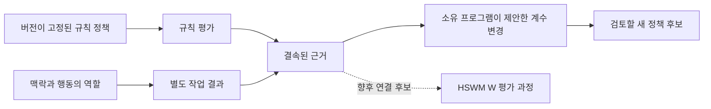

# 규칙 웨이트와 HSWM W를 연결하는 근거

규칙의 `weight`는 권고 위반을 얼마나 크게 감점할지 정하는 계수다. HSWM의
Semantic Weight와 동일한 값으로 취급하지 않는다. 이 선택형 애드온은 규칙 평가,
맥락, 역할을 가진 행동, 별도 작업 결과, 계수 변경 제안을 연결한다. 기존
[규칙 평가 계약](RULE_POLICY.md)을 사용하며 USL 코어에는 자동으로 설치하지 않는다.

[사용자 발화](../research/rule-weight-evidence/request.json)와
[확인한 HSWM 문서의 revision·digest](../research/rule-weight-evidence/references.json)를
분리해 보존한다. HSWM 문서가 설명하는 역할·맥락별 전이 성향과 로컬 규칙 감점
계수를 연결하는 세부 방식은 `SECONDARY_AI` 구현 선택이다. 문서의 AI 해설을
사용자의 원문으로 바꾸거나, 이 요청을 HSWM 정전 변경으로 해석하지 않는다.

## 서로 다른 값과 역할

| 항목 | 이 구현에서의 의미 |
|---|---|
| 필수 규칙 | 실패 시 `BLOCKED`. 웨이트 변경 대상으로 선택 불가 |
| 정책 웨이트 | `RECOMMENDED` + `PENALIZE`의 `(0,1]` 계수 |
| `penalty` | 정책 위반 정도의 가중평균. 작업 성공률·보상·신뢰도·W가 아님 |
| 맥락·행동 | ID·버전·내용 digest와 참여자별 역할·순번·소스 버전 |
| 작업 결과 | 별도 지표·평가자·출처에 결속된 관측값. 비용과 선택확률은 별도 |
| 변경 제안 | 기존 정책과 변경 후보, 근거, 이유. `PROPOSED_NOT_APPLIED` |
| HSWM W와의 관계 | `CANDIDATE_INPUT_ONLY`, 실제 연동은 `NOT_CONNECTED` |



마지막 점선은 연결 가능성에 대한 선언이다. HSWM RuleUnit 매핑, W 학습 결과
import, 활성화·배치 제어 또는 실제 HSWM 변경은 구현하지 않았다.

## 계약과 변경 제안

`usl/rule-weight-evidence`는 선택형 순수 함수 모듈이다.
`parseRuleWeightEvidence`는 기존 `evaluateRulePolicy`를 다시 계산하여 관측과
정책의 결속을 확인한다. 호스트는 그래프 밖에서 evidence digest, 맥락,
행동 전체, 결과 지표와 평가자를 등록한다. 호출 입력만 함께 바꿔서 등록된
snapshot을 교체할 수 없다. ID는 정체성, version은 버전 이름, digest는 내용
변경 검사, 시각은 관측 순서이며 서로 대체하지 않는다.

결과의 출처는 정책 평가나 대상 snapshot과 구별해야 한다. 계약은 이미 알려진
동일 digest·참조 재사용을 거부하지만, 새 ID나 digest로 꾸민 주장의 사실성이나
통계적 독립성을 입증하지는 않는다. `OWNER_REPORTED`는 소비자의 관측 주장이고
`SYNTHETIC`은 예제다. `selectionProbability: null`은 알 수 없다는 뜻이며
1로 추정하지 않는다. 결과를 확인하려고 링크를 열거나 외부 평가자를 실행하지 않는다.

`proposeRuleWeights`는 다음 조건을 검사하고 변경 후보를 반환한다.

- 기존 정책·관측·근거·맥락·scope·버전이 일치해야 한다.
- 필수 규칙이 통과하고 모든 규칙이 평가된 경우만 제안한다. `BLOCKED`,
  `UNDETERMINED`, `CONFLICT`, 불완전 평가는 제안할 수 없다. 실패 기록 자체는 보존 가능하다.
- 기존 `RECOMMENDED/PENALIZE` 규칙의 계수만 변경한다. 중복, 오래된 버전,
  잘못된 이전 값, 동일 값, 0 이하·1 초과 값은 거부한다.
- 필수 규칙, evaluator, severity, 규칙 집합과 scope를 보존하며 새 정책 버전을 만든다.
- 입력을 수정하지 않는다. 결과에 정책·근거 digest와
  `effectiveness: NOT_ESTABLISHED`, `canonicalW: NOT_CLAIMED`를 남긴다.

제안의 `OWNER_PROPOSED`는 소비자가 직접 선택한 변경안이라는 방법 이름이지,
권한이나 사용자 승인의 증거가 아니다. 실제 적용은 소유 프로그램의 별도 동작이다.
한 결과를 보고 자동으로 최적 계수를 계산하지 않는다. 학습을 연결하려면 사전에
정한 평가 기준, 독립 단위, 역할 보존 비교, 충분한 지원과 불확실성, 별도 holdout
등을 갖춘 소유 학습기의 결과가 필요하다. 현재 근거 계약만으로 그러한 조건이
충족됐다고 판정하지 않는다.

## 실행 예제와 그래프 검증

```sh
npm run example:rule-weight-evidence
npm run rule-weight-evidence:build
npm run rule-weight-evidence:check
npm run rule-weight-evidence:standards
```

[예제](../examples/rule-weight-evidence-fixture.ts)는 기존 메모리 규칙 평가와 별도의
가상 답변 정답 관측을 사용한다. 출처 계수 `0.8→0.9`, 태그 계수 `0.2→0.1`은
명시적 예제 제안이며 관측에서 학습한 최적값이 아니다. 모든 시각은 고정된
fixture clock이다. 실제 대시보드 사용자 성과나 실행 시각을 나타내지 않는다.

[공학 그래프](../research/rule-weight-evidence/graph.json),
[JSON-LD](../research/rule-weight-evidence/graph.jsonld),
[관계 profile](../research/rule-weight-evidence/profile.json),
[RDF 투영](../examples/fixtures/rule-weight-evidence/trace.jsonld)은 다음을 연결한다.

| 로컬 관계 (`urn:usl:rule-weight-evidence:`) | 역할별 domain/range, 각 1개 |
|---|---|
| `contextual_weight` | rule: Rule, configuration: BindingConfiguration, context: Context, weight: WeightAssignment |
| `records_evidence` | evidence: Evidence, evaluation: Evaluation, context: Context, action: Action, outcome: Outcome |
| `proposed_revision` | baseline: PolicySnapshot, candidate: PolicySnapshot, context: Context, evidence: Evidence, proposal: WeightRevisionProposal |
| `candidate_input_to` | signal: Evidence, wConcept: HSWM_W_Concept |

정확한 타입 IRI는 profile에 등록한다. 기존 `rule-policy:evaluated_policy`로
설정·대상·소비자·평가 결과를 연결하고 요청·구현·테스트·한계 관계도 재사용한다.
기존 정책과 변경 후보는 별도 snapshot·configuration으로 표현한다. 규칙 술어의
버전은 보존하고 계수 변경은 새 policy version/digest로 식별한다.
이 관계들은 프로젝트 로컬 어휘다. `candidate_input_to`는 `PROPOSED`인 해석이며
동치나 HSWM의 수락을 뜻하지 않는다. 테스트 정의를 과거 실행 성공으로 표시하지 않는다.

2026-10-03 확인한 [SHACL 2017](https://www.w3.org/TR/2017/REC-shacl-20170720/)로
타입·역할·cardinality·값의 제약을 검사하고, [PROV-O](https://www.w3.org/TR/prov-o/)로
출처·활동·주체를 표현한다. SPARQL 질의는 규칙에서 맥락·결과·제안까지 경로를
확인한다. 잘못된 역할, 누락된 pin, W와의 동치 선언, 제안의 적용 상태 승격 등을
반례로 검사한다. 전체 RDF/SHACL 구현 인증이나 효과·인과관계의 증명은 아니다.

portable binding은 workspace 별칭과 상대 경로를 쓴다. checkout이 이동하면
호스트의 root 매핑만 갱신하며 근거·정책·제안 ID와 내용 digest는 보존한다.
내용이 바뀌면 새 snapshot을 등록해야 한다. 그래프는 접근·실행 권한을 부여하지 않는다.
