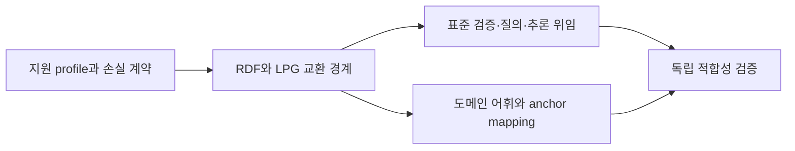

# USL 표준 그래프 엔지니어링 지원 범위 감사

**판정: 현재 USL은 표준 그래프 기술 전체의 상위호환이 아니다 — NOT_A_STANDARDS_SUPERSET.** 2026-10-03 조사, 코드 기준 `7c6d2a200978141e8e9743088f14e5e3b633cc43`. 이 판정은 SECONDARY_AI의 근거 기반 평가이며 표준 기관의 인증이 아니다.

USL은 출처·역할·바인딩·계획/관측 상태를 연결하는 공학 작업을 수행한다. 그러나 일반 RDF dataset의 무손실 교환, 표준 질의·추론·검증·protocol 동작을 모두 수행하지는 않는다. JSON-LD 출력, 자체 profile 검사, 일부 표준 어휘 사용을 범용 표준 processor 지원으로 확대 해석하면 안 된다.

기존 [engineering catalog](../research/engineering/catalog.json)의 **40개 기술과 12개 control을 모두 가져와** 원래 한계·반례·잔여 과제를 보존했다. 추가로 **40개 공식 자료를 22개 지원 영역**으로 대조했다. 전 세계 모든 그래프 관련 표준의 규범 전문을 수집한 목록은 아니다. 분야별 ontology·GeoSPARQL·vendor dialect·graph algorithm·GraphRAG 검색 품질은 별도 범위다.

기존 40항목은 2026-09-22의 역사적 조사이며 최신 제품 버전을 이번에 모두 재검증한 것은 아니다. 모든 항목의 upstreamExecution은 NOT_TESTED다. 로컬 control이 기술과 연결된다는 사실은 해당 기술을 USL이 구현했다는 뜻이 아니다. ISO GQL/SQL-PGQ는 공개 catalog/abstract만 확인했으며 유료 규범 전문의 조항별 적합성은 미평가다.

## 상위호환의 판단 기준

이번 감사에서는 선언한 표준 profile에 대해 입력·모델 수용, 무손실 왕복, 관련 observable behavior, 독립 적합성 근거, 확장의 보수성을 요구한다. vocabulary 사용에는 query engine을 요구하지 않는다. processor를 제공한다고 주장할 때에만 해당 processor의 동작을 요구하며, 명시된 외부 엔진으로 위임하는 구현도 가능하다.

| Gate | 판정 | 근거 |
|---|---|---|
| G1 표준 입력과 모델 수용 | FAIL | 실제로 일반 JSON-LD와 Turtle 입력을 거부한다. 전체 표준 입력을 수용하는 상위호환 주장은 성립하지 않는다. |
| G2 무손실 왕복 및 의미 보존 | FAIL | 임의 LPG property가 plan에서 사라지고 JSON-LD는 USL 선언 projection이다. 표준 원문 의미를 유지하는 왕복 계약이 없다. |
| G3 표준 observable behavior 또는 검증된 위임 | NOT_ESTABLISHED | 선택된 테스트 도구와 domain profile은 존재하지만 범용 표준 processor 또는 위임 계약이 없다. |
| G4 독립 적합성 근거와 정확한 지원 profile | NOT_ESTABLISHED | 이번 자체 probe와 fixture 검증은 공식 전체 conformance suite 실행이 아니다. 미래 기준은 NOT_RUN이다. |
| G5 확장의 보수성 및 원문/권한 경계 | NOT_ESTABLISHED | 선언과 권한 분리 원칙은 있으나 임의 표준 입력에 대한 확장의 보수성은 증명하지 않았다. n-ary만으로 엄격한 상위 표현력은 성립하지 않는다. |

## 실제로 확인한 경계

- USL 고유 graph의 이름 있는 n-ary 역할은 문법 검사를 통과한다. 이는 USL graph의 round trip이며 RDF dataset round trip은 아니다.
- 일반 JSON-LD와 Turtle 입력을 USL resource graph parser에 주면 거부된다.
- 선언 export를 독립 RDF parser로 읽으면 USL Link·Meaning·Participant가 나온다. 원래 의도한 `alice knows bob` domain triple은 없다. 선언에 대한 RDF 표현과 원문 RDF assertion은 다르다.
- property-graph/v2에서 node label/score·edge weight 같은 임의 property를 바꿔도 adapted plan과 identity는 같고 원문 digest만 바뀐다. 따라서 임의 LPG의 무손실 수입으로 볼 수 없다.
- DomainProfile은 정확한 role/type/metadata 검사다. 부모 타입을 metadata에 적는 것만으로 타입 조건을 만족시키지 않는다. 이 probe는 RDFS conformance 시험이 아니다. 추론하지 않는다는 범위는 코드 계약에서 별도로 확인한다.
- GQL engine을 호출하지 않는다는 항목은 정적 코드 검토다. 실행한 GQL conformance test로 세지 않는다.

관측 6개 중 순수 실행 probe 5개, 정적 코드 검토 1개다. [Probe 코드](../scripts/probe-standards-coverage.ts)의 범위를 넘는 보장을 주장하지 않는다. 공식 전체 적합성 suite와 후속 인수검사 22개는 NOT_RUN이다.

## 표준별 현재 지원

| 영역 | 현재 범위 | 구현과 한계 |
|---|---|---|
| RDF 1.1 graph / dataset / term model | DECLARATION_PROJECTION | USL Resource·Meaning·Link·Participant를 RDF 자원으로 내보낸다. 일반 RDF term/dataset import 및 named graph·blank-node scope·literal datatype/language의 무손실 왕복 계약이 없다. |
| Turtle / N-Triples / N-Quads / TriG / RDF/XML | NOT_IMPLEMENTED | 현재 입력 adapter는 usl-resource-graph/v1 JSON을 받는다. 이 문법들의 범용 USL import/export 경로가 없다. Turtle 거부는 직접 관측했고 나머지는 공개 표면을 검토했다. |
| JSON-LD 1.1 선언 export | BOUNDED_EXPORT | 고정 context의 USL 선언 graph를 생성하며 독립 RDF parser로 읽을 수 있다. Meaning IRI와 역할을 기록하지만 원래 domain predicate triple을 직접 주장하지 않는다. 이것은 설계된 선언 projection이다. |
| JSON-LD expansion / compaction / flattening / RDF conversion / framing | NOT_IMPLEMENTED | resourceGraphJsonLd는 특정 출력 형식을 생성하는 함수다. 범용 JSON-LD API 또는 framing processor가 아니다. remote context 로딩 정책도 표준 processor로 제공하지 않는다. |
| RDFC-1.0 canonicalization | NOT_IMPLEMENTED | raw bytes SHA-256 및 USL JSON contract digest가 존재한다. 정렬한 JSON의 hash는 blank node relabeling을 처리하는 RDFC 구현이 아니다. 의미적 동치 증명도 아니다. |
| RDF/RDFS semantics / subclass / domain / range | NOT_IMPLEMENTED | DomainProfile은 선언된 role/type IRI와 metadata의 정확한 일치를 검사한다. RDFS entailment closure를 수행하지 않는다는 명시적 코드 계약이다. metadata 검사 probe는 RDFS 규범 테스트가 아니다. |
| OWL 2 profiles / reasoning | NOT_IMPLEMENTED | USL은 type IRI를 보존할 수 있다. OWL 언어 처리·일관성 검사·EL/QL/RL reasoning을 제공하지 않는다. |
| SHACL shape validation | EXTERNAL_TEST_TOOLING | rdflib와 pySHACL이 repository fixture와 USL shapes를 실제 검증한다. 이 검증 도구 사용은 USL runtime의 범용 SHACL engine 지원을 뜻하지 않는다. DomainProfile도 SHACL 전체가 아니다. |
| SPARQL 1.1 Query | EXTERNAL_TEST_TOOLING | Python 검증기가 generated trace에 실제 SELECT/ASK 질의를 수행한다. USL SDK의 범용 SPARQL query API나 endpoint가 아니다. 제한된 competency queries만 실행한다. |
| SPARQL Update / Protocol / Graph Store | NOT_IMPLEMENTED | USL link 선언 또는 host callback 연결과 별개인 protocol 영역이다. SPARQL update/service 또는 Graph Store HTTP를 구현한 USL driver는 없다. |
| SPARQL JSON/XML/CSV/TSV results / entailment regimes | NOT_IMPLEMENTED | 로컬 RDF 질의 결과를 연구 검증에 사용한다. USL public contract에 표준 query result interchange나 선택 가능한 entailment regime이 없다. |
| Property graph data projection | LOSSY_PROJECTION | property-graph/v2는 native edge ID·direction·type·description 및 명시한 participants를 유지한다. 그 외 임의의 node/edge property는 adapted plan에 보존되지 않는다. source digest는 값 복원 수단이 아니다. |
| ISO GQL / SQL PGQ language processing | NOT_IMPLEMENTED | 일부 property graph JSON을 USL로 읽는 adapter만 있다. GQL/SQL-PGQ query·schema·mutation engine이 아니다. ISO 규범 전문 미열람으로 조항별 적합성은 평가하지 않았다. |
| PROV-O provenance | VOCABULARY_USE | JSON-LD에서 Entity와 wasDerivedFrom·wasGeneratedBy·wasAttributedTo 등을 사용한다. 선택한 출처 어휘 사용이며 모든 PROV 제약·외부 증언의 진실성 검증은 제공하지 않는다. |
| SKOS concepts / schemes / mapping | NOT_IMPLEMENTED | type IRI나 JSON metadata로 일부 이름을 담을 수는 있다. SKOS 전용 교환 mapping·label integrity·scheme 검증은 구현하지 않았다. |
| DCAT / DQV / VoID | NOT_IMPLEMENTED | USL manifest·정책 weight·generic resource metadata가 존재한다. DCAT catalog나 DQV quality measurement, VoID dataset 기술의 명시적 mapping은 없다. |
| R2RML / CSVW ingestion | NOT_IMPLEMENTED | 범용 ResourceGraph 입력이 표준 tabular mapping을 대신하지 않는다. R2RML processor와 CSVW metadata/dialect 기반 processor는 제공하지 않는다. |
| Web Annotation selectors / state | NOT_IMPLEMENTED | portable-transfer는 selected identity/revision/representation의 계약을 선언한다. 표준 selector/state의 일반 processor나 이동 후 annotation anchor 재해결 기능은 아직 없다. |
| Linked Data Platform HTTP behavior | NOT_IMPLEMENTED | URL을 locator로 기록하고 host가 선택한 operation을 연결할 수 있다. LDP resource/container HTTP semantics를 구현한 service가 아니다. |
| 그래프 공학 실무: ID·출처·역할·검증·상태 | BOUNDED_WORKFLOW | 기존 repository graph가 명명된 역할·출처·계획/관측 분리·SHACL·SPARQL 검증을 실제 사용한다. 명시한 local graph/profile의 공학 절차 준수이지 모든 그래프 시스템 기능의 구현을 뜻하지 않는다. |
| n-ary role 모델링 | BOUNDED_NATIVE_FEATURE | USL은 이름 있는 다항 역할을 직접 선언하고 검사한다. RDF/OWL도 relation node 방식으로 표현할 수 있어 n-ary 지원 자체가 엄격한 표현력 상위집합의 증명은 아니다. |
| RDF 1.2 / SHACL 1.2 / SPARQL 1.2 추적 | DRAFT_NOT_IMPLEMENTED | candidate/draft 문서는 확정 Recommendation과 분리해 기록한다. USL은 RDF 1.2 triple term·directional string 또는 SHACL 1.2 conformance를 제공하지 않는다. |

n-ary를 문법에서 직접 다루는 것은 유용하지만 RDF/OWL에서도 relation node와 role property로 표현할 수 있다. 따라서 n-ary만으로 더 큰 표현력을 증명할 수 없다. [W3C 모델링 Note](https://www.w3.org/TR/swbp-n-aryRelations/)는 이를 설명하며 규범적 적합성 표준은 아니다.

규칙의 severity, 차단 여부, soft penalty coefficient, HSWM의 학습된 W, provenance 신뢰도, 접근 권한은 다른 값이다. 현재 rule-policy·rule-weight-evidence는 선택형 계약/증거 기능이며 W 전체의 학습·평가나 표준 reasoner를 대체하지 않는다. 기기 이동의 identity/revision/manifest 계약과 실제 백업·복원 완료도 별개다. [기존 이동성 조사](PORTABILITY_RESEARCH.md)의 후속 과제를 유지한다.

## 기존 40개 기술의 전체 대응표

아래 control 연결은 원본 그대로다. 각 기술의 세부 원문 source·요구사항·반례·기대 동작은 [기계 판독 입력](../research/standards-coverage/coverage.json)에 빠짐없이 남겼다. 공통 상태: INHERITED_NOT_RECHECKED / upstream NOT_TESTED.

| ID · 기술 | 기존 control | 남은 구현/보장 |
|---|---|---|
| S01 · OSLC Core 3.0 | C01, C10 | OSLC endpoint discovery와 lifecycle domain API driver는 아직 구현하지 않았다. |
| S02 · WoT TD 1.1 | C02, C03 | WoT protocol binding 및 실제 장치의 상호작용 구현은 별도다. |
| S03 · MCP 2025-11-25, tools | C03, C04, C09 | 모든 MCP feature·인증·전송을 대체하지 않는다. |
| S04 · A2A v0.3.0 | C04, C08, C10 | A2A 서버·task 상태 동기화·메시지 전송은 미구현이다. |
| S05 · LinkML, slots | C06, C12 | LinkML generator별 제약 보존 검증 및 generator 연결은 별도다. |
| S06 · Palantir Ontology | C03, C11 | Palantir 플랫폼의 데이터·운영·보안 기능 전체를 구현한 것이 아니다. |
| S07 · Composio, 인증 | C03, C07 | Composio의 실제 계정 인증·credential 관리와 앱 커넥터는 외부 소유다. |
| S08 · Airbyte Agents, 기존 커넥터 모델 | C05, C06 | Airbyte Context Store·복제 파이프라인·live connector는 구현하지 않았다. |
| S09 · RDF 1.1, JSON-LD 1.1 | C01, C10, C12 | RDF 의미론 전체와 외부 ontology 추론은 제공하지 않는다. |
| S10 · SHACL | C01, C10 | SHACL 대신 USL이 모든 제약 언어를 처리한다는 뜻은 아니다. |
| S11 · PROV-O | C05, C10 | 서명·발행자 신뢰·원본 데이터 정직성은 별도 검증 대상이다. |
| S12 · SKOS, SSSOM | C01, C06 | 전체 SKOS 추론기나 SSSOM importer를 구현하지 않았다. |
| S13 · RML | C01, C06 | RML processor와 모든 source formulation의 변환은 미지원이다. |
| S14 · Ontop | C04, C05 | SQL/SPARQL 질의 최적화 및 DB transaction snapshot은 원본 소유자가 제공해야 한다. |
| S15 · CQL, 연구 목록 | C06, C10 | CQL의 수학적 변환 엔진과 증명을 USL에 이식한 것은 아니다. |
| S16 · MMT, 언어·theory morphism | C02, C05, C10 | MMT theory morphism 및 증명기 사이의 자동 번역은 미구현이다. |
| S17 · OpenAPI 3.1.1 | C04, C09 | OpenAPI 3.1 JSON body의 제한된 subset이며 전체 HTTP client 생성기가 아니다. |
| S18 · AsyncAPI 3.0.0 | C08 | AsyncAPI importer와 broker cursor/replay/backpressure는 미구현이다. |
| S19 · CloudEvents | C08 | CloudEvents ingestion·영속 deduplication·reconciliation은 별도 구현이 필요하다. |
| S20 · Apache Camel | C02, C04 | Camel component와 EIP 실행 엔진의 대체 구현은 아니다. |
| S21 · n8n integrations | C03, C08 | n8n workflow import/export와 durable workflow runtime은 미지원이다. |
| S22 · Apollo Federation | C03, C11 | GraphQL federation의 query planner와 key 해석은 원본 체계가 담당한다. |
| S23 · WebAssembly Component Model / WIT | C02, C03, C04 | Wasm 격리 실행·WIT compiler·component loader는 제공하지 않는다. |
| S24 · DataHub lineage | C05, C07 | DataHub의 시계열 계보를 복원하거나 자체 metadata DB를 만들지 않는다. |
| S25 · Egeria integration connectors | C05, C07 | Egeria connector lifecycle과 동기화 엔진 자체는 외부 구현이다. |
| S26 · Microsoft GraphRAG | C01, C10 | LLM 추출 정확도·community summary 품질을 개선했다고 주장하지 않는다. |
| S27 · Cube, dbt Semantic Layer | C02, C05 | Cube/dbt metric evaluation과 SQL 생성은 구현하지 않았다. |
| S28 · OpenLineage object model, facets | C10, C12 | OpenLineage importer와 실제 데이터 흐름 추출은 아직 미구현이다. |
| S29 · OpenTelemetry traces | C07, C10 | OTel collector·sampling 보정·분산 인과 복원은 미구현이다. |
| S30 · SysML v2, Systems Modeling API 1.0 | C01, C05, C10 | SysML/KerML 의미론과 Systems Modeling API adapter는 미구현이다. |
| S31 · AAS Metamodel v3.2, API v3.2 | C01, C02, C11 | AAS metamodel/API 직접 수입과 실물 검증은 후속이다. |
| S32 · OPC UA Address Space, Information Model | C02, C03, C11 | OPC UA client·namespace 해석·subscription·장치 제어는 미구현이다. |
| S33 · FMI 3.0.2 | C02, C04, C10 | FMU 실행·solver·co-simulation 수치 안정성 검증은 미구현이다. |
| S34 · QUDT | C02 | 현재 exact unit IRI 검사이며 QUDT 추론·변환·교정 시스템은 아니다. |
| S35 · SCIP, LSP 3.17 | C02, C05, C11 | SCIP/LSP index importer 및 실제 일반 Git symbol resolver는 미구현이다. |
| S36 · SWHID 1.1, Package URL / ECMA-427 | C03, C11 | SWHID/purl 해석과 저장소 가용성 확인 driver는 미구현이다. |
| S37 · Web Annotation Data Model | C02, C05 | 텍스트 재앵커링·이미지/영상 selector 해석은 미구현이다. |
| S38 · CycloneDX BOM-Link, SLSA v1.1 provenance | C05, C10, C12 | CycloneDX/SLSA importer와 서명·builder 신뢰 검증은 미구현이다. |
| S39 · RDF Dataset Canonicalization | C05, C10 | RDFC-1.0 알고리즘을 USL contractDigest로 대체하지 않으며 직접 구현도 아니다. |
| S40 · OWL-S, SAWSDL | C01, C06, C07 | OWL-S planning 또는 SAWSDL lifting/lowering 엔진은 미구현이다. |

| Control | 실제 검사 범위 | 남은 한계 |
|---|---|---|
| C01 · 역할 도메인 타입과 필수 역할 | 명시한 type IRI와 역할만 검사한다. | 원본의 타입 선언 자체가 현실에서 참인지는 검증하지 않는다. |
| C02 · 단위·revision 맥락 | profile metadata와 호출 input unit의 정확한 일치를 검사한다. | 단위 변환·좌표 변환·교정·수치 해석은 제공하지 않는다. |
| C03 · 호스트 권한과 효과 경계 | 소유자 binding·scope·effect를 확인하고 등록 시 snapshot을 고정한다. | 호스트의 거짓 선언이나 외부 서비스가 허용 범위를 어기는 행동까지 차단하는 sandbox는 아니다. |
| C04 · JSON Schema와 입력 예산 | 제한된 JSON Schema 2020-12 입력/출력을 Ajv strict mode로 검사한다. | ref·regex·format 등 지원하지 않는 keyword는 거부한다. 전체 JSON Schema 지원이 아니다. |
| C05 · 계약과 근거 pin | descriptor/source/profile 변경을 별개 digest로 검사한다. | 외부 최신 상태의 원자적 확인은 expectedSourceDigest를 받은 소유자 실행기의 책임이다. |
| C06 · 변환 손실과 지원 범위 | 부분·미지원 매핑은 호출을 거부하고 알려진 손실은 owner의 명시적 수용을 요구한다. | 매핑 보고의 완전성과 변환 의미 보존 자체를 자동 증명하지 않는다. |
| C07 · 예산 있는 기능 발견 | 공급된 목록 안에서 의미·입력 타입을 조회하고 불완전 범위를 표시한다. | 자연어 의미 추론·전체 인터넷 검색·전역적 기능 발견을 수행하지 않는다. |
| C08 · 실행 시도와 불명확한 결과 | 효과 후 오류·시간 초과·응답 계약 위반을 INDETERMINATE로 남기고 자동 재시도하지 않는다. | 분산 transaction·정확히 한 번 실행·강제 취소·durable reconciliation·stream 구독은 제공하지 않는다. |
| C09 · 명세 수입과 비신뢰 설명 | MCP tool list/OpenAPI 3.1 문서를 순수 변환하고 외부 참조를 따라가지 않는다. | MCP tools/list 입력과 OpenAPI의 제한된 JSON operation subset이며 서비스 인증·전송 driver는 별도다. |
| C10 · 선언·검사·의미의 참 구분 | 연결·검사·실행 보고가 semantic truth나 원본 제품의 결함 판정으로 승격되지 않게 한다. | 도메인 주장의 참과 물리적 적합성은 별도 증거와 검증기가 필요하다. |
| C11 · native ID와 역할 보존 | 응답/connection 범위에서 ID 충돌과 중복 역할을 거부한다. | 시스템 사이의 실체 동일성·장기간 symbol 동일성은 자동 판정하지 않는다. |
| C12 · 다자 관계의 표준 교환 | 명명된 역할·출처·선언 상태와 profile 참조를 JSON-LD/RDF로 내보낸다. | 지원하는 USL 출력에 한정하며 임의 RDF 역수입·모든 외부 형식의 무손실 왕복은 미지원이다. |

## 구현 순서와 완료 조건

단순한 USL core는 유지하고 선택형 adapter와 owner engine을 연결하는 방향이다. 모든 표준 엔진을 core 안에 재구현할 필요는 없다. 목표 문구는 우선 ‘명시한 표준 profile과 상호운용하는 연결 계층’이며 검증 전에는 ‘완전한 상위호환’을 사용하지 않는다.



- **S0:** 명시적 지원 profile과 손실·위임 계약 고정. 선행: 없음. 상태 PROPOSED.
- **S1:** 선택형 RDF dataset 및 LPG 무손실 교환 adapter. 선행: S0. 상태 PROPOSED.
- **S2:** SHACL·SPARQL·reasoner를 owner engine에 명시적으로 위임. 선행: S1. 상태 PROPOSED.
- **S3:** 필요한 provenance·catalog·tabular·annotation mapping. 선행: S1. 상태 PROPOSED.
- **S4:** 고정한 공식 suite와 독립 왕복 검사로 profile 적합성 판정. 선행: S2, S3. 상태 PROPOSED.

RDF 교환 경계에는 IRI·blank node·typed/language literal·default/named graph를 명시해야 한다. payload와 USL link metadata를 구분하고, 지원하지 않는 문법/의미를 명시적으로 거부하거나 손실로 보고한다. dataset 동형성, 원문 bytes 일치, RDF entailment는 서로 다른 비교다. N-Quads의 빈 named graph 같은 형식 자체의 한계도 profile에 포함한다.

### RDF 1.1 graph / dataset / term model

현재 판단: **DECLARATION_PROJECTION**. 일반 RDF term/dataset import 및 named graph·blank-node scope·literal datatype/language의 무손실 왕복 계약이 없다.

**check:rdf-model · NOT_RUN:** 선언한 RDF dataset profile의 term·graph·blank-node scope를 왕복 후 동형성으로 비교한다. 반례: language/datatype/graph 이름을 버리는 변환을 무손실로 표시하지 않는다.

근거: [RDF 1.1 Concepts](https://www.w3.org/TR/rdf11-concepts/). 코드: [src/integrations/resource-graph.ts](../src/integrations/resource-graph.ts).

### Turtle / N-Triples / N-Quads / TriG / RDF/XML

현재 판단: **NOT_IMPLEMENTED**. 이 문법들의 범용 USL import/export 경로가 없다. Turtle 거부는 직접 관측했고 나머지는 공개 표면을 검토했다.

**check:rdf-syntax · NOT_RUN:** 선택한 각 문법의 공식 positive/negative suite를 고정하고 지원 범위를 명시한다. 반례: 빈 named graph 등 형식별 손실과 잘못된 syntax를 구분한다.

근거: [RDF 1.1 Turtle](https://www.w3.org/TR/turtle/), [RDF 1.1 N-Triples](https://www.w3.org/TR/n-triples/), [RDF 1.1 N-Quads](https://www.w3.org/TR/n-quads/), [RDF 1.1 TriG](https://www.w3.org/TR/trig/), [RDF 1.1 XML Syntax](https://www.w3.org/TR/rdf-syntax-grammar/). 코드: [src/integrations/resource-graph.ts](../src/integrations/resource-graph.ts), [package.json](../package.json).

### JSON-LD 1.1 선언 export

현재 판단: **BOUNDED_EXPORT**. Meaning IRI와 역할을 기록하지만 원래 domain predicate triple을 직접 주장하지 않는다. 이것은 설계된 선언 projection이다.

**check:jsonld-export · NOT_RUN:** 선언 export와 domain RDF mapping을 분리하고 각 mapping의 의미 보존 조건을 검증한다. 반례: Link wrapper를 원문의 domain triple과 동일하다고 처리하지 않는다.

근거: [JSON-LD 1.1 Syntax](https://www.w3.org/TR/json-ld11/). 코드: [src/integrations/resource-graph.ts](../src/integrations/resource-graph.ts), [scripts/validate-rdf.py](../scripts/validate-rdf.py).

### JSON-LD expansion / compaction / flattening / RDF conversion / framing

현재 판단: **NOT_IMPLEMENTED**. 범용 JSON-LD API 또는 framing processor가 아니다. remote context 로딩 정책도 표준 processor로 제공하지 않는다.

**check:jsonld-processing · NOT_RUN:** 선택한 processor의 version 및 공식 test manifest를 고정하고 모든 지원 API를 검사한다. 반례: 잘못된 context·금지한 외부 context·지원하지 않는 keyword를 조용히 손실 처리하지 않는다.

근거: [JSON-LD 1.1 Processing Algorithms and API](https://www.w3.org/TR/json-ld11-api/), [JSON-LD 1.1 Framing](https://www.w3.org/TR/json-ld11-framing/). 코드: [src/integrations/resource-graph.ts](../src/integrations/resource-graph.ts), [package.json](../package.json).

### RDFC-1.0 canonicalization

현재 판단: **NOT_IMPLEMENTED**. 정렬한 JSON의 hash는 blank node relabeling을 처리하는 RDFC 구현이 아니다. 의미적 동치 증명도 아니다.

**check:rdfc · NOT_RUN:** RDFC 공식 vector와 blank-node permutation을 확인하고 bytes/contract/dataset digest 종류를 분리한다. 반례: 동형 dataset의 다른 blank-node label을 다른 canonical digest로 처리하지 않는다.

근거: [RDF Dataset Canonicalization 1.0](https://www.w3.org/TR/rdf-canon/). 코드: [src/contract-core.ts](../src/contract-core.ts), [src/addons/portable-transfer.ts](../src/addons/portable-transfer.ts).

### RDF/RDFS semantics / subclass / domain / range

현재 판단: **NOT_IMPLEMENTED**. RDFS entailment closure를 수행하지 않는다는 명시적 코드 계약이다. metadata 검사 probe는 RDFS 규범 테스트가 아니다.

**check:rdfs · NOT_RUN:** 선택한 RDF/RDFS entailment regime의 공식 entailment cases를 외부 engine에 대조한다. 반례: RDFS domain/range 추론과 closed-world validation의 실패를 혼동하지 않는다.

근거: [RDF 1.1 Semantics](https://www.w3.org/TR/rdf11-mt/), [RDF Schema 1.1](https://www.w3.org/TR/rdf-schema/). 코드: [src/domain-profile.ts](../src/domain-profile.ts), [src/integrations/resource-graph.ts](../src/integrations/resource-graph.ts).

### OWL 2 profiles / reasoning

현재 판단: **NOT_IMPLEMENTED**. OWL 언어 처리·일관성 검사·EL/QL/RL reasoning을 제공하지 않는다.

**check:owl · NOT_RUN:** 필요 profile과 semantics를 고정한 reasoner adapter를 독립 시험한다. 반례: unsupported axiom을 무시한 채 전체 ontology 검증 성공을 보고하지 않는다.

근거: [OWL 2 Profiles, Second Edition](https://www.w3.org/TR/owl2-profiles/). 코드: [src/integrations/resource-graph.ts](../src/integrations/resource-graph.ts), [src/domain-profile.ts](../src/domain-profile.ts), [package.json](../package.json).

### SHACL shape validation

현재 판단: **EXTERNAL_TEST_TOOLING**. 이 검증 도구 사용은 USL runtime의 범용 SHACL engine 지원을 뜻하지 않는다. DomainProfile도 SHACL 전체가 아니다.

**check:shacl · NOT_RUN:** 공개한 SHACL profile을 실제 data/shapes/report와 공식 positive/negative cases로 검사한다. 반례: 몇 개의 shape 통과를 arbitrary shape·SHACL-SPARQL 전체 지원으로 승격하지 않는다.

근거: [SHACL](https://www.w3.org/TR/2017/REC-shacl-20170720/). 코드: [scripts/validate-rdf.py](../scripts/validate-rdf.py), [schemas/resource-graph.shacl.ttl](../schemas/resource-graph.shacl.ttl), [src/domain-profile.ts](../src/domain-profile.ts).

### SPARQL 1.1 Query

현재 판단: **EXTERNAL_TEST_TOOLING**. USL SDK의 범용 SPARQL query API나 endpoint가 아니다. 제한된 competency queries만 실행한다.

**check:sparql-query · NOT_RUN:** 선택한 query service adapter의 dataset/result/error semantics를 공식 suite에 대조한다. 반례: OPTIONAL·FILTER·aggregate·property path 등의 미지원 동작을 성공으로 처리하지 않는다.

근거: [SPARQL 1.1 Query](https://www.w3.org/TR/sparql11-query/). 코드: [scripts/validate-engineering-rdf.py](../scripts/validate-engineering-rdf.py), [package.json](../package.json).

### SPARQL Update / Protocol / Graph Store

현재 판단: **NOT_IMPLEMENTED**. SPARQL update/service 또는 Graph Store HTTP를 구현한 USL driver는 없다.

**check:sparql-update · NOT_RUN:** owner가 제공하는 endpoint를 통해 protocol·update semantics 및 실패 경계를 검증한다. 반례: link가 있거나 query가 가능하다는 이유로 write 권한을 생성하지 않는다.

근거: [SPARQL 1.1 Update](https://www.w3.org/TR/sparql11-update/), [SPARQL 1.1 Protocol](https://www.w3.org/TR/sparql11-protocol/), [SPARQL 1.1 Graph Store HTTP Protocol](https://www.w3.org/TR/sparql11-http-rdf-update/). 코드: [package.json](../package.json), [src/capabilities.ts](../src/capabilities.ts).

### SPARQL JSON/XML/CSV/TSV results / entailment regimes

현재 판단: **NOT_IMPLEMENTED**. USL public contract에 표준 query result interchange나 선택 가능한 entailment regime이 없다.

**check:sparql-results · NOT_RUN:** binding term·unbound·ASK 결과 및 명시적 entailment 선택을 보존한다. 반례: 문자열화로 IRI/blank-node/literal을 합치거나 reasoning을 암묵적으로 활성화하지 않는다.

근거: [SPARQL 1.1 Query Results JSON Format](https://www.w3.org/TR/sparql11-results-json/), [SPARQL 1.1 Entailment Regimes](https://www.w3.org/TR/sparql11-entailment/), [SPARQL Query Results XML Format, Second Edition](https://www.w3.org/TR/sparql11-results-xml/), [SPARQL 1.1 Query Results CSV and TSV Formats](https://www.w3.org/TR/sparql11-results-csv-tsv/). 코드: [package.json](../package.json), [scripts/validate-engineering-rdf.py](../scripts/validate-engineering-rdf.py).

### Property graph data projection

현재 판단: **LOSSY_PROJECTION**. 그 외 임의의 node/edge property는 adapted plan에 보존되지 않는다. source digest는 값 복원 수단이 아니다.

**check:lpg · NOT_RUN:** 노드/edge identity·label·property 타입/값·direction·parallel edge를 왕복 보존하거나 정확한 loss report를 낸다. 반례: score/weight 값만 다른 입력이 같은 plan이 되는데도 lossless로 표시하지 않는다.

근거: [ISO/IEC 39075:2024 GQL](https://www.iso.org/standard/76120.html), [ISO/IEC 9075-16:2023 SQL/PGQ](https://www.iso.org/standard/79473.html), [ISO/IEC 39075:2024/Cor 1:2026](https://www.iso.org/standard/93701.html). 코드: [src/integrations/property-graph.ts](../src/integrations/property-graph.ts).

### ISO GQL / SQL PGQ language processing

현재 판단: **NOT_IMPLEMENTED**. GQL/SQL-PGQ query·schema·mutation engine이 아니다. ISO 규범 전문 미열람으로 조항별 적합성은 평가하지 않았다.

**check:gql · NOT_RUN:** 선택한 ISO edition/corrigendum과 구현 profile을 공개하고 가능한 conformance evidence를 대조한다. 반례: Cypher 또는 JSON edge 수입 성공을 GQL/SQL-PGQ 적합성으로 간주하지 않는다.

근거: [ISO/IEC 39075:2024 GQL](https://www.iso.org/standard/76120.html), [ISO/IEC 9075-16:2023 SQL/PGQ](https://www.iso.org/standard/79473.html), [ISO/IEC 39075:2024/Cor 1:2026](https://www.iso.org/standard/93701.html). 코드: [src/integrations/property-graph.ts](../src/integrations/property-graph.ts), [package.json](../package.json).

### PROV-O provenance

현재 판단: **VOCABULARY_USE**. 선택한 출처 어휘 사용이며 모든 PROV 제약·외부 증언의 진실성 검증은 제공하지 않는다.

**check:prov · NOT_RUN:** 선택한 PROV mapping의 entity/activity/agent 및 시간·derivation 관계를 검증한다. 반례: AI 해석을 사용자 원문 또는 실행 결과로 바꾸지 않는다.

근거: [PROV-O](https://www.w3.org/TR/prov-o/). 코드: [src/integrations/resource-graph.ts](../src/integrations/resource-graph.ts), [scripts/build-portability-research.ts](../scripts/build-portability-research.ts).

### SKOS concepts / schemes / mapping

현재 판단: **NOT_IMPLEMENTED**. SKOS 전용 교환 mapping·label integrity·scheme 검증은 구현하지 않았다.

**check:skos · NOT_RUN:** 선택한 SKOS profile의 label·scheme·semantic relation·mapping을 보존한다. 반례: closeMatch·related·subclass·sameAs를 하나의 동일성 관계로 합치지 않는다.

근거: [SKOS Reference](https://www.w3.org/TR/skos-reference/). 코드: [src/integrations/resource-graph.ts](../src/integrations/resource-graph.ts), [src/domain-profile.ts](../src/domain-profile.ts).

### DCAT / DQV / VoID

현재 판단: **NOT_IMPLEMENTED**. DCAT catalog나 DQV quality measurement, VoID dataset 기술의 명시적 mapping은 없다.

**check:catalog · NOT_RUN:** 선택 어휘별 실제 mapping과 provenance를 만든 후 전용 shape를 검사한다. 반례: W나 penalty 값을 단위·metric·측정 근거 없이 quality score라고 내보내지 않는다.

근거: [DCAT 3](https://www.w3.org/TR/vocab-dcat-3/), [Data Quality Vocabulary](https://www.w3.org/TR/vocab-dqv/), [VoID](https://www.w3.org/TR/void/). 코드: [src/integrations/resource-graph.ts](../src/integrations/resource-graph.ts), [src/addons/rule-policy.ts](../src/addons/rule-policy.ts), [src/addons/portable-transfer.ts](../src/addons/portable-transfer.ts).

### R2RML / CSVW ingestion

현재 판단: **NOT_IMPLEMENTED**. R2RML processor와 CSVW metadata/dialect 기반 processor는 제공하지 않는다.

**check:tabular · NOT_RUN:** owner DB/CSV snapshot과 mapping version을 고정해 typed RDF dataset 결과를 비교한다. 반례: NULL·빈 문자열·언어 태그·SQL 타입과 CSV dialect 차이를 숨기지 않는다.

근거: [R2RML](https://www.w3.org/TR/r2rml/), [CSV on the Web: Tabular Data Model](https://www.w3.org/TR/tabular-data-model/). 코드: [src/integrations/resource-graph.ts](../src/integrations/resource-graph.ts), [package.json](../package.json).

### Web Annotation selectors / state

현재 판단: **NOT_IMPLEMENTED**. 표준 selector/state의 일반 processor나 이동 후 annotation anchor 재해결 기능은 아직 없다.

**check:annotation · NOT_RUN:** selector 종류와 state/revision을 지정해 이동 후 동일 anchor 또는 명시적 unresolved를 반환한다. 반례: 문서가 변경됐는데 옛 text position을 같은 대상이라고 확정하지 않는다.

근거: [Web Annotation Data Model](https://www.w3.org/TR/annotation-model/). 코드: [src/addons/portable-transfer.ts](../src/addons/portable-transfer.ts), [src/integrations/resource-graph.ts](../src/integrations/resource-graph.ts).

### Linked Data Platform HTTP behavior

현재 판단: **NOT_IMPLEMENTED**. LDP resource/container HTTP semantics를 구현한 service가 아니다.

**check:ldp · NOT_RUN:** 필요한 LDP conformance class와 HTTP behavior를 명시한 owner service에 대조한다. 반례: 일반 URL GET 또는 MCP 호출을 LDP container 적합성으로 판정하지 않는다.

근거: [Linked Data Platform 1.0](https://www.w3.org/TR/ldp/). 코드: [src/integrations/resource-graph.ts](../src/integrations/resource-graph.ts), [src/capabilities.ts](../src/capabilities.ts), [package.json](../package.json).

### 그래프 공학 실무: ID·출처·역할·검증·상태

현재 판단: **BOUNDED_WORKFLOW**. 명시한 local graph/profile의 공학 절차 준수이지 모든 그래프 시스템 기능의 구현을 뜻하지 않는다.

**check:practice · NOT_RUN:** 선언한 competency questions의 실제 endpoint와 증거를 검사하고 근거 없는 완료 승격을 거부한다. 반례: node count 증가·문서 이름·LOCAL_CHECKS_PASS를 upstream engine 실행 성공으로 바꾸지 않는다.

근거: [Data on the Web Best Practices](https://www.w3.org/TR/dwbp/), [PROV-O](https://www.w3.org/TR/prov-o/), [SHACL](https://www.w3.org/TR/2017/REC-shacl-20170720/). 코드: [docs/GRAPH_ENGINEERING_STATUS.md](../docs/GRAPH_ENGINEERING_STATUS.md), [docs/ENGINEERING_CONTRACTS.md](../docs/ENGINEERING_CONTRACTS.md), [scripts/validate-engineering-rdf.py](../scripts/validate-engineering-rdf.py).

### n-ary role 모델링

현재 판단: **BOUNDED_NATIVE_FEATURE**. RDF/OWL도 relation node 방식으로 표현할 수 있어 n-ary 지원 자체가 엄격한 표현력 상위집합의 증명은 아니다.

**check:nary · NOT_RUN:** 역할·cardinality·relation identity 보존을 양방향 mapping에서 확인한다. 반례: 같은 domain triple과 관계에 대한 선언 wrapper의 assertion 의미를 혼동하지 않는다.

근거: [Defining N-ary Relations on the Semantic Web](https://www.w3.org/TR/swbp-n-aryRelations/), [RDF 1.1 Concepts](https://www.w3.org/TR/rdf11-concepts/). 코드: [src/integrations/resource-graph.ts](../src/integrations/resource-graph.ts), [src/domain-profile.ts](../src/domain-profile.ts).

### RDF 1.2 / SHACL 1.2 / SPARQL 1.2 추적

현재 판단: **DRAFT_NOT_IMPLEMENTED**. USL은 RDF 1.2 triple term·directional string 또는 SHACL 1.2 conformance를 제공하지 않는다.

**check:drafts · NOT_RUN:** 안정된 지원 profile과 실험 profile을 구분하고 version mismatch를 명시적으로 거부한다. 반례: draft를 stable로 표시하거나 triple term을 평문으로 손실 변환하지 않는다.

근거: [RDF 1.2 Concepts](https://www.w3.org/TR/2026/CR-rdf12-concepts-20260407/), [SHACL 1.2 Core](https://www.w3.org/TR/2026/WD-shacl12-core-20260918/), [SPARQL 1.2 Query publication history](https://www.w3.org/standards/history/sparql12-query/), [SPARQL 1.2 Protocol publication history](https://www.w3.org/standards/history/sparql12-protocol/). 코드: [src/integrations/resource-graph.ts](../src/integrations/resource-graph.ts), [package.json](../package.json).

## 공식 자료의 상태와 접근 범위

RDF 1.2 Concepts는 2026-04-07 Candidate Recommendation Snapshot이며 최신 Recommendation은 RDF 1.1이다. SHACL 1.2 Core는 2026-09-18 Working Draft, SPARQL 1.2 Query는 2026-10-01 Working Draft, Protocol은 2026-07-23 Working Draft다. ISO GQL은 2024판과 2026년 7월 Cor 1을 구분한다. Note·Draft를 확정 Recommendation으로 승격하지 않는다.

- [RDF 1.1 Concepts](https://www.w3.org/TR/rdf11-concepts/) — W3C_RECOMMENDATION_2014-02-25; 확인 2026-10-03; PUBLIC_SPEC_SECTIONS. RDF graph는 IRI·blank node·literal을 사용하는 triple 집합이며 dataset은 default graph와 named graph를 갖는다. 선택한 명세 범위의 설명이며 USL 구현 적합성을 인증하지 않는다.
- [RDF 1.1 Semantics](https://www.w3.org/TR/rdf11-mt/) — W3C_RECOMMENDATION_2014-02-25; 확인 2026-10-03; PUBLIC_SPEC_SECTIONS. RDF와 RDFS 해석 및 entailment를 정의한다. 그래프 직렬화 성공과 추론 적합성은 별개다. 선택한 명세 범위의 설명이며 USL 구현 적합성을 인증하지 않는다.
- [RDF Schema 1.1](https://www.w3.org/TR/rdf-schema/) — W3C_RECOMMENDATION_2014-02-25; 확인 2026-10-03; PUBLIC_SPEC_SECTIONS. class·property·subClassOf·domain·range 어휘와 의미를 제공한다. 선택한 명세 범위의 설명이며 USL 구현 적합성을 인증하지 않는다.
- [RDF 1.1 Turtle](https://www.w3.org/TR/turtle/) — W3C_RECOMMENDATION_2014-02-25; 확인 2026-10-03; PUBLIC_SPEC_SECTIONS. prefix·literal·blank node·list를 포함하는 RDF graph 텍스트 문법이다. 선택한 명세 범위의 설명이며 USL 구현 적합성을 인증하지 않는다.
- [RDF 1.1 N-Triples](https://www.w3.org/TR/n-triples/) — W3C_RECOMMENDATION_2014-02-25; 확인 2026-10-03; PUBLIC_SPEC_SECTIONS. RDF graph를 triple 단위로 직렬화하는 문법이다. 선택한 명세 범위의 설명이며 USL 구현 적합성을 인증하지 않는다.
- [RDF 1.1 N-Quads](https://www.w3.org/TR/n-quads/) — W3C_RECOMMENDATION_2014-02-25; 확인 2026-10-03; PUBLIC_SPEC_SECTIONS. RDF dataset을 quad 단위로 직렬화한다. 빈 named graph는 이 직렬화로 보존할 수 없으므로 손실 계약을 별도로 명시해야 한다.
- [RDF 1.1 TriG](https://www.w3.org/TR/trig/) — W3C_RECOMMENDATION_2014-02-25; 확인 2026-10-03; PUBLIC_SPEC_SECTIONS. 여러 graph와 graph 이름을 담는 RDF dataset 문법이다. 선택한 명세 범위의 설명이며 USL 구현 적합성을 인증하지 않는다.
- [RDF 1.1 XML Syntax](https://www.w3.org/TR/rdf-syntax-grammar/) — W3C_RECOMMENDATION_2014-02-25; 확인 2026-10-03; PUBLIC_SPEC_SECTIONS. RDF graph의 XML 문법을 정의한다. 선택한 명세 범위의 설명이며 USL 구현 적합성을 인증하지 않는다.
- [JSON-LD 1.1 Syntax](https://www.w3.org/TR/json-ld11/) — W3C_RECOMMENDATION_2020-07-16; 확인 2026-10-03; PUBLIC_SPEC_SECTIONS. JSON 기반 linked data 문법으로 context·IRI·typed value·language·named graph를 표현한다. 선택한 명세 범위의 설명이며 USL 구현 적합성을 인증하지 않는다.
- [JSON-LD 1.1 Processing Algorithms and API](https://www.w3.org/TR/json-ld11-api/) — W3C_RECOMMENDATION_2020-07-16; 확인 2026-10-03; PUBLIC_SPEC_SECTIONS. expansion·compaction·flattening·RDF 변환 알고리즘과 오류 동작을 정의한다. 선택한 명세 범위의 설명이며 USL 구현 적합성을 인증하지 않는다.
- [JSON-LD 1.1 Framing](https://www.w3.org/TR/json-ld11-framing/) — W3C_RECOMMENDATION_2020-07-16; 확인 2026-10-03; PUBLIC_SPEC_SECTIONS. frame에 따라 linked data의 트리 모양을 구성한다. 정규화 해시 알고리즘은 아니다. 선택한 명세 범위의 설명이며 USL 구현 적합성을 인증하지 않는다.
- [RDF Dataset Canonicalization 1.0](https://www.w3.org/TR/rdf-canon/) — W3C_RECOMMENDATION_2024-05-21; 확인 2026-10-03; PUBLIC_SPEC_SECTIONS. blank node를 포함한 dataset의 canonical representation을 계산한다. RDF dataset 동형성에 관한 정규화이며 의미적 동치·출처 신뢰·권한을 보장하지 않는다.
- [OWL 2 Profiles, Second Edition](https://www.w3.org/TR/owl2-profiles/) — W3C_RECOMMENDATION_2012-12-11; 확인 2026-10-03; PUBLIC_SPEC_SECTIONS. OWL 2 EL·QL·RL은 서로 다른 언어 제한과 계산 특성을 갖는다. OWL 표기·ontology 로드·특정 entailment regime의 reasoning은 각각 다른 지원 범위다.
- [SHACL](https://www.w3.org/TR/2017/REC-shacl-20170720/) — W3C_RECOMMENDATION_2017-07-20; 확인 2026-10-03; PUBLIC_SPEC_SECTIONS. RDF data graph를 shapes graph에 대조하고 validation report를 만든다. 일부 shapes 검사 성공은 SHACL 전체 기능 지원이나 데이터의 현실적 참을 뜻하지 않는다.
- [SPARQL 1.1 Query](https://www.w3.org/TR/sparql11-query/) — W3C_RECOMMENDATION_2013-03-21; 확인 2026-10-03; PUBLIC_SPEC_SECTIONS. RDF dataset 질의의 syntax와 결과 의미를 정의한다. 선택한 명세 범위의 설명이며 USL 구현 적합성을 인증하지 않는다.
- [SPARQL 1.1 Update](https://www.w3.org/TR/sparql11-update/) — W3C_RECOMMENDATION_2013-03-21; 확인 2026-10-03; PUBLIC_SPEC_SECTIONS. RDF graph 및 dataset 변경 작업의 의미를 정의한다. 선택한 명세 범위의 설명이며 USL 구현 적합성을 인증하지 않는다.
- [SPARQL 1.1 Protocol](https://www.w3.org/TR/sparql11-protocol/) — W3C_RECOMMENDATION_2013-03-21; 확인 2026-10-03; PUBLIC_SPEC_SECTIONS. query와 update를 전달하는 HTTP protocol 동작을 정의한다. 선택한 명세 범위의 설명이며 USL 구현 적합성을 인증하지 않는다.
- [SPARQL 1.1 Graph Store HTTP Protocol](https://www.w3.org/TR/sparql11-http-rdf-update/) — W3C_RECOMMENDATION_2013-03-21; 확인 2026-10-03; PUBLIC_SPEC_SECTIONS. HTTP로 RDF graph store를 관리하는 protocol이다. 선택한 명세 범위의 설명이며 USL 구현 적합성을 인증하지 않는다.
- [SPARQL 1.1 Query Results JSON Format](https://www.w3.org/TR/sparql11-results-json/) — W3C_RECOMMENDATION_2013-03-21; 확인 2026-10-03; PUBLIC_SPEC_SECTIONS. SELECT 변수 binding과 ASK 결과를 JSON으로 교환하는 형식을 정의한다. JSON·XML·CSV·TSV는 별도의 결과 형식이다. 각 형식의 term 및 정보 손실 범위를 명시해야 한다.
- [SPARQL 1.1 Entailment Regimes](https://www.w3.org/TR/sparql11-entailment/) — W3C_RECOMMENDATION_2013-03-21; 확인 2026-10-03; PUBLIC_SPEC_SECTIONS. 명시한 RDF·RDFS·OWL 등의 entailment regime에서 query 평가를 설명한다. 선택한 명세 범위의 설명이며 USL 구현 적합성을 인증하지 않는다.
- [ISO/IEC 39075:2024 GQL](https://www.iso.org/standard/76120.html) — ISO_PUBLISHED_2024_WITH_CORRIGENDUM_2026; 확인 2026-10-03; PUBLIC_CATALOG_ABSTRACT_ONLY. property graph의 구조와 생성·질의·변경을 위한 언어의 syntax 및 semantics를 정의한다. 공개 catalog/abstract와 Cor 1:2026 존재를 확인했다. 유료 규범 전문의 조항별 검토·인증은 수행하지 않았다.
- [ISO/IEC 9075-16:2023 SQL/PGQ](https://www.iso.org/standard/79473.html) — ISO_PUBLISHED_2023; 확인 2026-10-03; PUBLIC_CATALOG_ABSTRACT_ONLY. SQL에서 property graph 질의를 위한 Part 16이다. 공개 catalog 범위만 확인했다. 유료 규범 전문의 조항별 검토·인증은 수행하지 않았다.
- [PROV-O](https://www.w3.org/TR/prov-o/) — W3C_RECOMMENDATION_2013-04-30; 확인 2026-10-03; PUBLIC_SPEC_SECTIONS. Entity·Activity·Agent와 derivation·generation·attribution 관계를 표현하는 ontology다. 출처 표현은 출처의 진실성이나 접근 인가를 검증하지 않는다.
- [SKOS Reference](https://www.w3.org/TR/skos-reference/) — W3C_RECOMMENDATION_2009-08-18; 확인 2026-10-03; PUBLIC_SPEC_SECTIONS. concept scheme·label·hierarchy·mapping 어휘를 정의한다. closeMatch는 엔터티 동일성 선언이 아니다. 선택한 명세 범위의 설명이며 USL 구현 적합성을 인증하지 않는다.
- [DCAT 3](https://www.w3.org/TR/vocab-dcat-3/) — W3C_RECOMMENDATION_2024-08-22; 확인 2026-10-03; PUBLIC_SPEC_SECTIONS. catalog·dataset·distribution·data service 등의 상호운용 metadata를 정의한다. 선택한 명세 범위의 설명이며 USL 구현 적합성을 인증하지 않는다.
- [Data Quality Vocabulary](https://www.w3.org/TR/vocab-dqv/) — W3C_WORKING_GROUP_NOTE_2016-12-15; 확인 2026-10-03; PUBLIC_SPEC_SECTIONS. quality metric·measurement·annotation을 표현하는 어휘다. Recommendation이 아니다. rule weight 값이 자동으로 DQV 측정값이 되지는 않는다.
- [VoID](https://www.w3.org/TR/void/) — W3C_INTEREST_GROUP_NOTE_2011-03-03; 확인 2026-10-03; PUBLIC_SPEC_SECTIONS. RDF dataset과 linkset의 기술을 위한 어휘다. Recommendation이 아니며 전체 dataset 통계의 진실성을 자동 검증하지 않는다.
- [R2RML](https://www.w3.org/TR/r2rml/) — W3C_RECOMMENDATION_2012-09-27; 확인 2026-10-03; PUBLIC_SPEC_SECTIONS. 관계형 데이터베이스에서 RDF dataset을 생성하는 mapping 언어를 정의한다. 선택한 명세 범위의 설명이며 USL 구현 적합성을 인증하지 않는다.
- [CSV on the Web: Tabular Data Model](https://www.w3.org/TR/tabular-data-model/) — W3C_RECOMMENDATION_2015-12-17; 확인 2026-10-03; PUBLIC_SPEC_SECTIONS. tabular data·metadata를 다루는 모델 및 validation/변환의 기반을 제공한다. 선택한 명세 범위의 설명이며 USL 구현 적합성을 인증하지 않는다.
- [Web Annotation Data Model](https://www.w3.org/TR/annotation-model/) — W3C_RECOMMENDATION_2017-02-23; 확인 2026-10-03; PUBLIC_SPEC_SECTIONS. annotation의 body·target·selector·state를 모델링한다. selector 모델 지원과 이동 후 anchor 재해결 성공은 별도 검사해야 한다.
- [Linked Data Platform 1.0](https://www.w3.org/TR/ldp/) — W3C_RECOMMENDATION_2015-02-26; 확인 2026-10-03; PUBLIC_SPEC_SECTIONS. RDF와 non-RDF resource 및 container의 HTTP read/write 동작을 정의한다. 선택한 명세 범위의 설명이며 USL 구현 적합성을 인증하지 않는다.
- [Data on the Web Best Practices](https://www.w3.org/TR/dwbp/) — W3C_RECOMMENDATION_2017-01-31; 확인 2026-10-03; PUBLIC_SPEC_SECTIONS. metadata·provenance·version·persistent identifier·quality 등의 공개 데이터 실무 지침을 제공한다. best-practice 적용 검토와 query language conformance는 서로 다른 판단이다.
- [Defining N-ary Relations on the Semantic Web](https://www.w3.org/TR/swbp-n-aryRelations/) — W3C_WORKING_GROUP_NOTE_2006-04-12; 확인 2026-10-03; PUBLIC_SPEC_SECTIONS. relation node와 role property 등을 통해 RDF/OWL에서도 n-ary 관계를 모델링할 수 있다. 비규범적 모델링 패턴이다. USL의 n-ary 문법만으로 RDF보다 엄격히 큰 표현력을 증명할 수 없다.
- [RDF 1.2 Concepts](https://www.w3.org/TR/2026/CR-rdf12-concepts-20260407/) — W3C_CANDIDATE_RECOMMENDATION_SNAPSHOT_2026-04-07; 확인 2026-10-03; PUBLIC_SPEC_SECTIONS. triple term·directional language-tagged string 등 RDF 1.2 확장을 정의한다. 최신 Recommendation은 RDF 1.1이다. 후보 문서를 확정 Recommendation으로 승격하지 않는다.
- [SHACL 1.2 Core](https://www.w3.org/TR/2026/WD-shacl12-core-20260918/) — W3C_WORKING_DRAFT_2026-09-18; 확인 2026-10-03; PUBLIC_SPEC_SECTIONS. SHACL 1.2 Core의 진행 중인 명세다. 확정 표준으로 보지 않고 별도 추적한다.
- [ISO/IEC 39075:2024/Cor 1:2026](https://www.iso.org/standard/93701.html) — ISO_TECHNICAL_CORRIGENDUM_PUBLISHED_2026-07; 확인 2026-10-03; PUBLIC_CATALOG_ABSTRACT_ONLY. GQL 2024의 Technical Corrigendum 1이 2026년 7월 발행되었다. 표준 상태와 명시한 범위만 확인했다. USL 적합성 인증이 아니다.
- [SPARQL 1.2 Query publication history](https://www.w3.org/standards/history/sparql12-query/) — W3C_WORKING_DRAFT_2026-10-01; 확인 2026-10-03; PUBLIC_STATUS_HISTORY. 확인 시점 최신 Query 문서는 Working Draft이다. 표준 상태와 명시한 범위만 확인했다. USL 적합성 인증이 아니다.
- [SPARQL 1.2 Protocol publication history](https://www.w3.org/standards/history/sparql12-protocol/) — W3C_WORKING_DRAFT_2026-07-23; 확인 2026-10-03; PUBLIC_STATUS_HISTORY. 확인 시점 최신 Protocol 문서는 Working Draft이다. 표준 상태와 명시한 범위만 확인했다. USL 적합성 인증이 아니다.
- [SPARQL Query Results XML Format, Second Edition](https://www.w3.org/TR/sparql11-results-xml/) — W3C_RECOMMENDATION_2013-03-21; 확인 2026-10-03; PUBLIC_SPEC_SECTIONS. SPARQL query result를 XML로 교환한다. 표준 상태와 명시한 범위만 확인했다. USL 적합성 인증이 아니다.
- [SPARQL 1.1 Query Results CSV and TSV Formats](https://www.w3.org/TR/sparql11-results-csv-tsv/) — W3C_RECOMMENDATION_2013-03-21; 확인 2026-10-03; PUBLIC_SPEC_SECTIONS. SPARQL query result를 CSV 또는 TSV로 교환하며 형식별 정보 보존 범위가 다르다. 표준 상태와 명시한 범위만 확인했다. USL 적합성 인증이 아니다.

## 그래프 계약과 검증

[입력](../research/standards-coverage/coverage.json), [USL graph](../research/standards-coverage/graph.json), [JSON-LD 선언](../research/standards-coverage/graph.jsonld), [typed RDF trace](../research/standards-coverage/trace.jsonld), [role profile](../research/standards-coverage/profile.json), [SHACL](../schemas/standards-coverage/coverage.shacl.ttl)을 생성한다. Local source는 Git revision과 bytes SHA-256으로 고정한다. 웹 원문의 bytes를 보관하거나 hash 검증했다고 주장하지 않는다. URL·자료 상태·확인일·접근 범위를 보존한다.

| USL 관계 / RDF predicate | domain → range | 의미 |
|---|---|---|
| supported_by / supportedBy | Assessment → Source | Primary source informs an AI assessment; no implementation certification |
| inspects / inspects | Assessment → LocalSource | Assessment inspects this pinned implementation snapshot |
| observed_by / observedBy | Assessment → Observation | Bounded observation contributes evidence to the assessment |
| requires_check / requiresCheck | Assessment → AcceptanceCheck | Future acceptance condition, not an execution result |
| planned_in / plannedIn | Assessment → Step | Proposed implementation placement |
| gate_evaluates / evaluates | Gate → Assessment | Audit gate examines the assessment |
| gate_observed_by / observedBy | Gate → Observation | Specific evidence contributing to a gate decision |
| observation_inspects / inspects | Observation → LocalSource | Observation applies only to this source revision |
| depends_on / dependsOn | Step → Step | Step requires prerequisite; only these edges form a DAG |
| covered_by / coveredBy | InheritedTechnology → InheritedControl | Existing local integration control, not implementation of the upstream technology |

각 link의 명명된 역할은 정확히 하나씩이며 추가 역할은 거부한다. Assessment는 source·local source·future check를 각각 하나 이상, step을 정확히 하나 갖는다. 관측 연결은 0개 이상이다. gate는 판단을 하나 이상 참조한다. step의 depends_on만 DAG다. provenance는 출처/작성 주체를 나타내며 권한이나 사용자 정전 승인으로 해석하지 않는다.

- 각 표준 판단은 어느 primary source 및 코드 revision에 근거하는가?
- 실제 실행한 관측과 정적 코드 검토는 무엇이며 어떤 판단에 연결되는가?
- 어떤 gate가 상위호환을 반박하고 어느 관측이 근거인가?
- 표준의 Recommendation·Candidate·Draft·Note·ISO 공개 범위는 무엇인가?
- 40개 기존 기술과 12개 control이 빠짐없이 연결되며 residual을 유지하는가?
- 어떤 acceptance check가 아직 NOT_RUN이며 어떤 구현 단계가 필요한가?

독립 validator는 실제 RDF parsing·SHACL·SPARQL endpoint 집합을 확인하고, 누락된 근거·잘못된 대상 타입·미실행 검사 승격·누락된 한계·dependency 순환·판정 승격 등을 거부한다. 이 결과는 감사 그래프와 선택한 fixture의 적합성이며 모든 RDF/JSON-LD/SHACL/GQL 공식 suite 합격을 뜻하지 않는다.

```sh
node --import tsx scripts/build-standards-coverage.ts
node --import tsx scripts/build-standards-coverage.ts --check
python3 scripts/validate-standards-coverage.py
```
