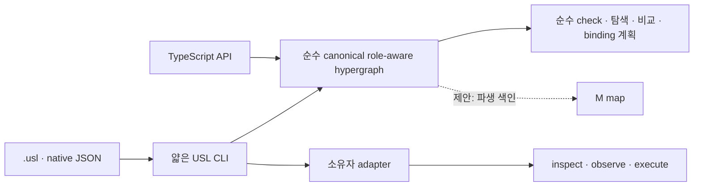

# USL 문법·그래프 코어·CLI의 표준 그래프 공학 정리

2026-09-29 AI 설계 초안. 이 문서는 사용자가 요청한 “USL은 문법이고 CLI
도구로 깔끔하게 동작해야 한다”는 방향과, 하이퍼그래프·의미 가중치·M 맵·
상하위 구조 요구를 하나의 공학 경계로 정리한다. 사용자가 확정한 것은 M 맵이
연결된 내용을 색인하고 상하위 구조를 다뤄야 한다는 방향이다. 아래 M map의
revision·profile·stale 규칙, 가중치 모델, 자료형은 그 방향을 구체화한
**SECONDARY_AI 제안**이며 합의된 schema나 현재 구현이 아니다. 구현 완료
보고나 HSWM 전체 증명도 아니다. M의 약어 정식 뜻은 아직 정하지 않는다.

## 판단과 범위

USL은 새 데이터베이스나 워크플로 엔진보다 먼저 **선언 문법과 의미 연결
모델**이어야 한다. `.usl`, TypeScript 값, 기존 그래프 응답은 모두 같은 순수
코어로 들어오고, CLI·MCP·SDK·HSWM 어댑터는 그 코어를 소비하는 얇은 경계가
되는 편이 맞다. 소유 시스템은 원본 데이터, ID, 권한과 실제 효과를 계속
소유한다.



여기서 하이퍼그래프의 link는 `meaning`과 이름 있는 participant 역할을 가진
n항 연결이다. 이항 edge들로 임의 분해해서 원래 역할과 관계 의미를 잃지
않는다. 순수 코어는 선언·schema·profile을 검사하고 canonical graph와 파생
view를 만든다. 순수 `check`/validation은 IO 없이 실패를 낸다. 반면 소유자
adapter의 `inspect`·`observe`는 외부 자원을 읽고, `execute`는 효과를 낼 수
있으므로 명시 정책과 소유자 경계에 둔다.

## 현재 근거와 제안의 구분

| 항목 | 현재 근거 | 이 문서의 제안 |
|---|---|---|
| 문법 입력 | `.usl`은 선택 선언 문법이며 resource/meaning/link를 제공한다. [언어](LANGUAGE.md) | 다음 문법에서 가중치·계층을 성급히 필수 구문으로 만들지 않는다. |
| 순수 모델 | 입력은 메모리 `SemanticPlan`으로 해석되고 IO와 구분된다. [구조](ARCHITECTURE.md) | 이를 canonical role-aware hypergraph라는 안정된 내부 경계로 명시한다. |
| n항 연결 | resource graph의 link와 중복 불가 participant 역할이 구현돼 있다. [resource graph](RESOURCE_GRAPH.md) | link 자체를 가중치·계층·출처의 단위로 삼는다. |
| CLI | `adapt`, `context`, `observe`, `cli-list`, `locate`, `bind-graph`, `cli-plan`, `cli-run` 등이 있다. [CLI](CLI.md) | 이 이름을 유지하며, 새 facade는 코어 계약을 우회하지 않는다. |
| 실행 | host는 등록한 entry node 하나만 실행하며 전체 GraphSpec engine은 아니다. [CLI host](CLI_GRAPH_ARCHITECTURE.md) | 다단계 실행과 원격 driver를 코어·인덱스와 별개의 후속 범위로 둔다. |
| 표준 교환 | JSON-LD 1.1, PROV-O, SHACL 구조 검사가 있다. [구조](ARCHITECTURE.md#표준-적용) | native hypergraph가 RDF 자체라는 주장이나 외부 표준 인증은 하지 않는다. |

현재 role-incidence 탐색은 supplied plan에서 resource와 link를 연결해 bounded
traversal을 수행한다. [구현](../src/language/navigation.ts)과
[검사](../test/navigation.test.ts)는 이를 검증한다. 그러나 이것은 M map이
아니다. 현재 구현에는 다음이 없다: weighted semantic evaluation, M index의
생성·보관·stale 판정, 전용 hierarchy 의미론과 ancestor/descendant 탐색.
기존 generic meaning/profile로 상하위 관계를 선언하는 것은 가능하지만,
그 관계를 상하위 규칙으로 해석하는 동작까지 구현된 것은 아니다.
따라서 아래의 weight/hierarchy/M map은 기존 기능의 이름만 바꾼 설명이 아니라
후속 설계·구현 대상이다.

## canonical hypergraph와 식별

코어의 기본 단위는 `Resource`, `Meaning`, `Link`, `Participant`, `Provenance`다.
각 link는 하나의 meaning과 `role → resource` 참여를 보존한다. Resource ID는
자원의 정체성을, locator와 workspace binding은 그 자원을 읽는 표현을 뜻한다.
경로 이동·여러 worktree·GitHub URL은 ID를 바꾸는 사유가 아니다. 반대로 같은
바이트나 비슷한 경로가 서로 다른 자원을 자동으로 합치게 해서도 안 된다.

현재 `resource-graph/v1`의 metadata는 adapter가 단항 descriptor/link meaning의
JSON 설명에 보존한다. 그것이 SemanticPlan 안의 first-class typed weight 또는
hierarchy semantics로 통합돼 있는 것은 아니다. 아래 `CanonicalLink`의
`hierarchy`와 `semanticWeight`는 바로 그 통합을 검토하기 위한 제안용
pseudotype이다.

```ts
// 설명용 pseudotype: 새로운 .usl 문법이나 현재 API 선언이 아니다.
type CanonicalLink = {
  id: StableId
  meaning: MeaningId
  participants: ReadonlyMap<RoleName, ResourceId>
  provenance?: Provenance
  hierarchy?: ReadonlyArray<HierarchyRelation>
  semanticWeight?: WeightAssertion
}
```

가중치의 의미·척도를 별도로 정의하기 전에는 이를 관계가 참일 확률로 해석하지
않는다. 어떤 값도 접근 권한을 부여하지 않는다. 가중치를 추가한다면 relevance,
distance, confidence처럼 차원을 구분할 수 있고, 값의 발행자, 산출 방식, 대상
revision, 범위, 시간, 근거를 함께 가진 `WeightAssertion`으로 표현한다. 여러
assertion이 충돌하면 코어가 임의로 평균 내거나 사실을 확정하지 않는다.
소비자가 명시한 policy로 선택·정규화·보류하고, 원문 assertion과 계산 결과를
모두 출처와 함께 남긴다. 값 `0`과 값의 부재, 방향, aggregation은 아직
열린 의미론 설계 사항이다.

## 상위·하위 구조와 다중 해상도

상하위는 하나의 보편 tree로 강제하면 안 된다. `contains`/`partOf`는 구성,
`specializes`는 분류, `abstracts`/`summarizes`는 추상화·요약으로 구분하는
설계를 제안한다. `dependsOn`은 별도 의존 관계이며 자동으로 상하위 관계로
해석하지 않는다. 관계마다 방향과 참여 대상 타입을 정한다. 한 대상은 코드
모듈 계층, 도메인 분류, 작업 분해라는 서로 다른 hierarchy에 동시에 참여할 수
있다. cycle 여부와 tree 제약은 전체 코어가 아니라 선택 profile이 검사한다.

다중 해상도는 원본 link를 지우지 않고, 요약 link가 어떤 하위 link·resource
집합을 요약하는지 명시하는 방식으로 만든다. 요약의 가중치나 신뢰도도 원본과
분리한다. 그러면 작은 코드 심볼에서 저장소, 프로젝트, 연구 주제까지 올려
탐색하되, 어떤 요약이 어떤 revision의 무엇을 생략했는지 역추적할 수 있다.

## M map: 저장 원본이 아닌 파생 인덱스

M map은 연결된 내용을 빨리 찾기 위한 색인 view로 둔다. canonical graph
revision, 선택한 profile, weight policy, index builder 버전을 입력으로 삼아
재생성 가능해야 한다. 따라서 M map 자체가 새 진실의 DB나 권한 저장소가 되지
않고, graph와 다른 revision을 가리키면 `STALE`로 표시해 재생성 또는 거부한다.

초기 index 축은 다음 정도면 충분하다.

- `resource ID → 참여 link / 역할 / 표현(binding)`
- `meaning ID → link / 계층 관계 / 출처`
- `hierarchy relation → parent·child 후보와 해상도`
- `weight assertion → 대상·발행자·revision·policy별 정렬 후보`

인덱스 결과는 후보 집합이다. 경로·semantic weight·M map hit만으로 의미적
동치, 사실성, 원격 접근을 결론 내리지 않는다. binding을 고를 때는 기존처럼
명시 선택, revision·content 확인, 소유자 read 권한이 필요하다.

## 표준 투영

native graph는 role-aware hypergraph를 보존하는 내부 표현으로 두고, 교환할 때
[`JSON-LD 1.1`](https://www.w3.org/TR/json-ld11/)/RDF로 투영한다. link는 이름
있는 `usl:Link` node로, participant는 `usl:Participant` 노드로 표현해야
역할과 n항 구조가 남는다. 이는 [W3C n-ary relations Note](https://www.w3.org/TR/swbp-n-aryRelations/)
패턴을 참고하는 제안이며 W3C Recommendation은 아니다. 원문·변환·가중치의
근거는 [`PROV-O`](https://www.w3.org/TR/prov-o/) source/activity/agent로
연결하고, project profile은 [`SHACL`](https://www.w3.org/TR/shacl/)로 필수
역할·허용 hierarchy relation·weight assertion 형식을 검사한다.

이는 기존 JSON-LD/PROV-O/SHACL 경로의 확장 설계다. RDF-native hypergraph,
RDF inference engine, 다른 표준과의 인증·완전 상호운용성을 주장하지 않는다.

## CLI를 얇게 유지하는 방법

CLI는 문법을 또 정의하거나 임의 DB 상태를 만들지 않는다. 기존 command는
입력·출력 파일과 policy를 검증한 뒤 core query 또는 owner adapter 하나를
호출한다. `adapt`는 입력을 core로, `context`는 탐색으로, `bind-graph`와
`locate`는 표현 선택으로, `cli-plan`/`cli-run`은 등록 action의 계획/실행으로
각각 대응한다. `cli-run`이 전체 graph workflow 실행을 뜻하지 않는 현재 경계도
유지한다.

현재 경로는 다음처럼 실제 fixture와 stable native ID를 받아 순수 adaptation
검사와 문맥 탐색을 수행한다. 후속 architecture도 새 query 문법을 먼저 만들기
보다, ID가 주어진 `adapt --operation context` 경로가 canonical graph와 M map
후보를 함께 소비하게 하는 편이 낫다. M map이 없거나 stale이면 같은 core
traversal로 안전하게 처리하고, index hit가 사실·권한을 확정하지 않는다.

```sh
npm run usl -- adapt --format resource-graph \
  --graph examples/fixtures/resource-graph.json --namespace demo --operation check
npm run usl -- adapt --format resource-graph \
  --graph examples/fixtures/resource-graph.json --namespace demo --operation context \
  --focus example:spec --target example:proof --compact
```

향후 **제안** CLI는 새 이름을 먼저 확정하지 않는다. 필요가 확인되면 다음
capability를 기존 command 계열 또는 단일 query entry로 제공한다: graph revision
검사, M map build/status, weight assertion import/validate, hierarchy traversal.
모두 JSON 입력·출력, digest와 profile pin, 명확한 read/write effect 표기를
가져야 한다. CLI가 owner credential, 임의 cwd/argv, 원격 권한을 받아 실행하는
통로가 되어서는 안 된다.

CLI와 machine-readable graph/capability contract는 기능 발견·검사·호출의 주된
경로가 될 수 있다. skill은 사람과 agent가 읽는 선택적 안내이고 MCP는 선택적
transport로 둘 수 있다. 어느 경로를 쓰든 SDK·CLI·MCP는 같은 core semantics를
소비하며, graph 텍스트나 capability 선언만으로 action이 자동 실행되지는 않는다.

## 설계 graph 캡처와 후속 구현의 분리

아래 architecture graph 산출물은 이 설계의 근거·현재 구현·제안을 분리해
기록하는 작업이다. catalog의 실제 ID는 `user:syntax-cli`,
`user:weighted-hypergraph`, `feature:hyperedge`, `feature:navigation`,
`proposal:weighted-assertion`, `proposal:m-map`, `proposal:hierarchy`,
`proposal:graph-cli`다. `proposal:*`은 모두 `SECONDARY_AI`와 `PROPOSED`로
표시한다. proposal과 user statement를 잇는 trace는 AI가 그 사용자 방향을
검토 대상으로 삼았다는 provenance일 뿐, 사용자가 proposal의 schema·의미론을
승인했다는 뜻이 아니다. 이 graph를 생성·검사한 사실도 weight, M map,
hierarchy runtime이나 새 CLI를 구현했다는 뜻이 아니다.

생성 graph의 `trace(statement, feature, artifact)`는 역할을 보존한 3항 link다.
코드 artifact는 commit을 고정한 공개 저장소 `git://` locator를 쓴다. 생성기는
catalog의 SHA-256을 현재 파일 및 로컬 Git의 해당 commit 바이트와 대조한다.
이번에 새로 만든 catalog·generator에는 공개 예정 위치와 현재 digest를 사용하고,
발화 기록은 해당 catalog를 참조한다. GitHub에 게시되었거나 원격에서 읽혔다고
주장하지 않는다.

| 산출물 | 역할 |
|---|---|
| `research/architecture/syntax-cli.catalog.json` | 사용자 원문, 구현 feature, proposal 및 검증 대상 source pin 목록 |
| `scripts/build-syntax-cli-architecture.ts` | 검증한 source digest와 commit pin으로 아래 graph·JSON-LD·profile·shape 생성 |
| `research/architecture/syntax-cli.graph.json` | 요구·근거·제안과 현재 한계를 resource graph로 기록한 생성물 |
| `research/architecture/syntax-cli.graph.jsonld` | 위 graph의 JSON-LD 투영 생성물 |
| `research/architecture/syntax-cli.profile.json` | 이 설계 graph의 허용 의미·역할 profile 생성물 |
| `research/architecture/syntax-cli.shacl.ttl` | profile과 투영 구조의 독립 SHACL shape 생성물 |
| `scripts/validate-syntax-cli-architecture.py` | RDF/SHACL, catalog와 graph의 pin 일치, 출처·상태·근거 연결과 반례를 검사 |

독립 표준 검사는 [requirements](../scripts/requirements-standards.txt)의
`rdflib`와 `pyshacl` 환경에서 실행한다. 로컬에서 재현하려면 다음처럼 전용
venv를 만들 수 있다. `/tmp/usl-standards-venv`는 로컬 검증 환경의 예시이며
graph artifact locator가 아니다.

```sh
python3 -m venv /tmp/usl-standards-venv
/tmp/usl-standards-venv/bin/pip install -r scripts/requirements-standards.txt
npx tsx scripts/build-syntax-cli-architecture.ts --check
/tmp/usl-standards-venv/bin/python scripts/validate-syntax-cli-architecture.py
```

이 설계 graph 자체도 기존 CLI에서 검사·탐색할 수 있다. 아래 탐색은
`user:syntax-cli`에서 `proposal:graph-cli`를 찾는다.

```sh
npm run usl -- adapt --format resource-graph \
  --graph research/architecture/syntax-cli.graph.json \
  --profile research/architecture/syntax-cli.profile.json \
  --namespace usl.syntax.cli.architecture --operation check
npm run usl -- adapt --format resource-graph \
  --graph research/architecture/syntax-cli.graph.json \
  --profile research/architecture/syntax-cli.profile.json \
  --namespace usl.syntax.cli.architecture --operation context \
  --focus user:syntax-cli --target proposal:graph-cli --compact
```

이번 캡처는 **36개 resource, 35개 link, 944개 RDF triple**이다. 위 검사와
참조·역할·상태를 바꾼 6개 반례가 통과했다. 특히 M map 제안을 구현 완료로
바꾼 입력은 metadata 검사에서, 잘못된 link 상태는 SHACL에서 거부한다.
이 검사는 기록의 구조·출처·상태를 확인하며 구현 동작이나 Lean 증명의 진위를
증명하지 않는다. 미결정인 구체적 schema·정책은 문서 마지막에 남긴다.

## 다음 작업과 수용 기준

1. **CLI 계약 정리:** `--help`를 graph 작업자가 읽을 수 있는 command별 도움말로
   나누고 JSON diagnostics와 exit code 계약을 문서·테스트로 고정한다. 기존
   command의 성공·usage·unresolved/denied 결과가 기계적으로 구별돼야 한다.
2. **core 확장 설계:** weight assertion과 최소 hierarchy relation의 JSON schema 및
   profile을 제안한다. 중복 역할, 알려지지 않은 대상 revision, 권한을 weight로
   표현한 입력을 거부하는 테스트가 필요하다.
3. **M map prototype:** 고정 graph revision에서 인덱스를 결정적으로 만들고,
   graph/profile/policy 변경 시 stale을 검출한다. 원본 graph 없이 index만으로
   답을 확정하지 않는 테스트가 필요하다. Lean 목표를 추가한다면 이는 현재
   증명이 아닌 후속 모델 목표로서, 고정 revision의 M lookup 일관성과 선택한
   hierarchy traversal policy를 먼저 명세·증명한다.
4. **CLI 연결:** 기존 `adapt --operation context`/`bind-graph` 흐름과 M map 조회가 같은 ID와
   binding 계약을 사용함을 예제로 보인다. 새 실행 명령은 owner adapter,
   계획 pin, receipt 계약을 통과할 때만 추가한다.

## 아직 열린 설계 결정

- M map의 정식 명칭과 그것을 소유하는 project 범위
- weight의 허용 척도, 발행 주체, 갱신·충돌 해결 policy
- 첫 hierarchy relation 집합과 어떤 profile에서 cycle/tree 제약을 요구할지
- 인덱스를 디스크에 보관할지, 매 호출 재생성할지, 보관 시 retention·privacy 규칙
