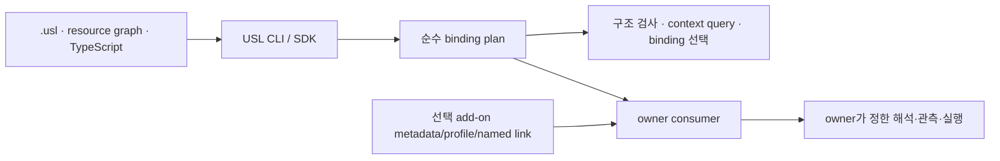

# USL 문법·단순 바인딩·CLI 경계

2026-09-29 사용자 정정에 따른 현재 설계다. USL은 서로 다른 자원을 연결하는
**단순 바인딩 문법**이며, CLI는 그 문법과 기존 그래프 입력을 검사·조회하는
도구다. USL은 HSWM 전체, 새 DB, 가중치 평가기, 계층 엔진, M 인덱스, 학습
파이프라인, workflow 실행기가 아니다.

사용자 원문:

> “USL 은 문법같은거고 그 cli 도구로 깔끔하게 동작하도록 하는게 맞을것같은데”

> “아니 USL 은 단순 연결이라니까 너무 많은걸 하지말아 그 기초는 가능하도록 만 해주면돼 ㅇㅇ 그 규칙은 에드온처럼 심고”

> “그거를 할수 있게끔하는 단순 바인딩 문법이잖아 USL 은 ㅇㅇ;”

문법·CLI의 세부 경계는 이 원문을 해석한 **SECONDARY_AI 설계**다. 사용자 원문과
AI 제안은 graph/문서에서 분리해 기록한다.



## 코어 계약

USL의 공통 모델은 `Resource`, `Meaning`, `Link`, `Participant`, `Provenance`다.
하나의 link는 meaning과 이름 있는 역할별 resource 참여를 보존한다. 이로써
이항 관계로 분해하면 잃을 수 있는 다자 연결의 역할을 유지한다.

Resource의 stable ID는 자원의 정체성이다. file path, worktree, GitHub URL,
fixed Git revision은 그 자원을 읽는 representation/locator다. 경로를 옮기거나
representation을 추가해도 ID와 link 의미를 자동으로 바꾸지 않는다. 여러
표현 중 하나를 쓰려면 caller/host가 명시적으로 선택한다.

순수 parsing, compile, schema/profile check, context query는 외부 효과 없이
동작한다. 소유자 adapter의 `inspect`와 `observe`는 외부 자원을 읽고,
`execute`는 효과를 낼 수 있다. binding 또는 graph 텍스트가 access, 사실성,
실행 권한을 부여하지 않는 이유다.

## 현재 구현 근거

| 범위 | 현재 근거 | 하지 않는 일 |
|---|---|---|
| 선언 문법 | [`.usl` language](LANGUAGE.md)의 resource/meaning/link | 선언을 사실로 판정하거나 도메인 규칙 실행 |
| 범용 입력 | [`resource-graph/v1`](RESOURCE_GRAPH.md)의 resource·meaning·named participant | 새 graph DB 생성 |
| 연결 탐색 | 역할을 보존한 bounded role-incidence [navigation](../src/language/navigation.ts) | M index, weighted evaluation, hierarchy semantics로 해석 |
| 표현 이동 | [resource bindings](RESOURCE_BINDINGS.md), `locate`, `bind-graph` | 경로 유사성으로 ID·권한을 추론 |
| CLI host | 등록한 owner command의 계획·단일 호출 [경계](CLI_GRAPH_ARCHITECTURE.md) | 전체 workflow engine 또는 자동 실행 |

현재 metadata는 resource/link 설명으로 보존할 수 있다. 그것이 core의 typed
가중치·계층·색인 의미론이 되지는 않는다. generic profile은 역할 타입과 필수
metadata 같은 구조 제약을 검사하지만, 도메인 의미의 참·권한·효과를 판정하지
않는다.

## 선택 add-on 규칙

HSWM 규칙, 가중치, 상하위 관계, M 색인 힌트 같은 내용은 core가 아닌 add-on
metadata, optional profile, named meaning/link로 선언할 수 있다. add-on owner가
그 구조의 뜻, 저장 방식, 평가·갱신, 접근 권한과 실행을 책임진다. USL은 원래
자원 ID·역할·출처·참조를 보존하고 generic structural/profile constraint를
검사할 뿐이다.

따라서 다음은 **ADD-ON RESPONSIBILITY**이며 현재 USL core backlog가 아니다.

- semantic weight 평가·갱신·충돌 해결
- typed hierarchy traversal과 다중 해상도 해석
- M map 인덱스 생성·stale 판단·저장
- outcome feedback, learning, 재훈련 또는 자동 revision 적용
- HSWM별 gate, 정책, 원격 접근·실행

ordinary binding은 HSWM 승인·도달성 확인·원격 권한 없이도 사용할 수 있다.
실제 HSWM-connected execution이 필요한 경우에만 기존 소유자 접근·도달성
계약을 별도 적용한다.

## CLI 사용 경로

CLI와 SDK는 같은 core binding semantics를 소비한다. skill은 읽기 안내로,
MCP는 선택 transport로 둘 수 있지만 graph나 capability declaration만으로
action이 자동 실행되지는 않는다.

```sh
npm run usl -- adapt --format resource-graph \
  --graph examples/fixtures/resource-graph.json --namespace demo --operation check
npm run usl -- adapt --format resource-graph \
  --graph examples/fixtures/resource-graph.json --namespace demo --operation context \
  --focus example:spec --target example:proof --compact
```

첫 명령은 fixture를 구조적으로 검사한다. 둘째 명령은 native ID로 context를
조회한다. 이 경로는 가중치, hierarchy, M map을 요구하지 않는다. 로컬·Git
representation을 선택해 graph에 반영할 때는 기존 `locate`와 `bind-graph`를
쓴다. 자세한 실행 권한 경계는 [CLI 문서](CLI.md)와
[CLI host 설계](CLI_GRAPH_ARCHITECTURE.md)를 따른다.

## 표준 교환의 한계

USL은 [`JSON-LD 1.1`](https://www.w3.org/TR/json-ld11/)으로 교환 표현을 만들고
[`PROV-O`](https://www.w3.org/TR/prov-o/)로 명시 출처를 연결하며,
[`SHACL`](https://www.w3.org/TR/shacl/)로 구조를 검사할 수 있다. n항 link를
RDF로 보낼 때 이름 있는 link와 role participant를 쓰는 것은 [W3C n-ary
relations Note](https://www.w3.org/TR/swbp-n-aryRelations/) 패턴을 참고한다.
그 Note는 Recommendation이 아니다.

이 투영이 USL을 RDF-native hypergraph, 외부 표준 인증 제품, 추론 엔진으로
만들지는 않는다.

## 축소된 범위와 대체된 제안

이전 초안은 USL core에 revisioned weights, typed hierarchy traversal, M map,
outcome feedback과 이를 위한 Lean 확장을 단계적으로 넣는 안을 제시했다. 이는
사용자 정정 전의 **SECONDARY_AI superseded proposal**이며 현재 구현 계획이
아니다. 기록은 Git history와 [단순 binding add-on 계획](HSWM_LIKE_EXECUTION_PLAN.md)에
남긴다.

다음 세 단계의 계약·예제·회귀 검증을 완료했다.

1. P01: 최소 binding 문법·구조 검사·stable ID와 representation 경계 확인
2. P02: 필요한 도메인 규칙을 optional metadata/profile/named link add-on으로 선언
3. P03: 기존 CLI 예제와 호환성, Lean의 현재 추상 구조 증명 범위를 유지

완료 근거는 [P01~P03 기록](HSWM_LIKE_EXECUTION_PLAN.md)에 연결했다. 다음
메인 CLI 개발은 [C01~C04](CORE_CLI_PLAN.md)의 도움말 정리, context 옵션 맞춤,
명시적 stdin, 빌드된 실행 파일 검증 순서로 계획했다. 완료한 작업과 아직
계획인 작업을 같은 그래프에서 서로 다른 상태로 조회할 수 있다.
