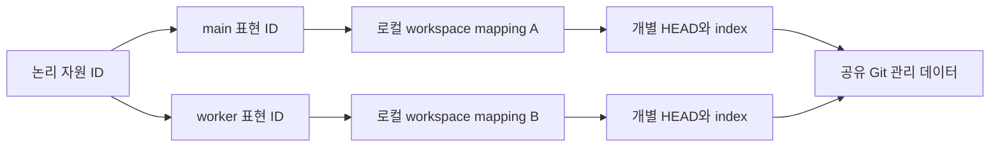

# Git worktree 분기·이동 적대적 검증

**판정: 기본 worktree 사용은 지원하지만, 임의 분기·복사·백업·다른 머신 복원까지 모든 기능이 갖춰진 것은 아니다.** 실제 임시 저장소의 성공 경계와 누락된 보호를 함께 검증했다. 런타임 기능을 추가한 작업이 아니라 테스트·근거·후속 계약을 추가한 감사다.

실행 시점 `2026-10-04T06:01:52.155562+00:00`, 코드 기준 `ef0ce11241f25fbc5d1b4d8c5cc5e422c4adde28`. 환경: Linux / x86_64 / git version 2.47.3 / Node v24.20.0. 새 worktree 시험 **19개**, 관련 기존 회귀 시험 **31개**, 총 **50개 assertion PASS**. 한계가 재현된 테스트도 PASS이므로 이 숫자를 완전 지원의 증거로 읽지 않는다.

실제 Git main/linked checkout을 만들고 서로 다른 commit, staged/unstaged 상태, detached HEAD, move, manual move+repair, copy, remove+prune, sparse checkout, symlink, graph 재바인딩, CLI 조회, 계획 재검사, 예약 저장소 공유/분리를 실행했다. 모든 파일·실행 marker는 disposable fixture 안에 있었으며 사용자 저장소를 이동하거나 원격에 접속하지 않았다.

## 핵심 반례

1. **잘못된 worktree도 파일이 같으면 MATCH:** 현재 binding은 기대 worktree/HEAD를 pin하지 않는다. HEAD가 달라져도 선언한 실행 입력이 같으면 planDigest가 그대로다.
2. **linked 폴더만 복사하면 독립 백업이 아니다:** `.git` 파일은 원래 common Git directory를 계속 참조한다. 원본을 옮기자 복사본은 NO_REPOSITORY가 됐다.
3. **실행 기록 저장소를 분리하면 중복 차단도 분리된다:** 같은 namespace/key로 양쪽 worktree에서 실행해 두 marker가 모두 생겼다. 같은 store를 유지한 경우에는 두 번째 실행이 차단됐다.
4. **root mapping만 바꿔서는 Git 이동 복구가 끝나지 않는다:** main과 linked를 직접 옮긴 뒤 Git repair가 필요했다. 현재 broken gitfile은 일반 폴더처럼 NO_REPOSITORY로 관측될 수 있다.
5. **directory snapshot과 실제 파일 검증은 다르다:** snapshot relation과 digest를 붙여도 디렉터리 내용은 NOT_CHECKED다. 전체 checkout과 의존성의 원자적 snapshot은 제공하지 않는다.

## 논리 자원·worktree·revision의 구분



Git worktree의 공유 디렉터리는 worktree identity가 아니다. branch 이름도 움직일 수 있다. 로컬 경로는 관측 주소로 보존하고, owner가 정한 자원·worktree 식별자와 revision 정책은 별도 계약으로 관리해야 한다. Git 자체의 layout과 move/repair 의미는 [Git worktree 문서](https://git-scm.com/docs/git-worktree), [repository layout](https://git-scm.com/docs/gitrepository-layout)에 근거한다. 최신 문서의 모든 옵션을 설치된 Git에서 실행했다고 주장하지 않는다.

## 시험별 판정

| ID | 범위 | 판정 | 확인한 동작 |
|---|---|---|---|
| finding:WT01 | 분기별 표현 선택과 그래프 ID 보존 | COVERED_IN_FIXTURE | 같은 논리 자원을 main/worker의 서로 다른 표현으로 선택하며 다른 HEAD·bytes·주소를 관측한다. 그래프의 ID·역할·의미·metadata는 보존한다. |
| finding:WT02 | worktree별 index와 dirty 상태 분리 | COVERED_IN_FIXTURE | main만 수정한 때와 worker만 stage한 때 dirty 결과가 각각 분리된다. |
| finding:WT03 | Git move 후 명시적 host 재바인딩 | COVERED_IN_FIXTURE | git worktree move 후 host root를 바꾸면 논리 자원/표현 ID는 유지되고 주소만 바뀐다. |
| finding:WT04 | 수동 이동의 Git 연결 복구 | LIMITATION_OBSERVED | main과 linked tree를 직접 옮기면 바뀐 root를 등록해도 NO_REPOSITORY다. Git worktree repair를 실행한 뒤 REPOSITORY로 돌아온다. |
| finding:WT05 | linked checkout 단독 복사는 독립 백업이 아님 | LIMITATION_OBSERVED | 복사본의 파일은 읽히지만 commonGitDir은 원래 저장소를 가리킨다. 원래 main을 옮기면 복사본은 NO_REPOSITORY가 된다. |
| finding:WT06 | 삭제·prune·sparse omission·symlink 경계 | COVERED_IN_FIXTURE | 선택한 worktree가 사라지거나 sparse checkout에 파일이 없으면 다른 표현으로 자동 전환하지 않는다. 다른 worktree로 나가는 symlink도 거부한다. 삭제/prune 후 같은 경로를 일반 폴더로 만들면 NO_REPOSITORY다. |
| finding:WT07 | 같은 파일 bytes로는 worktree·HEAD를 보증할 수 없음 | LIMITATION_OBSERVED | 잘못 연결한 다른 HEAD의 worktree라도 선택 파일이 같으면 MATCH다. 선언한 pinned 파일이 같으면 HEAD가 바뀌어도 실행 planDigest가 같다. |
| finding:WT08 | 이전 실행 계획과 바뀐 실행 파일 차단 | COVERED_IN_FIXTURE | host root 변경 뒤 옛 plan은 PLAN_CHANGED, pinned runner bytes 변경은 PREFLIGHT_REJECTED이며 둘 다 attempts 0이다. |
| finding:WT09 | 같은 예약 저장소의 중복 실행 차단 | COVERED_IN_FIXTURE | 같은 namespace·작업 키·의미와 동일한 예약 저장소를 유지하면 worktree를 바꿔도 두 번째 실행을 막는다. |
| finding:WT10 | 예약 저장소 분리 시 중복 실행 허용 | LIMITATION_OBSERVED | 동일 namespace와 작업 키라도 저장소를 worktree별로 나누면 두 작업 모두 SUCCEEDED이며 marker가 양쪽에 생긴다. |
| finding:WT11 | 디렉터리 snapshot 및 검사 원자성 | LIMITATION_OBSERVED | snapshot relation과 예상 digest를 선언해도 디렉터리 전체는 NOT_CHECKED이며 digest는 null이다. 코드가 선언한 일관성은 BEST_EFFORT_OBSERVATION이다. |
| finding:WT12 | 등록한 하위 경로와 Git root의 차이 | LIMITATION_OBSERVED | 하위 폴더를 workspace로 등록하면 파일은 그 범위 안에서 읽지만 Git root는 바깥의 상위 저장소일 수 있다. |

### finding:WT01 · 분기별 표현 선택과 그래프 ID 보존

worktree마다 별도 representation/workspace를 등록하고 선택을 명시한다. 같은 commit을 별도 worktree 동일성으로 쓰지 않는다.

- `inspects explicit main and linked-worktree representations as one logical resource` — ASSERTION PASS
- `observes detached HEAD at the same commit without merging distinct representations` — ASSERTION PASS
- `worktree graph rebinding preserves complete logical links while selecting divergent content` — ASSERTION PASS
- `CLI inspection selects the linked worktree through host-relative workspace configuration` — ASSERTION PASS

### finding:WT02 · worktree별 index와 dirty 상태 분리

현재 dirty는 submodule 내부 변경을 제외하는 관측값이며 원자적 snapshot 완료 표시가 아니다.

- `observes dirty working tree and index state independently per worktree` — ASSERTION PASS

### finding:WT03 · Git move 후 명시적 host 재바인딩

USL이 경로 이동을 자동 추적하는 것은 아니다. 소유자가 mapping을 갱신해야 한다.

- `git worktree move plus host remapping preserves selected resource and representation IDs` — ASSERTION PASS

### finding:WT04 · 수동 이동의 Git 연결 복구

별도 owner restore 절차에서 Git 연결과 양방향 gitfile을 검사·복구한다. NO_REPOSITORY를 Git 작업 환경 복구 성공으로 취급하지 않는다.

- `manual main and linked-worktree moves report NO_REPOSITORY before repair and recover after repair` — ASSERTION PASS

### finding:WT05 · linked checkout 단독 복사는 독립 백업이 아님

공유 Git 데이터와 worktree별 HEAD/index/config 및 선택한 working bytes를 함께 capture하고 복원 후 의존성 폐쇄를 검사한다.

- `observes limitation: a copied linked checkout retains Git metadata pointing at the original common directory` — ASSERTION PASS

### finding:WT06 · 삭제·prune·sparse omission·symlink 경계

미해결 상태를 호출자가 처리하고 새 root를 같은 checkout으로 추정하지 않는다.

- `observes limitation: removing a selected worktree never falls back to a sibling and a recreated path has no cached Git identity` — ASSERTION PASS
- `observes limitation: sparse checkout omission has no representation fallback` — ASSERTION PASS
- `rejects a symlink from one worktree into another registered worktree` — ASSERTION PASS

### finding:WT07 · 같은 파일 bytes로는 worktree·HEAD를 보증할 수 없음

선택형 checkout guard에 owner worktree 식별자·허용한 revision·dirty 정책을 명시하고 실제 관측과 대조한다. branch 이름·commonGitDir·절대 경로 자체는 영구 identity로 쓰지 않는다.

- `observes limitation: a wrong workspace alias can match bytes while its Git head differs` — ASSERTION PASS
- `a Git branch HEAD change is not attested when the declared pinned files are unchanged` — ASSERTION PASS

### finding:WT08 · 이전 실행 계획과 바뀐 실행 파일 차단

보장은 DECLARED_FILES_ONLY다. 실행이 사용하는 모든 중요한 입력과 의존성을 owner pin에 포함한다.

- `remapping a real linked worktree rejects a stale main-worktree plan before an attempt` — ASSERTION PASS
- `a changed pinned runner in a sibling worktree blocks before the external effect` — ASSERTION PASS

### finding:WT09 · 같은 예약 저장소의 중복 실행 차단

서로 별개인 논리 작업에는 별도 작업 키를 사용한다. 이 로컬 보장을 원격 exactly-once로 확대하지 않는다.

- `a shared operation store prevents re-execution after remapping between real worktrees` — ASSERTION PASS

### finding:WT10 · 예약 저장소 분리 시 중복 실행 허용

여러 worktree의 동일한 논리 작업은 owner가 공유하는 reservation 저장소를 사용하거나 authoritative 외부 operation registry에 위임한다. 단순 복제한 ledger는 합의 프로토콜이 아니다.

- `separate operation stores are an explicit cross-worktree duplicate-execution limitation` — ASSERTION PASS

### finding:WT11 · 디렉터리 snapshot 및 검사 원자성

전체 tree·index·미추적 파일·의존성 snapshot과 검증이 필요하다. race-free capture는 별도 구현·검증 대상이다.

- `a worktree directory digest declaration remains unchecked rather than proving a tree snapshot` — ASSERTION PASS

### finding:WT12 · 등록한 하위 경로와 Git root의 차이

file 읽기 scope와 Git metadata 관측 scope를 구분한다. 엄격한 checkout 동일성이 필요하면 별도 expected-checkout 계약으로 검사한다.

- `a subdirectory workspace observes its enclosing Git root without asserting checkout identity` — ASSERTION PASS

## 남은 구현과 검증

우선순위는 (1) 선택형 expected-checkout/revision/dirty guard, (2) 공유 Git 의존성까지 닫는 export/restore와 repair 절차, (3) 여러 worktree의 같은 논리 작업을 위한 owner operation registry, (4) 원자적 capture와 여러 OS/머신 시험이다. HEAD pin만으로 uncommitted 파일이나 submodule·LFS의 무결성을 보장하지 않는다. 이동 후에도 유지할 owner ID와 현재 경로의 검증을 분리해야 한다.

- **check:checkout-guard · NOT_RUN:** 명시한 owner worktree/revision/dirty 정책과 관측을 대조해 wrong alias를 거부한다.
- **check:closed-git-backup · NOT_RUN:** main/linked 관리 데이터·index·미추적 및 ignored 선택 파일·submodule·LFS·alternates 의존성을 닫은 bundle을 복원하고 원래 저장소 없이 검증한다.
- **check:atomic-capture · NOT_RUN:** concurrent checkout/rebase/rename와 파일변경 도중 일관성 있는 capture 또는 명시적 거부를 검증한다.
- **check:cross-machine-operations · NOT_RUN:** 분리된 머신·저장소·네트워크 단절에서도 owner operation registry와 충돌/효과 대조 계약을 검증한다.
- **check:platforms · NOT_RUN:** Windows/macOS 및 다른 filesystem·Git 버전에서 path, case, unicode, symlink, durability, worktree repair를 검증한다.

이번 실행은 한 Linux 머신 안의 임시 경로 이동/복사다. 실제 타 컴퓨터·Windows/macOS·서로 다른 filesystem·네트워크 단절·concurrent mutation 전체를 검증한 것은 아니다. [기존 이동성 조사](PORTABILITY_RESEARCH.md)와 [표준 지원 감사](STANDARDS_COVERAGE.md)의 미구현 항목을 완료로 승격하지 않는다.

## 근거 그래프와 재현

[판정 catalog](../research/worktree-audit/catalog.json), [실행 receipt](../research/worktree-audit/receipt.json), [원본 TAP](../research/worktree-audit/tests.tap), [typed RDF trace](../research/worktree-audit/trace.jsonld)를 연결했다. test definition과 실제 TestExecution을 구분하고, 각 판단에서 정확한 테스트 이름과 source bytes digest로 이동할 수 있다. Source commit은 runtime baseline이며 새 테스트와 스크립트는 별도 bytes pin으로 기록했다. Receipt는 로컬 실행 기록으로 서명·원격 증명은 아니다.

| predicate | domain → range | cardinality와 의미 |
|---|---|---|
| assesses | Audit → Finding | 1개 이상; 이 감사의 해석된 판정 |
| groundedIn | Audit → PrimarySource | 1개 이상; 공식 문서 근거 |
| requiresCheck | Audit → FutureCheck | 1개 이상; 아직 NOT_RUN |
| evidencedBy | Finding → TestExecution | 1개 이상; 해당 assertion 결과, 전체 기능 성공과 다름 |
| inspects | Finding → SourceFile | 1개 이상; 판정에 직접 관련된 소스 |
| definedIn | TestExecution → SourceFile | 정확히 1개; 테스트 정의의 bytes pin |

RDF parsing·SHACL 및 실제 SPARQL 질의로 판정→테스트→소스의 정확한 endpoint와 coverage 값을 검사한다. 의존성 관계를 정의하지 않았으므로 이 그래프 전체에 DAG를 강제하지 않는다. USER_PRIMARY 원문과 SECONDARY_AI 해석을 분리한다. 테스트가 성공했더라도 LIMITATION_OBSERVED를 COVERED_IN_FIXTURE로 바꾸면 검증에 실패한다.

```sh
# 실제 disposable fixture 시험 실행 + receipt/graph/report 갱신
python3 scripts/audit-worktrees.py --record
# 기록된 source pin과 graph/report를 검사. 시험 재실행은 아님
python3 scripts/audit-worktrees.py --check
```

Python 의존성은 [기존 표준 검사 requirements](../scripts/requirements-standards.txt)를 사용한다. 신규 시험 파일들은 기존 npm test와 typecheck에 자동 포함된다.
